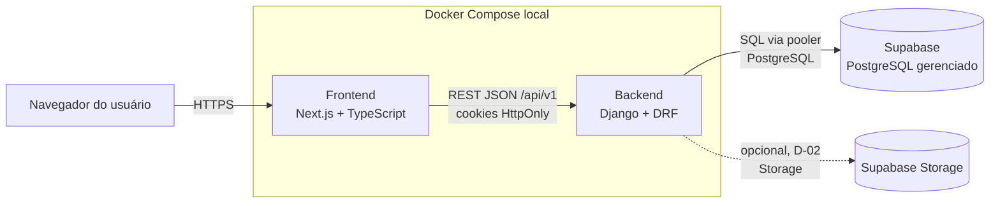
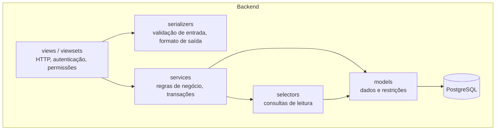
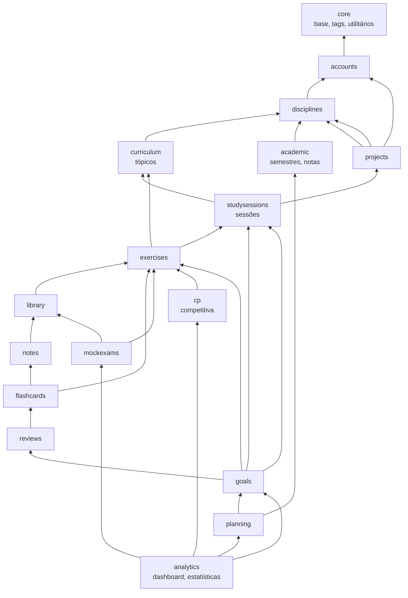
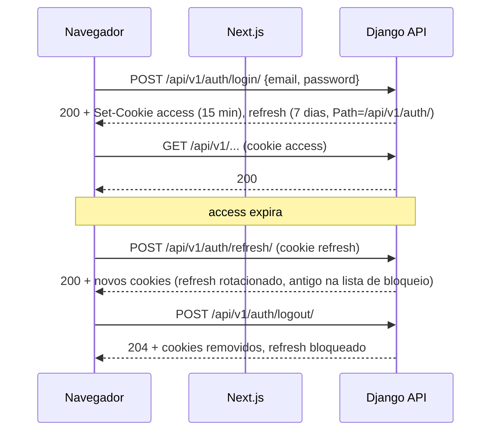
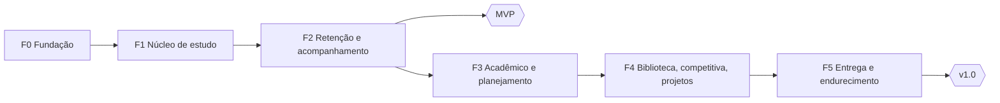

# Study Platform — Plano de Desenvolvimento

> **Status:** planejamento (nenhum código de aplicação foi escrito).
> **Versão do documento:** 0.1 — 23/11/2026.
> **Papel deste arquivo:** referência oficial para desenvolvedores e agentes de programação durante todo o ciclo de desenvolvimento. O `README.md` resume o que está aqui; em caso de divergência, **este documento prevalece** e o README deve ser corrigido.
> **Convenções:** `D-xx` = decisão ainda não tomada (seção 3.15). `ADR-xx` = decisão já tomada e justificada (seção 3.4.12). "Proposto" = valor sugerido neste plano, ainda não validado na prática.

## Sumário

3.1 Visão geral · 3.2 Requisitos funcionais · 3.3 Requisitos não funcionais · 3.4 Arquitetura de software · 3.5 Modelagem do banco de dados · 3.6 Arquitetura do backend · 3.7 Arquitetura do frontend · 3.8 Especificação da API · 3.9 Interface e experiência · 3.10 Infraestrutura e ambiente · 3.11 Testes e qualidade · 3.12 Roadmap · 3.13 Riscos · 3.14 Critérios de conclusão · 3.15 Decisões em aberto · 3.16 Análise prévia: inconsistências e lacunas

---

## 3.1. Visão geral do projeto

### 3.1.1. Apresentação

A **Study Platform** é uma plataforma web pessoal de estudos, organização acadêmica e produtividade. Ela centraliza, em um só lugar, disciplinas, conteúdos, materiais, exercícios, anotações, revisão espaçada, avaliações, planejamento, metas e estatísticas de um estudante de graduação que também treina para olimpíadas de matemática e competições de programação.

Começa como sistema de **um único usuário**, mas a modelagem e a camada de API já isolam os dados por dono (`owner`), de modo que o suporte a mais usuários no futuro não exija reescrita (ADR-06).

### 3.1.2. Problema que a aplicação resolve

O estudo avançado em várias frentes simultâneas (graduação, matemática olímpica, programação competitiva, engenharia de software) gera quatro problemas recorrentes:

1. **Fragmentação:** notas, listas, materiais, metas e prazos ficam espalhados em arquivos, planilhas e aplicativos diferentes.
2. **Falta de evidência de evolução:** é difícil saber quanto tempo foi realmente dedicado a cada área e se os exercícios estão sendo bem estudados, e não apenas resolvidos.
3. **Esquecimento:** sem revisão espaçada de exercícios, tópicos e cartões, o conteúdo aprendido se perde.
4. **Planejamento desconectado da execução:** o plano semanal não conversa com o que foi efetivamente feito.

### 3.1.3. Objetivos

**Gerais**

- Ser a fonte única de verdade dos estudos e da organização acadêmica do usuário.
- Transformar registro em informação: tempo, desempenho e domínio por tópico.
- Reduzir o atrito do registro diário (iniciar uma sessão e registrar uma tentativa devem levar segundos).

**Específicos**

| # | Objetivo | Como se mede |
|---|---|---|
| O1 | Registrar o estudo diário com atrito mínimo | Iniciar sessão em ≤ 2 cliques; registrar tentativa em ≤ 30 s |
| O2 | Distinguir "resolvido" de "bem estudado" | Estado do exercício e metas contam os dois separadamente |
| O3 | Manter a revisão em dia | Fila única de revisão (cartões, exercícios, tópicos) com contagem diária |
| O4 | Controlar notas e projeções da graduação | Média e nota necessária calculadas conforme a regra de cada disciplina |
| O5 | Acompanhar metas e fazer revisões periódicas | Progresso automático e roteiro de revisão semanal/mensal |
| O6 | Servir de portfólio técnico | Repositório testado, documentado e implantável |

### 3.1.4. Público-alvo

- **Primário:** o próprio autor — estudante de Matemática Aplicada a Negócios, com treino de OBM universitária e Maratona de Programação.
- **Secundário (futuro, fora do escopo atual):** outros estudantes que queiram uma instância própria.

### 3.1.5. Proposta de valor

Um sistema **sem IA, sem distrações e sem dependência de terceiros para o núcleo do uso**, que une o que normalmente exige várias ferramentas: gerenciador de disciplinas e notas, banco de exercícios com tentativas, flashcards com repetição espaçada, anotações com matemática (KaTeX), calendário, metas e estatísticas, com dados que pertencem ao usuário e podem ser exportados.

### 3.1.6. Escopo funcional

Os 16 módulos abaixo são o escopo funcional completo. A seção 3.2 detalha cada requisito e a seção 3.12 define a ordem.

| Módulo | Fase de entrega principal |
|---|---|
| Configurações e perfil · Disciplinas · Conteúdos e tópicos · Exercícios e questões · Sessões de estudo · Dashboard (básico) | F0–F1 |
| Flashcards e revisão espaçada · Anotações · Metas · Estatísticas · Dashboard (completo) | F2 |
| Gestão acadêmica · Avaliações e simulados · Planejamento e calendário | F3 |
| Biblioteca de materiais · Programação competitiva · Projetos | F4 |
| Exportação, backups, implantação e endurecimento | F5 |

**MVP = F0 + F1 + F2** (seção 3.14 define quando está pronto). **Versão 1.0 = F0 a F5.**

### 3.1.7. Fora do escopo

Estas funcionalidades **não fazem parte do projeto** e não devem ser implementadas sem uma revisão formal deste plano:

- **Qualquer integração com inteligência artificial:** chatbots, agentes autônomos, RAG, fine-tuning, tutores com IA, geração automática de conteúdo por LLM, busca semântica por embeddings.
- Colaboração em tempo real e compartilhamento entre usuários; redes sociais.
- Aplicativo móvel nativo (a interface web é responsiva).
- Microsserviços, filas de mensagens, tarefas assíncronas distribuídas (Celery e similares).
- Execução de código de terceiros (juiz online) e correção automática de soluções.
- Integração automática com plataformas externas (Codeforces, AtCoder etc.): os registros são manuais ou por importação de arquivo.
- Pagamentos, planos e cobrança.
- Notificações push e e-mails transacionais (e-mail só entra se D-12 for decidida a favor).

---

## 3.2. Requisitos funcionais

**Convenções**

- Prioridade segue MoSCoW restrita: **Must Have**, **Should Have**, **Could Have**. "Won't Have" está na seção 3.1.7.
- A coluna **Fase** liga cada requisito ao roadmap (seção 3.12). Nenhum requisito depende de outro de fase posterior (verificado automaticamente na geração deste documento).
- Todo requisito de dados pressupõe **isolamento por usuário** (ADR-06), validação no servidor e as regras de erro da seção 3.4.9; isso não é repetido nos critérios.
- Totais: 93 requisitos funcionais (39 Must, 39 Should, 15 Could).

#### 1. Dashboard

| ID | Nome | Descrição | Prioridade | Critérios de aceitação | Dependências | Fase |
|---|---|---|---|---|---|---|
| RF001 | Resumo do dia | Tela inicial com saudação, sessões e minutos estudados hoje, meta diária e pendências do dia. | Must Have | Exibe minutos estudados hoje e % da meta diária; reflete uma sessão recém-encerrada sem recarregar a página; mostra estado vazio quando não há dados. | RF067 | F1 |
| RF002 | Indicadores semanais | Cartões de métrica da semana corrente: minutos estudados, exercícios tentados, exercícios resolvidos sozinho, revisões feitas. | Must Have | Valores batem com a soma dos registros da semana (semana definida por RF091); comparação com a semana anterior; consulta única de agregação (sem N+1). | RF067, RF037 | F1 |
| RF003 | Fila de revisão no dashboard | Mostra quantos itens vencem hoje e atalho para iniciar a sessão de revisão. | Must Have | Contagem igual à fila de RF048; clique inicia a revisão; mostra 0 com mensagem de estado vazio. | RF048 | F2 |
| RF004 | Próximos eventos e prazos | Lista os próximos eventos do calendário e avaliações acadêmicas nos próximos 14 dias. | Should Have | Ordenado por data; avaliações pendentes destacadas; itens passados não aparecem. | RF055, RF007 | F3 |
| RF005 | Ações rápidas | Atalhos para iniciar sessão de estudo e registrar tentativa (atalho de nova anotação entra com RF028). | Should Have | Cada atalho abre o fluxo correspondente em no máximo 2 cliques; acessíveis por teclado. | RF067, RF037 | F1 |

#### 2. Gestão acadêmica

| ID | Nome | Descrição | Prioridade | Critérios de aceitação | Dependências | Fase |
|---|---|---|---|---|---|---|
| RF006 | Semestres letivos | Cadastro de semestres (nome, início, fim) e associação das disciplinas universitárias. | Must Have | Não permite fim anterior ao início; semestre ativo é único por usuário; disciplinas listáveis por semestre. | RF013 | F3 |
| RF007 | Avaliações acadêmicas | Cadastro de provas, trabalhos e listas por disciplina, com peso, data, nota e situação. | Must Have | Peso entre 0 e 100; soma dos pesos da disciplina exibida e aviso quando diferente de 100%; nota entre 0 e a nota máxima. | RF013 | F3 |
| RF008 | Cálculo da média | Calcula a média parcial e final da disciplina segundo a regra configurada (ponderada ou aritmética). | Must Have | Reproduz o caso de aceite: P1=6,5 (40%), trabalho=8,0 (20%), P2 pendente (40%), bônus 0,5 → pontos acumulados 4,7; resultado arredondado conforme regra. | RF007 | F3 |
| RF009 | Projeção de nota necessária | Informa a nota necessária na avaliação pendente para atingir uma média alvo. | Should Have | No caso de aceite: média alvo 5,0 exige 0,8 na P2 e média 7,0 exige 5,8; sinaliza quando o alvo é inalcançável (> nota máxima). | RF008 | F3 |
| RF010 | Bônus de nota | Registra bônus por disciplina com modo de aplicação (soma à média final, soma a uma avaliação ou substitui a menor nota). | Should Have | Cada modo tem teste unitário; média respeita o limite configurado (ex.: 10,0). | RF008 | F3 |
| RF011 | Regra de cálculo editável | Permite fórmula personalizada de média usando nomes de avaliações, + - * /, parênteses, min e max. | Could Have | Avaliador próprio de expressões, sem eval/exec; rejeita qualquer token fora da gramática; erro de sintaxe informa a posição; suíte de testes por operador. | RF008 | F3 |
| RF012 | Frequência e faltas | Registro de aulas e faltas por disciplina e percentual de presença. | Could Have | Percentual calculado corretamente; alerta quando abaixo do mínimo configurável da disciplina. | RF013 | F3 |

#### 3. Disciplinas

| ID | Nome | Descrição | Prioridade | Critérios de aceitação | Dependências | Fase |
|---|---|---|---|---|---|---|
| RF013 | CRUD de disciplinas | Cria, edita e remove disciplinas e áreas de estudo, com tipo (curso universitário, olimpíada, programação competitiva, engenharia de software, estudo livre). | Must Have | Campos acadêmicos (semestre, créditos, nota mínima) só aceitos para o tipo curso universitário; nome único por usuário; remoção bloqueada se houver registros dependentes, com mensagem clara. | RF088 | F1 |
| RF014 | Arquivar e reativar | Disciplinas encerradas saem das listas padrão sem perder histórico. | Should Have | Arquivada não aparece em seletores; continua em estatísticas históricas; reativação restaura o estado. | RF013 | F1 |
| RF015 | Página da disciplina | Visão agregada: tópicos e domínio, exercícios, notas, sessões e avaliações da disciplina. | Should Have | Carrega com número constante de consultas; blocos sem dados mostram estado vazio. | RF013, RF017, RF035, RF067 | F2 |
| RF016 | Cor e ordenação | Cor de identificação e ordem manual das disciplinas. | Could Have | Cor usada de forma consistente em gráficos e calendário; contraste AA com o texto sobreposto. | RF013 | F1 |

#### 4. Conteúdos e tópicos

| ID | Nome | Descrição | Prioridade | Critérios de aceitação | Dependências | Fase |
|---|---|---|---|---|---|---|
| RF017 | Árvore de tópicos | Tópicos hierárquicos (capítulo > seção > assunto) por disciplina. | Must Have | Profundidade máxima 4; impede ciclos e mover para um descendente; exclusão em cascata somente após confirmação. | RF013 | F1 |
| RF018 | Nível de domínio | Cada tópico possui nível de domínio de 0 a 5 atualizável manualmente. | Must Have | Valor fora de 0–5 é rejeitado; histórico das alterações preservado; domínio do pai exibe a média dos filhos. | RF017 | F1 |
| RF019 | Reordenar e mover tópicos | Reordenação dentro do nível e mudança de pai. | Should Have | Posição persistida e estável após recarregar; operação atômica. | RF017 | F1 |
| RF020 | Status e último estudo | Status (não iniciado, em andamento, concluído) e data do último estudo atualizada pelas sessões. | Should Have | Encerrar sessão associada ao tópico atualiza a data; status editável manualmente. | RF017, RF067 | F1 |
| RF021 | Importação de estrutura | Importar a árvore de tópicos a partir de Markdown com listas aninhadas ou CSV. | Could Have | Pré-visualização antes de confirmar; erros por linha; importação transacional (tudo ou nada). | RF017 | F2 |

#### 5. Biblioteca de materiais

| ID | Nome | Descrição | Prioridade | Critérios de aceitação | Dependências | Fase |
|---|---|---|---|---|---|---|
| RF022 | Cadastro de materiais | Livros, provas, apostilas, slides, artigos e links com título, autor, tipo e status de leitura. | Must Have | Título obrigatório; tipo link exige URL válida; status (para ler, lendo, concluído). | RF013 | F4 |
| RF023 | Upload de arquivo | Anexar PDF ou outro arquivo ao material. | Should Have | Limite de tamanho e tipos MIME permitidos validados no servidor; checksum registrado; falha de upload não cria registro órfão. Depende da decisão D-02. | RF022 | F4 |
| RF024 | Progresso de leitura | Páginas lidas e total, com percentual. | Should Have | Lidas ≤ total; percentual atualizado; concluir marca status automaticamente. | RF022 | F4 |
| RF025 | Vínculos | Vincular material a disciplina, tópico e exercícios. | Must Have | Material listável a partir da disciplina e do tópico; remover vínculo não apaga o material. | RF022, RF017, RF035 | F4 |
| RF026 | Tags e busca | Tags livres e busca por título, autor e tag. | Should Have | Busca insensível a acentos e caixa; filtros combináveis. | RF022 | F4 |
| RF027 | Download seguro | Acesso ao arquivo somente por URL temporária ou stream autenticado. | Should Have | Arquivo inacessível sem sessão válida; URL expira; teste de acesso negado. | RF023 | F4 |

#### 6. Anotações

| ID | Nome | Descrição | Prioridade | Critérios de aceitação | Dependências | Fase |
|---|---|---|---|---|---|---|
| RF028 | CRUD de anotações | Editor rico (Tiptap) com título, corpo e salvamento automático. | Must Have | Salva sem perder conteúdo ao recarregar; indicador de salvando/salvo; conflito de edição simultânea detectado por versão. | RF088 | F2 |
| RF029 | Matemática com KaTeX | Fórmulas inline e em bloco no editor e na leitura. | Must Have | Fórmula inválida mostra erro localizado sem quebrar a nota; renderização idêntica no editor e na visualização. | RF028 | F2 |
| RF030 | Vínculos da anotação | Associar a disciplina, tópico, exercício ou material. | Should Have | Listar anotações pelo vínculo; vínculo opcional. | RF028, RF013 | F2 |
| RF031 | Busca full-text | Busca no título e no texto das anotações. | Should Have | Usa índice de texto do PostgreSQL; resultado em até 500 ms com 5.000 notas (RNF); destaca termos. | RF028 | F2 |
| RF032 | Fixar e etiquetar | Fixar notas e aplicar tags. | Could Have | Fixadas aparecem no topo; filtro por tag. | RF028 | F2 |
| RF033 | Exportar em Markdown | Exportar uma nota ou todas em Markdown com fórmulas em LaTeX. | Could Have | Arquivo reabre sem perda das fórmulas; nomes de arquivo seguros. | RF028 | F5 |

#### 7. Exercícios e questões

| ID | Nome | Descrição | Prioridade | Critérios de aceitação | Dependências | Fase |
|---|---|---|---|---|---|---|
| RF034 | Fontes de exercícios | Cadastro de fontes (OBMU, Codeforces, livro X, lista do professor). | Must Have | Nome único por usuário; fonte em uso não pode ser removida. | RF088 | F1 |
| RF035 | CRUD de exercícios | Exercício com fonte, referência externa, título, enunciado, solução, dificuldade (1–5) e disciplina/tópico. | Must Have | Combinação fonte+referência única; dificuldade 1–5; tópico deve pertencer à mesma disciplina. | RF013, RF034 | F1 |
| RF036 | Filtros e busca | Filtrar por fonte, disciplina, tópico, dificuldade e estado; ordenar; buscar por texto. | Must Have | Filtros combináveis; paginação; 95% das consultas abaixo de 300 ms com 10.000 exercícios (RNF). | RF035 | F1 |
| RF037 | Registrar tentativa | Registra resultado (resolveu sozinho, com dica, parcial, não resolveu), tempo, nível de dica (0–3), erro dominante e notas. | Must Have | Resultado obrigatório; tempo ≥ 0; tentativa atualiza o estado do exercício na mesma transação; pode ser ligada a uma sessão. | RF035 | F1 |
| RF038 | Tipos de erro | Taxonomia própria (conceitual, algébrico, lógico, implementação, gestão de tempo). | Should Have | Tipos padrão criados no primeiro acesso; editáveis; em uso não pode ser removido. | RF037 | F1 |
| RF039 | Estado do exercício | Estados: novo, em andamento, resolvido, bem estudado. | Must Have | Na Fase 1 existem novo, em andamento e resolvido; "bem estudado" é habilitado na Fase 2 com RF046, pela regra D-05 (resolvido sozinho + ciclo de revisão concluído); estado recalculado por serviço e coberto por testes. | RF037 | F1 |
| RF040 | Enunciado e solução em Markdown | Campos de enunciado e solução em Markdown com KaTeX e blocos de código. | Should Have | Renderização segura (sem HTML bruto); código com destaque; fórmulas renderizadas. | RF035 | F1 |
| RF041 | Importação por CSV | Importar exercícios de um CSV (ex.: banco de provas da OBMU). | Could Have | Pré-visualização; relatório de linhas inválidas; duplicatas ignoradas ou atualizadas conforme opção; transacional. | RF035 | F2 |
| RF042 | Caderno de erros | Visão das tentativas com erro, técnica-chave, reescrita (sim/não) e reforço da revisão. | Should Have | Filtra por tipo de erro e disciplina; marca reescrita; gera item de revisão sob demanda. | RF037, RF038, RF048 | F2 |

#### 8. Flashcards e revisão espaçada

| ID | Nome | Descrição | Prioridade | Critérios de aceitação | Dependências | Fase |
|---|---|---|---|---|---|---|
| RF043 | Decks | Decks por disciplina ou tópico. | Must Have | Nome único por usuário; exclusão de deck pede confirmação e informa quantidade de cartões. | RF013 | F2 |
| RF044 | Cartões | Frente e verso em Markdown com KaTeX. | Must Have | Frente e verso obrigatórios; renderização igual à de notas. | RF043 | F2 |
| RF045 | Sessão de revisão | Revisão ativa com avaliação Errei, Difícil, Bom ou Fácil. | Must Have | Mostra apenas itens vencidos; resposta registrada de forma idempotente; teclado 1–4 para avaliar; resumo ao final. | RF044, RF046 | F2 |
| RF046 | Agendamento | Calcula a próxima data a partir da avaliação, usando a escada de intervalos configurável (padrão 1, 3, 10, 30 dias). | Must Have | Errei volta ao primeiro intervalo; Difícil repete o intervalo; Bom avança um degrau; Fácil avança dois; testes unitários da função pura; datas no fuso do usuário. | RF044 | F2 |
| RF047 | Criar cartão a partir de nota ou exercício | Gerar cartão pré-preenchido a partir de conteúdo existente. | Should Have | Mantém vínculo de origem; edição do cartão não altera a origem. | RF044, RF028, RF035 | F2 |
| RF048 | Fila unificada de revisão | Mesma fila para cartões, exercícios e tópicos agendados. | Must Have | Ordena por vencimento; item pertence a exatamente um tipo (restrição no banco); contagem por tipo. | RF046 | F2 |
| RF049 | Suspender e reiniciar item | Suspender temporariamente ou reiniciar o agendamento de um item. | Could Have | Suspenso não aparece na fila; reinício volta ao primeiro intervalo. | RF048 | F2 |

#### 9. Avaliações e simulados

| ID | Nome | Descrição | Prioridade | Critérios de aceitação | Dependências | Fase |
|---|---|---|---|---|---|---|
| RF050 | Criar simulado | Simulado, prova anterior ou contest virtual com data, duração planejada e pontuação total. | Should Have | Duração > 0; pontuação total = soma dos itens quando houver itens. | RF035 | F3 |
| RF051 | Itens do simulado | Itens ligados a exercícios, com pontuação máxima, nota obtida e tempo gasto. | Should Have | Nota ≤ máxima; item referencia exercício do mesmo usuário; ordem preservada. | RF050 | F3 |
| RF052 | Cronômetro do simulado | Execução cronometrada com alerta de tempo restante. | Should Have | Início e fim registrados no servidor; retomada após recarregar a página. | RF050 | F3 |
| RF053 | Análise pós-simulado | Resumo por tópico, tempo por item e erros dominantes. | Should Have | Totais conferem com os itens; destaca itens acima do tempo planejado. | RF051, RF038 | F3 |
| RF054 | Prova anterior vinculada | Ligar o simulado a um material da biblioteca. | Could Have | Link opcional; remover o material não apaga o simulado. | RF050, RF022 | F4 |

#### 10. Planejamento e calendário

| ID | Nome | Descrição | Prioridade | Critérios de aceitação | Dependências | Fase |
|---|---|---|---|---|---|---|
| RF055 | Eventos de calendário | CRUD de eventos (aula, prova, estudo, competição, entrega, treino, pessoal) com início, fim e fuso. | Must Have | Fim após o início; eventos de dia inteiro suportados; armazenados em UTC e exibidos no fuso do usuário. | RF088 | F3 |
| RF056 | Visões mês, semana e dia | Navegação por períodos com cores por disciplina. | Must Have | Exibe corretamente eventos que cruzam meia-noite; navegação por teclado; carregamento por intervalo de datas. | RF055 | F3 |
| RF057 | Recorrência semanal | Repetição semanal com data final. | Should Have | Gera ocorrências no intervalo consultado; editar uma ocorrência não altera as demais (decisão D-10 sobre exceções). | RF055 | F3 |
| RF058 | Semana padrão | Perfis de semana (ex.: regular e preparação intensiva) com blocos por dia e área. | Should Have | Apenas um perfil ativo; aplicar o perfil gera eventos da semana escolhida sem duplicar. | RF055, RF013 | F3 |
| RF059 | Eventos derivados | Prazos de avaliações e metas aparecem no calendário sem duplicação de dados. | Should Have | Alterar a data da avaliação atualiza o calendário; não existe cópia a manter sincronizada. | RF055, RF007, RF062 | F3 |
| RF060 | Conflitos de horário | Alerta ao criar eventos sobrepostos. | Could Have | Sobreposição sinalizada, não bloqueada. | RF055 | F3 |
| RF061 | Exportar ICS | Exportar o calendário em formato ICS. | Could Have | Arquivo importável em calendários comuns; inclui fuso. | RF055 | F5 |

#### 11. Metas e objetivos

| ID | Nome | Descrição | Prioridade | Critérios de aceitação | Dependências | Fase |
|---|---|---|---|---|---|---|
| RF062 | CRUD de metas | Metas semanais, mensais, semestrais, anuais ou de período livre com métrica e valor alvo. | Must Have | Período válido; valor alvo > 0; métrica escolhida entre as suportadas. | RF088 | F2 |
| RF063 | Progresso automático | Calcula o progresso a partir dos dados (minutos, exercícios resolvidos, bem estudados, revisões, sessões). | Must Have | Valor igual à consulta de verificação nos testes; conta exercícios bem estudados e não apenas resolvidos quando a métrica pedir. | RF062, RF067, RF037, RF039 | F2 |
| RF064 | Metas hierárquicas | Meta anual composta por metas menores. | Could Have | Sem ciclos; progresso do pai agrega os filhos. | RF062 | F2 |
| RF065 | Progresso manual | Registro manual para metas sem métrica automática. | Should Have | Entradas datadas e reversíveis; soma atualiza o progresso. | RF062 | F2 |
| RF066 | Revisão semanal e mensal | Roteiro de cinco perguntas (planejado, concluído, evidências de evolução, obstáculos, ajustes) com dados do período pré-carregados. | Should Have | Um registro por período e tipo; números pré-preenchidos conferem com RF063; texto livre editável. | RF062, RF067 | F2 |

#### 12. Sessões de estudo

| ID | Nome | Descrição | Prioridade | Critérios de aceitação | Dependências | Fase |
|---|---|---|---|---|---|---|
| RF067 | Cronômetro de sessão | Iniciar, pausar, retomar e encerrar sessão de estudo. | Must Have | Somente uma sessão ativa por usuário (restrição no banco); duração desconta pausas; tempo contado pelo servidor. | RF013 | F1 |
| RF068 | Registro manual | Registrar sessão passada informando início e duração. | Must Have | Fim após o início; não permite sobreposição com outra sessão; limite de 16 h por sessão. | RF013 | F1 |
| RF069 | Autoavaliação | Foco e energia (1–5) e observações ao encerrar. | Should Have | Campos opcionais; valores fora de 1–5 rejeitados. | RF067 | F1 |
| RF070 | Associações | Associar a disciplina, tópico e/ou projeto, com tipo de atividade (leitura, exercícios, revisão, aula, simulado, projeto, programação); tentativas registradas dentro da sessão a vinculam aos exercícios resolvidos. | Must Have | Tópico pertence à disciplina escolhida; tipo obrigatório; tentativa criada durante a sessão fica ligada a ela. | RF067, RF017 | F1 |
| RF071 | Recuperação da sessão ativa | Sessão em andamento sobrevive a fechar a aba ou trocar de dispositivo. | Should Have | Ao abrir o app, a sessão ativa é exibida com o tempo correto. | RF067 | F1 |

#### 13. Estatísticas e analytics

| ID | Nome | Descrição | Prioridade | Critérios de aceitação | Dependências | Fase |
|---|---|---|---|---|---|---|
| RF072 | Tempo por disciplina e período | Gráficos de minutos por disciplina, dia, semana e mês. | Must Have | Totais conferem com as sessões; filtro de período; acessível com tabela alternativa. | RF067 | F2 |
| RF073 | Desempenho em exercícios | Taxa de resolução sozinho, com dica e não resolvido por assunto e por semana. | Must Have | Percentuais somam 100%; denominador explícito; filtros por disciplina e fonte. | RF037 | F2 |
| RF074 | Evolução do domínio | Evolução do nível de domínio dos tópicos ao longo do tempo. | Should Have | Usa o histórico de RF018; sem dados mostra estado vazio. | RF018 | F2 |
| RF075 | Mapa de consistência | Calendário de calor com dias estudados e sequência atual. | Should Have | Dia contado no fuso do usuário; sequência calculada corretamente na virada do dia. | RF067 | F2 |
| RF076 | Erros recorrentes | Ranking dos tipos de erro e tópicos com mais falhas. | Should Have | Baseia-se nas tentativas com erro dominante registrado; mostra o total considerado. | RF038 | F2 |
| RF077 | Planejado versus realizado | Compara horas planejadas (calendário/semana padrão) com horas realizadas. | Could Have | Planejado e realizado no mesmo intervalo e fuso; diferença exibida. | RF058, RF067 | F3 |

#### 14. Programação competitiva

| ID | Nome | Descrição | Prioridade | Critérios de aceitação | Dependências | Fase |
|---|---|---|---|---|---|---|
| RF078 | Metadados de problema competitivo | Plataforma, contest, índice, rating, limites e tags de um exercício de programação competitiva. | Must Have | Disponível somente em exercícios do tipo competitivo; rating inteiro positivo; link válido. | RF035 | F4 |
| RF079 | Contests e resultados | Registro de contests reais, virtuais e treinos de maratona, com colocação, resolvidos, penalidade e resultado por problema. | Must Have | Resolvidos igual à contagem de problemas marcados; colocação opcional; problema pode apontar para exercício. | RF078 | F4 |
| RF080 | Estatísticas competitivas | Resolvidos por tag e faixa de rating, evolução por contest. | Should Have | Gráficos conferem com os dados; faixas de rating configuradas em código. | RF079 | F4 |
| RF081 | Treino virtual | Contest virtual cronometrado com lista de problemas. | Could Have | Duração fixa; encerra automaticamente; resultados salvos. | RF079, RF052 | F4 |
| RF082 | Lista de upsolving | Problemas não resolvidos em contests, prontos para retomar. | Should Have | Lista gerada a partir dos resultados; marcar resolvido atualiza o exercício. | RF079 | F4 |

#### 15. Projetos pessoais e acadêmicos

| ID | Nome | Descrição | Prioridade | Critérios de aceitação | Dependências | Fase |
|---|---|---|---|---|---|---|
| RF083 | CRUD de projetos | Projeto com nome, descrição, tipo (pessoal ou acadêmico), status, datas e disciplina opcional. | Must Have | Nome único por usuário; datas coerentes; arquivar sem apagar. | RF088 | F4 |
| RF084 | Tarefas do projeto | Tarefas em colunas (a fazer, fazendo, feito) com prioridade e prazo. | Must Have | Mover entre colunas persiste a ordem; prazo opcional. | RF083 | F4 |
| RF085 | Marcos | Marcos com data e conclusão. | Should Have | Marco concluído registra a data; atrasados destacados. | RF083 | F4 |
| RF086 | Links e etiquetas | Repositório, documentação e tags. | Could Have | URLs validadas. | RF083 | F4 |
| RF087 | Tempo por projeto | Horas somadas das sessões associadas ao projeto. | Should Have | Soma confere com as sessões; sessão pode apontar para um projeto. | RF083, RF067 | F4 |

#### 16. Configurações e perfil

| ID | Nome | Descrição | Prioridade | Critérios de aceitação | Dependências | Fase |
|---|---|---|---|---|---|---|
| RF088 | Autenticação | Login, logout e renovação de sessão; cadastro público desativado. | Must Have | Credenciais inválidas retornam erro genérico; limite de tentativas; refresh rotaciona; cadastro bloqueado quando a opção ALLOW_REGISTRATION for falsa. | — | F0 |
| RF089 | Perfil | Nome, fuso horário e idioma (pt-BR). | Must Have | Fuso inválido rejeitado; mudança de fuso afeta cálculos de dia imediatamente. | RF088 | F1 |
| RF090 | Senha | Alterar senha com validação de força; recuperação por e-mail somente se houver servidor de e-mail definido (D-12). | Should Have | Senha atual exigida; sessões antigas invalidadas após troca. | RF088 | F1 |
| RF091 | Preferências | Escada de revisão, meta diária de estudo, primeiro dia da semana. | Should Have | Escada com 2 a 8 intervalos crescentes; mudanças valem para agendamentos futuros. | RF089 | F2 |
| RF092 | Exportação de dados | Exportar todos os dados do usuário em JSON. | Should Have | Arquivo contém todas as entidades do usuário e nenhuma de outro; testado com dois usuários. | RF088 | F5 |
| RF093 | Tema | Tema claro, escuro ou do sistema, com a mesma qualidade visual. | Must Have | Preferência persistida; sem flash de tema incorreto ao carregar; contraste AA nos dois temas. | — | F0 |


---

## 3.3. Requisitos não funcionais

Valores marcados como *proposto* são metas iniciais para orientar o projeto; devem ser medidos na Fase 5 e ajustados com base nos resultados reais.

| ID | Categoria | Requisito | Meta e forma de verificação | Prioridade |
|---|---|---|---|---|
| RNF001 | Segurança | Senhas armazenadas com hash forte | Argon2id (preferencial) ou PBKDF2 padrão do Django; nenhuma senha em log; teste automatizado | Must |
| RNF002 | Segurança | Sessão por JWT de curta duração com renovação rotativa | Acesso de 15 min e refresh de 7 dias (*proposto*); refresh invalidado ao trocar senha; testes de expiração | Must |
| RNF003 | Segurança | Proteção contra CSRF, XSS e injeção | Cookies `HttpOnly`, `Secure`, `SameSite=Lax`; CSRF em métodos não seguros; Markdown renderizado sem HTML bruto; apenas ORM/consultas parametrizadas; revisão da lista OWASP Top 10 na Fase 5 | Must |
| RNF004 | Segurança | Isolamento de dados por usuário | 100% dos querysets filtrados por `owner`; teste de contrato que percorre todos os endpoints com dois usuários e falha se houver vazamento | Must |
| RNF005 | Segurança | Segredos fora do repositório | Somente variáveis de ambiente; `.env` no `.gitignore`; varredura de segredos no CI | Must |
| RNF006 | Segurança | Banco no Supabase acessado apenas pelo backend | RLS habilitado em todas as tabelas do schema `public` sem políticas para `anon`/`authenticated` e privilégios revogados desses papéis; Data API do Supabase desativada se possível (ADR-02) | Must |
| RNF007 | Segurança | Limite de tentativas e de taxa | Throttling DRF: login 5/min por IP (*proposto*) e limite geral por usuário | Should |
| RNF008 | Segurança | Cabeçalhos e transporte seguros | HTTPS obrigatório em produção, HSTS, `X-Content-Type-Options`, CSP no frontend; verificação com ferramenta de auditoria na Fase 5 | Must |
| RNF009 | Segurança | Dependências auditadas | `pip-audit` e `npm audit` no CI sem vulnerabilidades altas ou críticas sem justificativa | Should |
| RNF010 | Desempenho | Latência da API | p95 < 300 ms para listagens e < 150 ms para leituras simples com 10.000 exercícios e 5.000 notas (*proposto*); medido com dados de carga gerados por script | Should |
| RNF011 | Desempenho | Consultas eficientes | Sem N+1: testes com `assertNumQueries` nos endpoints agregados (dashboard, estatísticas, página da disciplina) | Must |
| RNF012 | Desempenho | Desempenho percebido no frontend | LCP < 2,5 s em conexão 4G simulada nas telas principais (*proposto*); carregamento tardio do editor e dos gráficos | Should |
| RNF013 | Escalabilidade | Crescimento de dados | Paginação obrigatória em listas; índices da seção 3.5; sem estado em memória no backend (permite várias instâncias) | Must |
| RNF014 | Escalabilidade | Conexões ao banco sob controle | Uso do pooler do Supabase; `CONN_MAX_AGE` e tamanho de pool definidos conforme o modo (ADR-03) | Must |
| RNF015 | Manutenibilidade | Modularidade | Um app Django por módulo; dependências entre apps unidirecionais, verificadas por regra de importação no CI | Must |
| RNF016 | Manutenibilidade | Padrões de código | Ruff (lint e formato), mypy no backend; ESLint, Prettier e `tsc --noEmit` no frontend; CI bloqueia o merge se falhar | Must |
| RNF017 | Manutenibilidade | Contrato de API versionado | Esquema OpenAPI gerado e tipos TypeScript derivados dele; CI falha se o esquema versionado divergir do código | Should |
| RNF018 | Manutenibilidade | Decisões documentadas | ADRs em `docs/adr/` para cada decisão relevante | Should |
| RNF019 | Usabilidade | Fluxos curtos de registro | Iniciar sessão ≤ 2 cliques; registrar tentativa ≤ 30 s; teclado para as ações de revisão | Must |
| RNF020 | Usabilidade | Feedback e prevenção de perda | Estados de carregamento, erro e sucesso em toda ação; confirmação em exclusões; salvamento automático em notas | Must |
| RNF021 | Acessibilidade | WCAG 2.2 nível AA | Contraste ≥ 4,5:1 (texto) nos dois temas; foco visível; navegação por teclado; rótulos reais; `prefers-reduced-motion`; auditoria automática (axe) no CI e revisão manual na Fase 5 | Must |
| RNF022 | Responsividade | Desktop primeiro, funcional em celular | Layout testado em 1440, 1024, 768 e 390 px; alvos de toque ≥ 44 px | Must |
| RNF023 | Integridade dos dados | Restrições no banco | Chaves estrangeiras, `CHECK`, `UNIQUE` e índices parciais conforme a seção 3.5; validação no serializer **e** no banco | Must |
| RNF024 | Integridade dos dados | Operações compostas atômicas | Serviços que alteram mais de uma tabela usam `transaction.atomic`; idempotência na resposta de revisão | Must |
| RNF025 | Integridade dos dados | Tempo e fuso | Datas e horas em UTC (`timestamptz`); "dia" calculado no fuso do usuário; testes de virada de dia e de horário de verão | Must |
| RNF026 | Testabilidade | Cobertura e pirâmide | Cobertura ≥ 85% em `services/` e funções puras; ≥ 70% no restante do backend; testes de API para todo endpoint (*proposto*) | Should |
| RNF027 | Testabilidade | Testes sem rede e determinísticos | Relógio injetável; fixtures por `factory_boy`; nenhum teste usa o banco de produção do Supabase | Must |
| RNF028 | Disponibilidade e recuperação | Backups verificados | Backup lógico (`pg_dump`) periódico fora do Supabase, além dos backups do plano contratado; restauração testada ao menos uma vez antes da v1.0 (D-12) | Must |
| RNF029 | Disponibilidade e recuperação | Observabilidade mínima | Logs JSON estruturados com `request_id`; endpoints `/healthz` e `/readyz`; erros inesperados registrados com contexto | Must |
| RNF030 | Disponibilidade e recuperação | Migrações seguras | Migrações aplicadas por etapa explícita, nunca na inicialização do contêiner; migrações destrutivas em duas fases | Must |
| RNF031 | Portabilidade | Sem dependência exclusiva do Supabase no código de negócio | Django usa apenas PostgreSQL padrão; recursos específicos do Supabase (Storage, painel) ficam isolados atrás de uma interface (ADR-02, D-02) | Should |

---

## 3.4. Arquitetura de software

### 3.4.1. Visão geral

Arquitetura em três blocos independentes, comunicando-se apenas por HTTP e SQL:



- O **frontend** nunca fala com o banco nem usa chaves do Supabase. Toda leitura e escrita passa pela API.
- O **backend** é o único cliente do banco. Ele concentra autenticação, autorização, validação e regras de negócio.
- O **banco** é o PostgreSQL do Supabase, usado como PostgreSQL gerenciado "puro" (ADR-02).

### 3.4.2. Separação frontend e backend

| Aspecto | Frontend (Next.js) | Backend (Django) |
|---|---|---|
| Responsabilidade | Apresentação, navegação, estado de interface, validação de formulário para feedback imediato | Regras de negócio, validação autoritativa, persistência, autorização |
| Fonte de verdade dos dados | Nenhuma (cache de leitura) | Banco de dados |
| Contrato | Consome o esquema OpenAPI e os tipos gerados dele | Publica o esquema OpenAPI (drf-spectacular) |
| Proibido | Replicar regras de negócio (ex.: cálculo de média, agendamento de revisão); acessar o banco | Renderizar HTML de aplicação; conhecer detalhes de interface |

Regra prática: se alterar o cálculo mudaria um número exibido, o cálculo vive no backend. O frontend pode **formatar** e **antecipar** (ex.: mostrar o erro de peso > 100 enquanto digita), mas a decisão final é do servidor.

### 3.4.3. Comunicação via API REST

- Base: `/api/v1/`. JSON em UTF-8. Datas/horas em ISO 8601 UTC (`2026-11-23T12:00:00Z`); datas puras em `YYYY-MM-DD`.
- Recursos no plural, `kebab-case` nas URLs e `snake_case` nos campos JSON.
- Métodos: `GET` (leitura), `POST` (criação e ações), `PATCH` (atualização parcial), `DELETE` (remoção). `PUT` não é usado.
- Paginação: `?page=` e `?page_size=` (padrão 25, máximo 100); resposta `{count, next, previous, results}`.
- Filtros por parâmetros de consulta (`django-filter`), ordenação por `?ordering=`, busca por `?search=`.
- Ações que não são CRUD usam `POST /recurso/{id}/acao/` (ex.: `POST /exercises/{id}/attempts/`).
- Identificadores: UUID.
- Versionamento: prefixo na URL; mudanças incompatíveis exigem `/api/v2/`.
- Documentação interativa: `/api/schema/` (OpenAPI) e `/api/docs/` (somente em ambientes não produtivos).

### 3.4.4. Responsabilidades de cada camada



| Camada (backend) | Faz | Não faz |
|---|---|---|
| `models` | Campos, relacionamentos, `Meta.constraints`, índices, métodos triviais | Regra de negócio multi-entidade, consultas de relatório |
| `serializers` | Validar tipos e regras de campo; converter entrada/saída | Gravar em várias tabelas; chamar serviços de outro módulo |
| `services` | Operações de escrita com regra de negócio, dentro de `transaction.atomic` (ex.: registrar tentativa, responder revisão, encerrar sessão) | Conhecer `request`/HTTP |
| `selectors` | Consultas de leitura reutilizáveis e agregações (`select_related`, `prefetch_related`, `annotate`) | Alterar dados |
| `views` | Mapear HTTP ↔ serviços/seletores; aplicar permissões; paginar | Conter regra de negócio |
| `permissions` | Autorização (dono do objeto, usuário ativo) | Filtrar dados manualmente em cada view (isso é do `OwnedQuerysetMixin`) |

### 3.4.5. Organização dos módulos

O backend é um **monólito modular**: um app Django por módulo de negócio, com dependências sempre "para baixo" (a seta significa "depende de").



Regras: (1) um app só importa de apps abaixo dele; (2) apps conversam por `services` e `selectors` públicos, nunca importando models para escrever neles; (3) `analytics` só lê; ninguém depende dele. Uma verificação automática de importações (por exemplo, `import-linter`) é adicionada na Fase 0 para impedir ciclos (RNF015).

### 3.4.6. Estratégia de autenticação

**Decisão (ADR-04):** autenticação própria do Django, **sem Supabase Auth**, porque o Supabase é usado apenas como banco (ADR-02) e manter um único provedor de identidade evita duplicar usuários e regras.



- Biblioteca: `djangorestframework-simplejwt` com rotação e lista de bloqueio de refresh.
- Transporte (proposto em D-03): tokens em cookies `HttpOnly; Secure; SameSite=Lax`. Não ficam acessíveis ao JavaScript, reduzindo o impacto de XSS.
- CSRF: como cookies são enviados automaticamente, métodos não seguros exigem o cabeçalho `X-CSRFToken` (padrão *double submit*); a classe de autenticação personalizada aplica a verificação de CSRF do DRF.
- Em desenvolvimento, `localhost:3000` e `localhost:8000` são do mesmo *site* (portas não contam), então `SameSite=Lax` funciona. Em produção, front e API devem compartilhar o domínio registrável (ex.: `app.exemplo.com` e `api.exemplo.com`).
- Renderização no servidor do Next.js: o servidor repassa o cookie recebido ao chamar a API (`API_INTERNAL_URL`).
- Usuário: modelo customizado com **e-mail como identificador**. Cadastro público desativado por padrão (`ALLOW_REGISTRATION=false`); o usuário é criado por `createsuperuser` ou pelo admin do Django.
- Hash de senha: Argon2id (`argon2-cffi`) como primeiro hasher; validadores de senha do Django ativos.
- Limite de tentativas: throttling no login (RNF007).

### 3.4.7. Gerenciamento de permissões

Modelo simples e restritivo, preparado para multiusuário:

1. **Autenticado obrigatório** em todos os endpoints, exceto `auth/login`, `auth/refresh`, `healthz` e `readyz` (`DEFAULT_PERMISSION_CLASSES = [IsAuthenticated]`).
2. **Propriedade do objeto:** todo model de negócio herda de `OwnedModel` (campo `owner`). Um `OwnedQuerysetMixin` filtra `queryset.filter(owner=request.user)` e injeta `owner` na criação. Um objeto de outro usuário retorna **404**, não 403, para não revelar existência.
3. **Referências cruzadas:** ao receber um ID de outro recurso (ex.: `discipline` ao criar exercício), o serializer valida que o recurso pertence ao mesmo usuário (`OwnedPrimaryKeyRelatedField`).
4. **Papéis:** apenas `is_staff`/`is_superuser` do Django para o admin. Sem RBAC próprio enquanto houver um usuário (decisão revisitada se D-09 mudar).
5. **Teste de contrato (RNF004):** uma suíte percorre todas as rotas registradas com dois usuários e falha se alguma resposta contiver dados do outro.

### 3.4.8. Validação de dados

Três camadas, cada uma com um papel:

| Camada | Exemplo | Quando falha |
|---|---|---|
| Frontend (Zod + React Hook Form) | Campo obrigatório, formato de URL, intervalo 0–5 | Mensagem no campo, sem requisição |
| Serializer DRF | Tipos, tamanho, `choices`, posse das referências, regras entre campos | `400` com detalhes por campo |
| Banco (`CHECK`, `UNIQUE`, FK) | Peso 0–100, `ended_at > started_at`, exatamente uma FK em `review_item` | `409`/`400` mapeado pelo tratador de exceções |

O serializer **não substitui** a restrição do banco: a regra crítica existe nos dois lugares (RNF023).

### 3.4.9. Tratamento de erros

Formato único de erro, produzido por um `exception_handler` DRF customizado:

```json
{
  "error": {
    "code": "validation_error",
    "message": "Dados inválidos.",
    "details": { "weight_percent": ["Deve estar entre 0 e 100."] },
    "request_id": "b6c1…"
  }
}
```

| Situação | HTTP | `code` |
|---|---|---|
| Validação | 400 | `validation_error` |
| Não autenticado / token expirado | 401 | `not_authenticated` / `token_expired` |
| Sem permissão | 403 | `permission_denied` |
| Não encontrado (inclui objeto de outro usuário) | 404 | `not_found` |
| Violação de regra de negócio (ex.: sessão ativa já existe) | 409 | `conflict` / código específico |
| Limite de taxa | 429 | `throttled` |
| Erro inesperado | 500 | `server_error` (sem detalhes internos; detalhes só no log) |

Erros de domínio são exceções tipadas (`DomainError` e subclasses) lançadas pelos `services` e traduzidas para HTTP no tratador, de modo que os serviços não conhecem HTTP. O frontend mapeia `code` para mensagens em português.

### 3.4.10. Logging e observabilidade

- Logs em **JSON** na saída padrão (12-factor): `timestamp`, `level`, `logger`, `message`, `request_id`, `user_id`, `method`, `path`, `status`, `duration_ms`.
- Middleware gera/propaga `X-Request-ID` e o inclui na resposta de erro.
- Nunca registrar senhas, tokens, cookies, corpo de requisições de autenticação nem conteúdo de notas.
- Níveis: `INFO` para requisições e eventos de negócio relevantes (sessão iniciada, revisão respondida); `WARNING` para regras violadas e 4xx incomuns; `ERROR` para 5xx com *stack trace*.
- `/healthz` (processo vivo) e `/readyz` (consulta `SELECT 1` ao banco) para verificações de saúde.
- Serviço de agregação de erros (ex.: Sentry) é **opcional** e fica fora do MVP (D-13).

### 3.4.11. Estratégia de testes (resumo)

Pirâmide: muitos testes unitários de funções puras e serviços, testes de API por endpoint, poucos testes de ponta a ponta nos fluxos críticos. Detalhes, ferramentas e metas estão na seção 3.11.

### 3.4.12. Decisões arquiteturais tomadas (ADRs)

Cada ADR deve ganhar um arquivo curto em `docs/adr/` (contexto, decisão, alternativas, consequências) na Fase 0.

| ADR | Decisão | Justificativa | Alternativa descartada |
|---|---|---|---|
| ADR-01 | Monólito modular Django + frontend Next.js separado, comunicação por REST | Pedido explícito de desacoplamento; um único backend é suficiente para um usuário e é simples de operar | Microsserviços (complexidade sem ganho); Next.js full-stack (mistura responsabilidades) |
| ADR-02 | **Supabase como PostgreSQL gerenciado**, acessado **somente pelo Django** via string de conexão; não usar Supabase Auth, PostgREST/Data API nem `supabase-js` | Aproveita banco gerenciado, backups e painel sem acoplar o código a APIs proprietárias; o Django ORM e as migrações continuam a fonte do schema | Usar Supabase como BaaS (duplicaria autenticação e regras no cliente, contrariando ADR-01) |
| ADR-03 | Conexão de runtime e de migração pelo **pooler em modo sessão (porta 5432)**; o modo transação (6543) fica como evolução, com `DISABLE_SERVER_SIDE_CURSORS=True` e `CONN_MAX_AGE=0` | A conexão direta do Supabase usa IPv6 no plano gratuito; o pooler em modo sessão funciona em IPv4 e preserva o comportamento esperado pelo Django (conexões persistentes, `SET`, transações) | Modo transação desde o início (exige cuidados com cursores do lado do servidor e estado de sessão) |
| ADR-04 | Autenticação própria com JWT (SimpleJWT) em cookies `HttpOnly` | Um só provedor de identidade; tokens fora do alcance do JavaScript | JWT em `localStorage` (exposto a XSS); sessão Django clássica (menos adequada a clientes desacoplados) |
| ADR-05 | Chaves primárias UUID v4 | Evita enumeração de IDs na API; facilita importação/merge futuro | `bigint` sequencial (mais compacto, porém previsível) |
| ADR-06 | Todo dado de negócio pertence a um `owner` desde o início | Multiusuário futuro sem migração dolorosa | Sem `owner` (mais simples hoje, caro depois) |
| ADR-07 | Regras de negócio em `services`, leitura em `selectors`, views finas | Testabilidade e reutilização | "Fat models" e lógica em serializers |
| ADR-08 | Contrato por OpenAPI (drf-spectacular) e tipos TypeScript gerados (openapi-typescript) | Elimina divergência manual entre back e front | Tipos escritos à mão |
| ADR-09 | Sem filas/Celery; cálculos sob demanda e agregações em SQL | Volume pessoal não justifica; reduz infraestrutura | Celery + Redis |
| ADR-10 | Uma entidade `Discipline` com campo `kind` cobre cursos universitários, olimpíada, programação competitiva etc. | Tópicos, exercícios e sessões se ligam a um único conceito; campos acadêmicos opcionais, validados por `CHECK` | Tabelas separadas por área (duplica relacionamentos) |
| ADR-11 | Fila de revisão com FKs exclusivas (`flashcard`, `exercise` ou `topic`) e `CHECK` de exatamente uma | Integridade referencial real, sem `GenericForeignKey` | `GenericForeignKey` (sem FK no banco) |
| ADR-12 | Django 5.2 LTS (suporte de segurança estendido até abril de 2028), com migração planejada para a LTS de abril de 2027 (6.2) quando estabilizar | Estabilidade para um projeto de longa duração | Django 6.1 (mais recente, suporte mais curto) |
| ADR-13 | Markdown seguro (sem HTML bruto) + KaTeX para texto longo (enunciados, soluções, cartões); Tiptap (JSON) para anotações | Reduz risco de XSS e mantém conteúdo portátil | HTML armazenado e renderizado cru |
| ADR-14 | Dados de tempo em `timestamptz` (UTC); "dia do usuário" derivado do fuso do perfil | Evita erros de virada de dia e de horário de verão | Datas locais armazenadas sem fuso |

---

## 3.5. Modelagem do banco de dados

### 3.5.1. Princípios

1. **PostgreSQL gerenciado pelo Supabase**, com o schema criado e evoluído **exclusivamente pelas migrações do Django** (nunca pelo painel do Supabase).
2. **Chave primária `uuid`** (v4, gerada pela aplicação) em todas as tabelas (ADR-05).
3. **Isolamento por dono:** toda tabela de negócio tem `owner_id → accounts_user(id)` com `ON DELETE CASCADE` (ADR-06). Para não poluir o diagrama, essa relação não é desenhada.
4. **Auditoria mínima:** `created_at` e `updated_at` (`timestamptz`) em toda tabela de negócio.
5. **Tempo em UTC** (`timestamptz`); datas de calendário em `date` (ADR-14).
6. **Sem redundância:** valores derivados (média da disciplina, progresso de metas, contagem de resolvidos, percentuais) **não são armazenados**; são calculados por *selectors*. Exceções justificadas: `Exercise.state`, `Topic.last_studied_at` e `ReviewItem.due_on`, necessários para filtrar/ordenar com desempenho, sempre atualizados por serviços na mesma transação.
7. **Nomes das tabelas:** padrão do Django (`<app>_<modelo>`, em minúsculas, ex.: `exercises_attempt`). Neste documento usa-se o nome do modelo.
8. **Tags:** uma tabela `Tag` por usuário e relações *muitos-para-muitos* com tabelas intermediárias geradas pelo Django (sem `GenericForeignKey`).
9. **Exclusão:** `CASCADE` para dependentes que não têm sentido sem o pai (tentativas de um exercício); `PROTECT` para cadastros de referência em uso (fonte, tipo de erro); `SET NULL` para vínculos opcionais (nota ligada a um tópico).
10. **Supabase:** RLS habilitado em todas as tabelas do schema `public`, sem políticas, e privilégios revogados de `anon` e `authenticated` (RNF006). Como o Django acessa com o papel dono das tabelas, ele não é afetado. A migração usa `RunSQL` condicional (só revoga se os papéis existirem), para funcionar também no PostgreSQL local (D-01).

### 3.5.2. Diagrama entidade-relacionamento

```mermaid
erDiagram
    USER ||--|| USER_PROFILE : possui
    USER ||--o{ PERIODIC_REVIEW : registra
    USER ||--o{ TAG : cria

    DISCIPLINE ||--o| COURSE_INFO : "detalhes acadêmicos"
    TERM |o--o{ COURSE_INFO : agrupa
    COURSE_INFO ||--o| GRADE_RULE : define
    DISCIPLINE ||--o{ ACADEMIC_ASSESSMENT : avalia
    DISCIPLINE ||--o{ GRADE_BONUS : bonifica
    ACADEMIC_ASSESSMENT |o--o{ GRADE_BONUS : "aplica-se a"
    DISCIPLINE ||--o{ ATTENDANCE_RECORD : frequencia

    DISCIPLINE ||--o{ TOPIC : contem
    TOPIC |o--o{ TOPIC : "pai de"
    TOPIC ||--o{ TOPIC_MASTERY_LOG : historico

    DISCIPLINE ||--o{ EXERCISE : agrupa
    TOPIC |o--o{ EXERCISE : classifica
    EXERCISE_SOURCE ||--o{ EXERCISE : origina
    EXERCISE ||--o{ ATTEMPT : recebe
    ERROR_TYPE |o--o{ ATTEMPT : "erro dominante"
    STUDY_SESSION |o--o{ ATTEMPT : "ocorre em"
    EXERCISE ||--o| CP_PROBLEM_INFO : "metadados CP"
    CP_CONTEST ||--o{ CP_CONTEST_RESULT : resultados
    EXERCISE |o--o{ CP_CONTEST_RESULT : referencia

    DECK ||--o{ FLASHCARD : contem
    DISCIPLINE |o--o{ DECK : organiza
    EXERCISE |o--o{ FLASHCARD : origem
    NOTE |o--o{ FLASHCARD : origem
    FLASHCARD |o--o| REVIEW_ITEM : agenda
    EXERCISE |o--o| REVIEW_ITEM : agenda
    TOPIC |o--o| REVIEW_ITEM : agenda
    REVIEW_ITEM ||--o{ REVIEW_LOG : historico

    DISCIPLINE |o--o{ NOTE : classifica
    TOPIC |o--o{ NOTE : classifica
    EXERCISE |o--o{ NOTE : comenta
    MATERIAL |o--o{ NOTE : comenta
    DISCIPLINE |o--o{ MATERIAL : classifica
    TOPIC |o--o{ MATERIAL : classifica
    MATERIAL }o--o{ EXERCISE : "origem de"
    MATERIAL |o--o{ MOCK_EXAM : "prova anterior"

    DISCIPLINE |o--o{ STUDY_SESSION : dedica
    TOPIC |o--o{ STUDY_SESSION : foca
    PROJECT |o--o{ STUDY_SESSION : dedica

    MOCK_EXAM ||--o{ MOCK_EXAM_ITEM : itens
    EXERCISE |o--o{ MOCK_EXAM_ITEM : usa

    DISCIPLINE |o--o{ CALENDAR_EVENT : cor
    ACADEMIC_ASSESSMENT |o--o{ CALENDAR_EVENT : prazo
    CALENDAR_EVENT ||--o{ CALENDAR_EVENT_EXCEPTION : excecoes
    WEEKLY_PLAN_PROFILE ||--o{ WEEKLY_PLAN_BLOCK : blocos
    DISCIPLINE |o--o{ WEEKLY_PLAN_BLOCK : area

    GOAL |o--o{ GOAL : "composta por"
    GOAL ||--o{ GOAL_PROGRESS_ENTRY : lancamentos
    DISCIPLINE |o--o{ GOAL : escopo

    PROJECT ||--o{ PROJECT_TASK : tarefas
    PROJECT ||--o{ PROJECT_MILESTONE : marcos
    DISCIPLINE |o--o{ PROJECT : "vinculado a"

    TAG }o--o{ EXERCISE : etiqueta
    TAG }o--o{ NOTE : etiqueta
    TAG }o--o{ MATERIAL : etiqueta
    TAG }o--o{ PROJECT : etiqueta
```



### 3.5.3. Dicionário de dados

Convenções: **PK** chave primária; **FK** chave estrangeira; `O` = `owner_id` presente (não repetido); `ts` = `timestamptz`; todo modelo de negócio tem também `id uuid PK`, `created_at ts`, `updated_at ts`. Enumerações são `varchar` com `CHECK (valor IN (...))` gerado pelo Django (`TextChoices`).

#### Contas (`accounts`)

| Entidade | Campo | Tipo | Restrições e observações |
|---|---|---|---|
| **User** | email | varchar(254) | Único sem diferenciar maiúsculas (índice único em `lower(email)`); identificador de login |
| | password | varchar(128) | Hash Argon2id |
| | name | varchar(150) | |
| | is_active, is_staff, is_superuser | boolean | |
| | date_joined, last_login | ts | |
| **UserProfile** | user | uuid FK 1-1 | `ON DELETE CASCADE` |
| | timezone | varchar(64) | Nome IANA; padrão `America/Sao_Paulo` |
| | locale | varchar(10) | Padrão `pt-BR` |
| | theme | varchar(10) | `light`, `dark`, `system` |
| | daily_study_goal_minutes | smallint | 0–960 |
| | week_starts_on | smallint | 0 (domingo) a 6 |
| | review_intervals_days | integer[] | 2 a 8 valores estritamente crescentes; padrão `{1,3,10,30}` |

#### Núcleo (`core`)

| Entidade | Campo | Tipo | Restrições e observações |
|---|---|---|---|
| **Tag** | O, name | varchar(50) | `UNIQUE (owner_id, lower(name))` |
| | color | varchar(7) | Hex `#RRGGBB`, opcional |

#### Disciplinas (`disciplines`)

| Entidade | Campo | Tipo | Restrições e observações |
|---|---|---|---|
| **Discipline** | O, name | varchar(150) | `UNIQUE (owner_id, lower(name))` |
| | kind | varchar(30) | `university_course`, `olympiad`, `competitive_programming`, `software_engineering`, `self_study` |
| | code | varchar(30) | Código da disciplina na faculdade, opcional |
| | color | varchar(7) | Hex |
| | position | integer | Ordem manual |
| | archived_at | ts | Nulo = ativa |

#### Gestão acadêmica (`academic`)

| Entidade | Campo | Tipo | Restrições e observações |
|---|---|---|---|
| **Term** | O, name | varchar(50) | `UNIQUE (owner_id, name)` |
| | start_date, end_date | date | `CHECK (end_date >= start_date)` |
| | is_current | boolean | Índice único parcial `(owner_id) WHERE is_current` |
| **CourseInfo** | discipline | uuid PK/FK 1-1 | Somente disciplinas `kind = university_course` (validado em serviço) |
| | term | uuid FK null | `SET NULL` |
| | credits | numeric(4,1) null | `CHECK >= 0` |
| | passing_grade | numeric(4,2) | Padrão a confirmar (D-06); configurável |
| | min_attendance_percent | numeric(5,2) null | 0–100 |
| **GradeRule** | course_info | uuid PK/FK 1-1 | |
| | model | varchar(20) | `weighted`, `arithmetic`, `custom` |
| | formula | text null | Obrigatória se `custom`; avaliada por interpretador próprio (RF011) |
| | max_grade | numeric(4,2) | Padrão 10,00 |
| | decimals | smallint | Casas decimais do arredondamento (0–2) |
| **AcademicAssessment** | discipline | uuid FK | `CASCADE` |
| | name | varchar(100) | `UNIQUE (discipline_id, name)` |
| | kind | varchar(20) | `exam`, `assignment`, `list`, `other` |
| | weight_percent | numeric(5,2) | `CHECK (0 <= x <= 100)` |
| | max_score | numeric(5,2) | Padrão 10,00; `CHECK > 0` |
| | score | numeric(5,2) null | `CHECK (score IS NULL OR score BETWEEN 0 AND max_score)` |
| | due_date | date null | |
| | status | varchar(15) | `pending`, `taken`, `graded` |
| **GradeBonus** | discipline | uuid FK | `CASCADE` |
| | name | varchar(100) | |
| | value | numeric(4,2) | `CHECK >= 0` |
| | mode | varchar(25) | `add_to_final`, `add_to_assessment`, `replace_lowest` |
| | assessment | uuid FK null | Obrigatório quando `mode = add_to_assessment` (`CHECK`) |
| **AttendanceRecord** | discipline | uuid FK | `UNIQUE (discipline_id, date)` |
| | date | date | |
| | status | varchar(10) | `present`, `absent`, `excused` |

#### Conteúdos (`curriculum`)

| Entidade | Campo | Tipo | Restrições e observações |
|---|---|---|---|
| **Topic** | discipline | uuid FK | `CASCADE` |
| | parent | uuid FK null | Auto-relação; profundidade máxima 4 validada em serviço; mesma disciplina do pai |
| | title | varchar(200) | |
| | description | text | |
| | position | integer | `UNIQUE (parent_id, position)` é evitado; reordenação atômica em serviço |
| | status | varchar(15) | `not_started`, `in_progress`, `done` |
| | mastery_level | smallint | `CHECK (0..5)` |
| | last_studied_at | ts null | Atualizado ao encerrar sessão (derivado, ver princípio 6) |
| **TopicMasteryLog** | topic | uuid FK | `CASCADE` |
| | level | smallint | `CHECK (0..5)` |
| | changed_at | ts | Origem: `manual` ou `review` (`source`) |

#### Exercícios (`exercises`)

| Entidade | Campo | Tipo | Restrições e observações |
|---|---|---|---|
| **ExerciseSource** | O, name | varchar(100) | `UNIQUE (owner_id, lower(name))` |
| | kind | varchar(20) | `olympiad`, `competitive`, `book`, `course`, `other` |
| **ErrorType** | O, name | varchar(60) | `UNIQUE (owner_id, lower(name))` |
| | is_default | boolean | Tipos criados no primeiro acesso |
| **Exercise** | discipline | uuid FK | `PROTECT` |
| | topic | uuid FK null | `SET NULL`; deve pertencer à mesma disciplina (serviço) |
| | source | uuid FK | `PROTECT` |
| | external_ref | varchar(100) null | Ex.: `2023-P2-Q4`, `1850B` |
| | title | varchar(200) | |
| | statement_md, solution_md | text | Markdown + KaTeX, sem HTML bruto |
| | difficulty | smallint null | `CHECK (1..5)` |
| | url | varchar(500) null | |
| | state | varchar(15) | `new`, `in_progress`, `solved`, `mastered` (derivado; ver D-05) |
| | mastered_at | ts null | |
| | | | `UNIQUE (owner_id, source_id, external_ref) WHERE external_ref IS NOT NULL` |
| **Attempt** | exercise | uuid FK | `CASCADE` |
| | study_session | uuid FK null | `SET NULL` |
| | attempted_at | ts | |
| | result | varchar(20) | `solved_alone`, `solved_with_hint`, `partial`, `not_solved` |
| | duration_seconds | integer null | `CHECK >= 0` |
| | hint_level | smallint | `CHECK (0..3)` |
| | dominant_error | uuid FK null | `SET NULL` |
| | key_technique | varchar(200) | Técnica-chave (caderno de erros) |
| | rewritten | boolean | Solução reescrita sim/não |
| | notes_md | text | |

#### Programação competitiva (`cp`)

| Entidade | Campo | Tipo | Restrições e observações |
|---|---|---|---|
| **CpProblemInfo** | exercise | uuid PK/FK 1-1 | `CASCADE`; exercício deve ter fonte do tipo `competitive` (serviço) |
| | platform | varchar(20) | `codeforces`, `atcoder`, `cses`, `beecrowd`, `maratona_sbc`, `other` |
| | contest_ref, problem_index | varchar(30) null | |
| | rating | integer null | `CHECK > 0` |
| | time_limit_ms, memory_limit_mb | integer null | |
| **CpContest** | O, platform | varchar(20) | Mesmo conjunto acima |
| | name | varchar(200) | |
| | kind | varchar(20) | `real`, `virtual`, `practice`, `marathon_training` |
| | held_at | ts | |
| | rank, penalty | integer null | |
| | team_name | varchar(100) null | |
| | notes_md | text | |
| **CpContestResult** | contest | uuid FK | `CASCADE`; `UNIQUE (contest_id, label)` |
| | label | varchar(10) | Letra do problema |
| | exercise | uuid FK null | `SET NULL` |
| | solved | boolean | A contagem de resolvidos é derivada |
| | solve_minutes | integer null | `CHECK >= 0` |
| | wrong_submissions | integer | `CHECK >= 0` |

#### Flashcards (`flashcards`) e revisão (`reviews`)

| Entidade | Campo | Tipo | Restrições e observações |
|---|---|---|---|
| **Deck** | O, name | varchar(120) | `UNIQUE (owner_id, lower(name))` |
| | discipline, topic | uuid FK null | `SET NULL` |
| **Flashcard** | deck | uuid FK | `CASCADE` |
| | front_md, back_md | text | Não vazios |
| | source_exercise, source_note | uuid FK null | `SET NULL`; origem opcional |
| **ReviewItem** | O | | |
| | flashcard, exercise, topic | uuid FK null | `CASCADE`; `CHECK` exatamente uma delas não nula (ADR-11) |
| | | | Índice único parcial por FK não nula: `UNIQUE (flashcard_id) WHERE flashcard_id IS NOT NULL` (idem para as outras) |
| | status | varchar(10) | `active`, `suspended` |
| | step | smallint | Posição na escada de intervalos (0 = início) |
| | due_on | date | Dia (fuso do usuário) em que vence; derivado do agendamento |
| | repetitions, lapses | integer | `CHECK >= 0` |
| | last_reviewed_at | ts null | |
| **ReviewLog** | review_item | uuid FK | `CASCADE` |
| | reviewed_at | ts | |
| | rating | varchar(10) | `again`, `hard`, `good`, `easy` |
| | previous_step, new_step | smallint | |
| | scheduled_for | date | |
| | client_request_id | uuid | `UNIQUE (review_item_id, client_request_id)` garante idempotência |
| | duration_ms | integer null | |

#### Anotações (`notes`) e biblioteca (`library`)

| Entidade | Campo | Tipo | Restrições e observações |
|---|---|---|---|
| **Note** | title | varchar(200) | |
| | body_json | jsonb | Documento Tiptap |
| | body_text | text | Texto puro derivado, para busca |
| | search_vector | tsvector | Coluna gerada a partir de `title` e `body_text` (configuração `portuguese`); índice GIN |
| | is_pinned | boolean | |
| | version | integer | Controle otimista de concorrência (RF028) |
| | discipline, topic, exercise, material | uuid FK null | `SET NULL` |
| **Material** | title | varchar(250) | |
| | author | varchar(200) null | |
| | kind | varchar(15) | `book`, `exam`, `handout`, `slides`, `article`, `link`, `other` |
| | url | varchar(500) null | Obrigatória se `kind = link` (`CHECK`) |
| | status | varchar(12) | `to_read`, `reading`, `done` |
| | pages_total, pages_read | integer null / integer | `CHECK (pages_read >= 0 AND (pages_total IS NULL OR pages_read <= pages_total))` |
| | file_key | varchar(500) null | Caminho no armazenamento (D-02) |
| | file_name, mime_type | varchar null | |
| | size_bytes | bigint null | `CHECK >= 0` |
| | checksum_sha256 | char(64) null | |
| | discipline, topic | uuid FK null | `SET NULL` |
| | exercises | M2M | Tabela intermediária `library_material_exercises` |

#### Sessões (`studysessions`), simulados (`mockexams`)

| Entidade | Campo | Tipo | Restrições e observações |
|---|---|---|---|
| **StudySession** | activity_kind | varchar(15) | `reading`, `exercises`, `review`, `class`, `mock_exam`, `project`, `programming` |
| | discipline, topic, project | uuid FK null | `SET NULL` |
| | started_at | ts | |
| | ended_at | ts null | `CHECK (ended_at IS NULL OR ended_at > started_at)` |
| | paused_at | ts null | Preenchido enquanto pausada |
| | paused_total_seconds | integer | `CHECK >= 0` |
| | focus_rating, energy_rating | smallint null | `CHECK (1..5)` |
| | notes | text | |
| | is_manual | boolean | |
| | | | Índice único parcial `UNIQUE (owner_id) WHERE ended_at IS NULL` (uma sessão ativa por usuário) |
| **MockExam** | title | varchar(200) | |
| | kind | varchar(20) | `mock`, `past_exam`, `virtual_contest` |
| | discipline, material | uuid FK null | `SET NULL` |
| | planned_minutes | integer | `CHECK > 0` |
| | started_at, ended_at | ts null | |
| | notes_md | text | |
| **MockExamItem** | mock_exam | uuid FK | `CASCADE`; `UNIQUE (mock_exam_id, position)` |
| | position | smallint | |
| | label | varchar(20) | |
| | exercise | uuid FK null | `SET NULL` |
| | max_score | numeric(6,2) | `CHECK >= 0` |
| | score | numeric(6,2) null | `CHECK (score IS NULL OR score BETWEEN 0 AND max_score)` |
| | time_spent_seconds | integer null | |
| | result | varchar(20) null | Mesmo conjunto de `Attempt.result` |

A pontuação total do simulado é **derivada** (soma dos itens), não armazenada.

#### Planejamento (`planning`), metas (`goals`), projetos (`projects`)

| Entidade | Campo | Tipo | Restrições e observações |
|---|---|---|---|
| **CalendarEvent** | title | varchar(200) | |
| | kind | varchar(15) | `class`, `exam`, `study`, `competition`, `deadline`, `workout`, `personal` |
| | starts_at, ends_at | ts | `CHECK (ends_at >= starts_at)` |
| | all_day | boolean | |
| | discipline | uuid FK null | `SET NULL` |
| | assessment | uuid FK null | `CASCADE`: prazo vinculado a `AcademicAssessment` (RF059) |
| | recurrence_interval_weeks | smallint null | `CHECK >= 1`; nulo = sem recorrência |
| | recurrence_until | date null | Obrigatória se houver recorrência |
| | location | varchar(200) | |
| **CalendarEventException** | event | uuid FK | `UNIQUE (event_id, occurrence_date)`; existência sujeita a D-10 |
| | occurrence_date | date | |
| | is_cancelled | boolean | |
| | override_starts_at, override_ends_at | ts null | |
| **WeeklyPlanProfile** | O, name | varchar(80) | `UNIQUE (owner_id, name)` |
| | is_active | boolean | Índice único parcial `(owner_id) WHERE is_active` |
| **WeeklyPlanBlock** | profile | uuid FK | `CASCADE` |
| | weekday | smallint | `CHECK (0..6)` |
| | start_time, end_time | time | `CHECK (end_time > start_time)` |
| | discipline | uuid FK null | `SET NULL` |
| | label | varchar(100) | |
| | activity_kind | varchar(15) | Mesmo conjunto de `StudySession.activity_kind` |
| **Goal** | title | varchar(200) | |
| | description | text | |
| | scope | varchar(10) | `weekly`, `monthly`, `semester`, `yearly`, `custom` |
| | period_start, period_end | date | `CHECK (period_end >= period_start)` |
| | metric | varchar(25) | `study_minutes`, `exercises_attempted`, `exercises_solved`, `exercises_mastered`, `reviews_done`, `sessions_count`, `cp_contests`, `manual` |
| | target_value | numeric(12,2) | `CHECK > 0` |
| | discipline | uuid FK null | `SET NULL`; restringe a métrica a uma disciplina |
| | parent | uuid FK null | Auto-relação; sem ciclos (serviço) |
| | status | varchar(12) | `active`, `done`, `abandoned` |
| **GoalProgressEntry** | goal | uuid FK | `CASCADE` |
| | entry_date | date | |
| | delta | numeric(12,2) | |
| | note | varchar(300) | Usado só quando `metric = manual` (RF065) |
| **PeriodicReview** | O, kind | varchar(10) | `weekly`, `monthly`; `UNIQUE (owner_id, kind, period_start)` |
| | period_start, period_end | date | |
| | planned_text, completed_text, evidence_text, obstacles_text, adjustments_text | text | As cinco perguntas de RF066 |
| **Project** | O, name | varchar(150) | `UNIQUE (owner_id, lower(name))` |
| | description | text | |
| | kind | varchar(10) | `personal`, `academic` |
| | status | varchar(15) | `idea`, `planning`, `in_progress`, `paused`, `done` |
| | start_date, target_date | date null | `CHECK (target_date >= start_date)` quando ambas |
| | repo_url, docs_url | varchar(500) null | |
| | discipline | uuid FK null | `SET NULL` |
| | archived_at | ts null | |
| **ProjectTask** | project | uuid FK | `CASCADE` |
| | title | varchar(200) | |
| | status | varchar(10) | `todo`, `doing`, `done` |
| | priority | smallint | `CHECK (1..3)` |
| | due_date | date null | |
| | position | integer | |
| **ProjectMilestone** | project | uuid FK | `CASCADE` |
| | title | varchar(200) | |
| | due_date | date | |
| | completed_at | ts null | |

### 3.5.4. Relacionamentos explicados

| Relação | Cardinalidade | Explicação e regra |
|---|---|---|
| **Usuário → tudo** | 1 : N | Todo registro de negócio pertence a um usuário. Excluir o usuário remove seus dados em cascata (útil para exportação seguida de exclusão). |
| **Disciplina → Tópico** | 1 : N | Um tópico pertence a exatamente uma disciplina; tópicos formam uma árvore por auto-relação (`parent`). O tópico filho deve ter a mesma disciplina do pai. |
| **Disciplina → Exercício; Tópico → Exercício** | 1 : N; 0..1 : N | O exercício sempre tem disciplina e, opcionalmente, um tópico da mesma disciplina. Assim, "estudar OBMU" e "estudar Cálculo" usam a mesma estrutura (ADR-10). |
| **Fonte → Exercício** | 1 : N | A fonte (OBMU, Codeforces, livro) é cadastro de referência com `PROTECT`; a dupla fonte + referência externa é única. |
| **Exercício → Tentativa** | 1 : N | O histórico de tentativas é a base de estatísticas e do estado "bem estudado". A tentativa pode estar ligada a uma sessão (`SET NULL`) e a um tipo de erro. |
| **Material ↔ Exercício** | N : M | Um material (prova, livro) origina vários exercícios e um exercício pode citar vários materiais. Material também se liga a disciplina e a tópico (0..1). |
| **Anotação → disciplina/tópico/exercício/material** | N : 0..1 cada | Vínculos opcionais; remover o alvo não apaga a nota (`SET NULL`). |
| **Deck → Flashcard** | 1 : N | Cartão pertence a um deck. Pode registrar o exercício ou a nota de origem. |
| **ReviewItem ↔ Flashcard/Exercício/Tópico** | 1 : 0..1 cada, exatamente um | Um item de revisão agenda **um** objeto. Isso unifica a fila (RF048) mantendo chaves estrangeiras reais (ADR-11). |
| **ReviewItem → ReviewLog** | 1 : N | Cada resposta gera um log imutável; o estado atual do agendamento fica no item. |
| **Disciplina → CourseInfo → GradeRule** | 1 : 0..1 : 0..1 | Dados acadêmicos (semestre, créditos, nota mínima) e regra de média existem apenas para cursos universitários. |
| **Disciplina → AcademicAssessment; GradeBonus** | 1 : N | Avaliações com peso e notas; bônus pode atuar na média final, em uma avaliação ou substituir a menor nota. A média **nunca é armazenada**. |
| **AcademicAssessment → CalendarEvent** | 0..1 : N | O evento aponta para a avaliação; o prazo mostrado é o da avaliação, sem copiar datas (RF059). |
| **Meta (Goal) → GoalProgressEntry** | 1 : N | Só metas manuais usam lançamentos; as demais calculam progresso a partir de sessões, tentativas e revisões. Meta pode ter meta-pai. |
| **Sessão → Disciplina/Tópico/Projeto** | N : 0..1 cada | A sessão registra onde o tempo foi gasto. Tentativas apontam para a sessão (e não o contrário), evitando referência circular. |
| **Evento de calendário → Disciplina/Avaliação** | N : 0..1 cada | Cor e vínculo acadêmico. Perfis de semana padrão geram eventos, mas são uma entidade separada (`WeeklyPlan*`). |
| **Projeto → Tarefa/Marco; Projeto → Sessão** | 1 : N; 1 : N | Tempo do projeto é a soma das sessões que o referenciam; não é armazenado. |
| **Tag ↔ Exercício/Anotação/Material/Projeto** | N : M | Tags livres por usuário, sem relação genérica. |

### 3.5.5. Índices

Além das chaves primárias e dos índices únicos descritos acima, o Django cria índices para chaves estrangeiras. Os índices abaixo são **adicionais**, justificados por consultas conhecidas:

| Tabela | Índice | Consulta atendida |
|---|---|---|
| `exercises_exercise` | `(owner_id, discipline_id, state)` | Listagem filtrada por disciplina e estado |
| | `(owner_id, source_id)` e `(owner_id, difficulty)` | Filtros por fonte e dificuldade |
| | GIN trigram em `lower(title)` (extensão `pg_trgm`, a confirmar disponível) ou `ILIKE` simples no início | Busca por título (RF036) |
| `exercises_attempt` | `(owner_id, attempted_at DESC)` e `(exercise_id, attempted_at DESC)` | Estatísticas por período; histórico do exercício |
| | `(owner_id, dominant_error_id)` parcial `WHERE dominant_error_id IS NOT NULL` | Erros recorrentes (RF076) |
| `studysessions_studysession` | `(owner_id, started_at DESC)`; `(owner_id, discipline_id, started_at)` | Tempo por período e disciplina |
| | índice único parcial `(owner_id) WHERE ended_at IS NULL` | Sessão ativa (RF067, RF071) |
| `reviews_reviewitem` | `(owner_id, due_on) WHERE status = 'active'` | Fila do dia (RF048) |
| `reviews_reviewlog` | `(review_item_id, reviewed_at DESC)` | Histórico por item |
| `curriculum_topic` | `(discipline_id, parent_id, position)` | Montagem da árvore |
| `notes_note` | GIN em `search_vector`; `(owner_id, is_pinned, updated_at DESC)` | Busca full-text e listagem |
| `library_material` | `(owner_id, kind, status)`; `(owner_id, discipline_id)` | Filtros da biblioteca |
| `planning_calendarevent` | `(owner_id, starts_at, ends_at)` | Consulta por intervalo de datas |
| `goals_goal` | `(owner_id, status, period_end)` | Metas ativas |
| `academic_academicassessment` | `(discipline_id, due_date)` | Próximas avaliações |
| `cp_cpcontest` | `(owner_id, held_at DESC)` | Linha do tempo de contests |

Índices adicionais só entram após evidência (`EXPLAIN ANALYZE`) na Fase 5, para evitar custo de escrita sem benefício.

### 3.5.6. Regras de integridade críticas (resumo)

1. Uma sessão ativa por usuário (índice parcial).
2. Um item de revisão referencia exatamente um objeto (`CHECK` + índices únicos parciais).
3. `Exercise` tem fonte + referência únicas por usuário.
4. Soma dos pesos das avaliações pode não fechar 100% **durante o cadastro**; o sistema avisa, mas só considera o cálculo "completo" quando fecha (RF007).
5. `Topic.mastery_level`, `Attempt.hint_level`, notas e pesos têm `CHECK` de faixa.
6. Todas as FKs entre entidades de negócio de donos diferentes são impossíveis pela validação de posse; um teste de contrato verifica isso (RNF004).

### 3.5.7. Evolução futura

- Multiusuário: já suportado pelo `owner`; faltaria cadastro, papéis e limites.
- Arquivos: `Material.file_key` abstrai o local de armazenamento (D-02).
- Recorrência de calendário mais rica (RRULE completa) pode substituir `recurrence_*` sem alterar o restante (D-10).
- Exclusão lógica (`deleted_at`) não é usada; se for necessária, será adicionada por modelo com justificativa.

---

## 3.6. Arquitetura do backend

### 3.6.1. Estrutura de diretórios

Código, nomes de tabelas e URLs em **inglês**; textos exibidos ao usuário em **português do Brasil**.

```
backend/
├── manage.py
├── pyproject.toml               # configuração de ruff, mypy, pytest, coverage, import-linter
├── requirements/
│   ├── base.txt                 # dependências de execução
│   ├── dev.txt                  # base + ferramentas de teste e qualidade
│   └── prod.txt                 # base + servidor de produção
├── Dockerfile
├── config/
│   ├── settings/
│   │   ├── base.py              # comum a todos os ambientes
│   │   ├── local.py             # desenvolvimento
│   │   ├── test.py              # testes
│   │   └── production.py        # produção
│   ├── urls.py                  # inclui /api/v1/, /healthz, /readyz, /admin/, /api/schema/
│   ├── wsgi.py
│   └── asgi.py
├── apps/
│   ├── core/                    # base compartilhada (ver 3.6.3)
│   ├── accounts/                # User, UserProfile, autenticação
│   ├── disciplines/
│   ├── curriculum/              # tópicos e histórico de domínio
│   ├── academic/                # semestres, avaliações, notas, frequência
│   ├── exercises/               # fontes, exercícios, tentativas, tipos de erro
│   ├── cp/                      # programação competitiva
│   ├── flashcards/
│   ├── reviews/                 # fila e agendamento de revisão
│   ├── notes/
│   ├── library/
│   ├── mockexams/
│   ├── planning/                # calendário e semana padrão
│   ├── goals/                   # metas e revisões periódicas
│   ├── studysessions/
│   ├── projects/
│   └── analytics/               # dashboard e estatísticas (somente leitura)
└── tests/                       # conftest, fábricas globais, testes de contrato entre apps
```

Estrutura de **cada app** (arquivos criados somente quando necessários):

```
apps/<app>/
├── models.py
├── serializers.py
├── views.py                     # ViewSets e APIViews
├── urls.py                      # registrado em config/urls.py sob /api/v1/
├── services.py                  # escrita e regras de negócio
├── selectors.py                 # leitura e agregações
├── permissions.py               # apenas se houver regra específica
├── filters.py                   # classes django-filter
├── admin.py
├── migrations/
└── tests/
    ├── factories.py
    ├── test_models.py
    ├── test_services.py
    └── test_api.py
```

### 3.6.2. Responsabilidade de cada componente

| Componente | Responsabilidade | Regra de ouro |
|---|---|---|
| **Models** | Esquema, restrições (`Meta.constraints`), índices, `__str__`, métodos sem efeito colateral | Toda regra de integridade crítica vira `CheckConstraint`/`UniqueConstraint` |
| **Serializers** | Validação de entrada e formatação de saída; `OwnedPrimaryKeyRelatedField` para referências | Não gravam em mais de uma tabela |
| **Views** | Fluxo HTTP: autenticação, permissão, paginação, chamada a serviço/seletor | Sem regra de negócio; ≤ 15 linhas por ação |
| **URLs** | Roteamento com `DefaultRouter` por app | Rotas no plural e em `kebab-case` |
| **Services** | Funções (não classes) que executam casos de uso, com `transaction.atomic` e exceções de domínio | Recebem `owner` e dados já validados; não recebem `request` |
| **Selectors** | Consultas de leitura e agregações com `select_related`/`prefetch_related`/`annotate` | Retornam `QuerySet` ou estruturas simples; não gravam |
| **Permissions** | Autorização por objeto quando a regra de propriedade não bastar | Padrão é `IsAuthenticated` + posse |
| **Filters** | Filtros declarativos por recurso | Campos expostos listados explicitamente |
| **Admin** | Operação de emergência pelo superusuário | Somente leitura para dados de usuário em produção |
| **Tests** | Fábricas, testes de modelo, serviço e API | Ver 3.11 |

Exemplos de serviços previstos: `exercises.services.record_attempt`, `reviews.services.answer_review`, `studysessions.services.start_session / pause / resume / finish`, `academic.services.compute_course_grade`, `academic.services.required_score_for_target`, `goals.selectors.goal_progress`.

### 3.6.3. App `core`

| Módulo | Conteúdo |
|---|---|
| `models.py` | `TimeStampedModel`, `OwnedModel` (herda o anterior; UUID, `owner`), `Tag` |
| `mixins.py` | `OwnedQuerysetMixin`: filtra por `owner`, injeta `owner` na criação |
| `fields.py` | `OwnedPrimaryKeyRelatedField` |
| `exceptions.py` | `DomainError` e subclasses (`Conflict`, `RuleViolation`, `NotFoundInScope`); `exception_handler` |
| `pagination.py` | Paginador padrão |
| `middleware.py` | `RequestIdMiddleware`, log de requisições |
| `logging.py` | Formatador JSON |
| `clock.py` | Função `now()` injetável para testes; utilitários de "dia do usuário" |
| `health.py` | `/healthz` e `/readyz` |
| `markdown.py` | Sanitização/validação de Markdown recebido (rejeita HTML bruto) |

### 3.6.4. Configurações por ambiente

| Configuração | `local` | `test` | `production` |
|---|---|---|---|
| `DEBUG` | verdadeiro | falso | falso (obrigatório) |
| Banco | `DATABASE_URL` (Supabase de desenvolvimento ou contêiner local, D-01) | PostgreSQL local/CI, **nunca** o Supabase de produção | `DATABASE_URL` do Supabase de produção |
| Cookies seguros | `Secure` desligado em HTTP local | desligado | `Secure`, `HttpOnly`, `SameSite=Lax` |
| CORS/CSRF | origem `http://localhost:3000` | — | origens explícitas por variável |
| Hash de senha | Argon2 | MD5 rápido **apenas em teste** para acelerar a suíte | Argon2id |
| Logs | JSON legível | silencioso | JSON, nível `INFO` |
| Documentação da API | ativa | ativa | desativada |

Todos os valores sensíveis vêm de variáveis de ambiente (seção 3.10.6). Falta de variável obrigatória derruba a inicialização com mensagem clara (*fail fast*).

### 3.6.5. Dependências do backend (propostas; versões fixadas na Fase 0, D-13)

| Finalidade | Pacote |
|---|---|
| Framework e API | `Django` (5.2 LTS, ADR-12), `djangorestframework`, `django-filter`, `drf-spectacular` |
| Autenticação | `djangorestframework-simplejwt` (com *blacklist*), `argon2-cffi` |
| Banco | `psycopg` (v3), `django-environ` |
| Segurança e rede | `django-cors-headers` |
| Execução | `gunicorn` (produção), `whitenoise` (estáticos do admin) |
| Logs | `python-json-logger` |
| Testes e qualidade | `pytest`, `pytest-django`, `pytest-cov`, `factory-boy`, `freezegun`, `ruff`, `mypy`, `django-stubs`, `djangorestframework-stubs`, `import-linter`, `pip-audit`, `pre-commit` |

Nenhuma dependência é adicionada sem registro no PR explicando o motivo (diretriz de evitar dependências excessivas).

---

## 3.7. Arquitetura do frontend

### 3.7.1. Stack e decisões

| Item | Escolha | Observação |
|---|---|---|
| Framework | Next.js (App Router) + React + TypeScript `strict` | Versões fixadas na Fase 0 (D-13) |
| Estilo | Tailwind CSS + shadcn/ui | shadcn copia componentes para o repositório (código nosso, sem dependência de runtime pesada) |
| Dados do servidor | TanStack Query | Cache, invalidação, estados de carregamento e erro |
| Formulários | React Hook Form + Zod | Esquema Zod por formulário, espelhando as regras da API |
| Estado de interface | Zustand, **apenas** para estado efêmero de UI (barra lateral, cronômetro ativo) | Dados do servidor nunca vão para stores |
| Gráficos | Recharts | |
| Matemática | KaTeX | Renderização no cliente e no servidor (SSR) |
| Editor | Tiptap | Carregado sob demanda (`dynamic import`); desativar renderização imediata no SSR (`immediatelyRender: false`, a verificar na versão adotada) |
| Tipos da API | `openapi-typescript` a partir de `/api/schema/` | ADR-08 |
| Datas | `date-fns` + `date-fns-tz` | Fuso vindo do perfil |

### 3.7.2. Estrutura de diretórios

```
frontend/
├── package.json
├── tsconfig.json                 # "strict": true
├── next.config.ts
├── components.json               # configuração do shadcn/ui
├── eslint.config.mjs
├── .prettierrc
├── vitest.config.ts
├── playwright.config.ts
├── Dockerfile
├── public/
├── tests/e2e/                    # Playwright
└── src/
    ├── app/                      # rotas (App Router)
    │   ├── layout.tsx            # fontes, tema, provedores
    │   ├── error.tsx, not-found.tsx, global-error.tsx
    │   ├── (auth)/login/page.tsx
    │   └── (app)/                # área autenticada
    │       ├── layout.tsx        # sidebar + topbar + verificação de sessão
    │       ├── dashboard/page.tsx
    │       ├── disciplines/      # lista, [id]
    │       ├── topics/           # árvore
    │       ├── exercises/        # lista, [id], novo, error-notebook
    │       ├── sessions/
    │       ├── review/           # fila e sessão de revisão
    │       ├── flashcards/
    │       ├── notes/
    │       ├── goals/
    │       ├── stats/
    │       ├── academic/         # semestres, notas
    │       ├── mock-exams/
    │       ├── calendar/
    │       ├── library/
    │       ├── competitive/
    │       ├── projects/
    │       └── settings/
    ├── components/
    │   ├── ui/                   # shadcn/ui (Button, Input, Dialog...)
    │   ├── layout/               # Sidebar, Topbar, PageHeader, Shell
    │   ├── feedback/             # EmptyState, ErrorState, Skeletons, Toaster
    │   ├── charts/               # wrappers de Recharts com o tema
    │   ├── markdown/             # <MarkdownView> com KaTeX e realce de código
    │   └── editor/               # <RichEditor> (Tiptap)
    ├── features/<módulo>/        # tudo de um módulo no mesmo lugar
    │   ├── api.ts                # funções tipadas que chamam a API
    │   ├── queries.ts            # hooks do TanStack Query (useExercises, useAnswerReview…)
    │   ├── schemas.ts            # Zod
    │   ├── components/           # componentes específicos do módulo
    │   └── utils.ts
    ├── hooks/                    # hooks genéricos (useDebounce, useHotkeys…)
    ├── lib/
    │   ├── api-client.ts         # fetch com credenciais, CSRF, refresh e tradução de erros
    │   ├── query-client.ts
    │   ├── errors.ts             # ApiError e mapeamento code → mensagem pt-BR
    │   ├── dates.ts, format.ts, utils.ts
    ├── stores/                   # ui-store.ts, active-session-store.ts
    ├── types/
    │   └── api.ts                # GERADO — não editar à mão
    └── styles/
        └── globals.css           # tokens do design system como variáveis CSS
```

### 3.7.3. Padrões e responsabilidades

| Tema | Padrão |
|---|---|
| **Páginas** | Arquivos `page.tsx` finos: compõem componentes de `features/`. Server Components por padrão; `"use client"` apenas onde há interação ou TanStack Query. |
| **Componentes reutilizáveis** | `components/ui` (primitivos), `components/feedback` (estados) e `components/charts`/`markdown`/`editor`. Um componente só vai para `components/` quando for usado por 2+ módulos. |
| **Layouts** | `(auth)` sem navegação; `(app)` com sidebar, topbar e *gate* de sessão (redireciona para `/login` se não autenticado). |
| **Hooks** | Um hook de query/mutação por operação (`useExercises`, `useRecordAttempt`), com chaves de cache centralizadas por módulo. |
| **Services (API)** | `features/<módulo>/api.ts`; nenhuma página chama `fetch` diretamente. |
| **Stores** | Zustand pequeno, sem persistência de dados do servidor. A sessão ativa é lida do servidor (RF071); o store apenas guarda o cronômetro exibido. |
| **Types** | `types/api.ts` gerado do OpenAPI; tipos de domínio derivados dele, nunca duplicados à mão. |
| **Formulários** | React Hook Form + Zod. Erros de campo vindos da API (`details`) são aplicados com `setError`. Enviar desabilitado enquanto pendente. |
| **Validação** | Mesmas regras visíveis da API (intervalos, obrigatórios) para feedback imediato; a API continua autoritativa (3.4.8). |
| **Comunicação com a API** | `lib/api-client.ts`: `credentials: "include"`, cabeçalho `X-CSRFToken` em métodos não seguros, uma tentativa de `POST /auth/refresh/` ao receber `401 token_expired`, e conversão de qualquer falha em `ApiError` tipado. Em Server Components, o cookie recebido é repassado a `API_INTERNAL_URL`. |
| **Carregamento** | `loading.tsx` e *skeletons* por região; botões com estado pendente; nunca tela em branco. |
| **Erro** | `error.tsx` por segmento, `ErrorState` com ação "Tentar de novo" e `request_id` visível para suporte; erros de formulário inline. |
| **Sucesso** | Notificação discreta (toast) e atualização otimista apenas quando seguro (ex.: marcar tarefa); revalidação das chaves afetadas. |
| **Vazio** | Todo listagem tem `EmptyState` com explicação e ação primária (ver 3.9). |
| **Acessibilidade** | Componentes shadcn/Radix como base; `aria-live` para toasts e resultado de revisão; foco gerenciado em diálogos. |
| **Desempenho** | Rotas carregadas sob demanda; Tiptap e Recharts via `dynamic import`; `next/font` para Inter e JetBrains Mono. |

---

## 3.8. Especificação da API

### 3.8.1. Convenções gerais

- **Prefixo:** `/api/v1`. Todos os caminhos abaixo são relativos a ele, exceto `/healthz` e `/readyz`.
- **Autenticação:** "Sim" = cookie de acesso válido (ver 3.4.6); "Não" = público. Métodos `POST`, `PATCH` e `DELETE` autenticados exigem também o cabeçalho `X-CSRFToken`.
- **Listas:** todas as respostas de lista têm o formato `Page<T>` = `{count, next, previous, results: T[]}` e aceitam `page`, `page_size`, `ordering` e, quando indicado, `search`.
- **Criação:** `201` com o objeto criado. **Atualização:** `PATCH` parcial, `200` com o objeto. **Remoção:** `204`.
- **Erros:** formato de 3.4.9. Recurso de outro usuário responde `404`.
- **Campos de corpo:** nomes em `snake_case`; chaves estrangeiras são IDs (UUID); `*` marca campo obrigatório na criação.
- Cada linha com mais de um método descreve o conjunto padrão `GET` (detalhe), `PATCH`, `DELETE`.
- O esquema OpenAPI gerado (`/api/schema/`) é a fonte final dos campos; esta seção define o **contrato de projeto**.

### 3.8.2. Autenticação, perfil e saúde (RF088–RF093)

| Método | URL | Descrição | Parâmetros | Corpo | Resposta | Auth |
|---|---|---|---|---|---|---|
| GET | `/auth/csrf/` | Define o cookie CSRF | — | — | `204` | Não |
| POST | `/auth/login/` | Autentica e define cookies `access` e `refresh` | — | `email*`, `password*` | `200 {user}`; `401` genérico se inválido; `429` se excedeu limite | Não |
| POST | `/auth/refresh/` | Renova o acesso e rotaciona o refresh | — | — (cookie `refresh`) | `200`; `401` se inválido | Não |
| POST | `/auth/logout/` | Encerra a sessão e bloqueia o refresh | — | — | `204` | Sim |
| POST | `/auth/register/` | Cadastro; **existe apenas se `ALLOW_REGISTRATION=true`** | — | `email*`, `password*`, `name*` | `201 {user}`; `404` se desativado | Não |
| GET, PATCH | `/me/` | Lê/atualiza o perfil | — | `name`, `timezone`, `locale`, `theme`, `daily_study_goal_minutes`, `week_starts_on`, `review_intervals_days` | `200 Me` | Sim |
| POST | `/me/password/` | Altera a senha e invalida refresh anteriores | — | `current_password*`, `new_password*` | `204`; `400` se fraca | Sim |
| GET | `/me/export/` | Exporta todos os dados do usuário (F5) | — | — | `200` JSON (anexo) | Sim |
| GET | `/healthz` (fora de `/api/v1`) | Processo vivo | — | — | `200 {status:"ok"}` | Não |
| GET | `/readyz` (fora de `/api/v1`) | Banco acessível | — | — | `200` ou `503` | Não |

### 3.8.3. Tags (núcleo)

| Método | URL | Descrição | Parâmetros | Corpo | Resposta | Auth |
|---|---|---|---|---|---|---|
| GET | `/tags/` | Lista tags | `search` | — | `200 Page<Tag>` | Sim |
| POST | `/tags/` | Cria tag | — | `name*`, `color` | `201 Tag` | Sim |
| GET, PATCH, DELETE | `/tags/{id}/` | Detalhe, edição e remoção | — | `name`, `color` | `200 Tag` / `204` | Sim |

### 3.8.4. Disciplinas (RF013–RF016)

| Método | URL | Descrição | Parâmetros | Corpo | Resposta | Auth |
|---|---|---|---|---|---|---|
| GET | `/disciplines/` | Lista disciplinas | `kind`, `archived` (padrão falso), `term`, `search` | — | `200 Page<Discipline>` | Sim |
| POST | `/disciplines/` | Cria disciplina | — | `name*`, `kind*`, `code`, `color`, `position` | `201 Discipline` | Sim |
| GET, PATCH, DELETE | `/disciplines/{id}/` | Detalhe, edição e remoção | — | campos de criação | `200 Discipline` / `204`; `409` se houver dependentes | Sim |
| POST | `/disciplines/{id}/archive/` | Arquiva | — | — | `200 Discipline` | Sim |
| POST | `/disciplines/{id}/unarchive/` | Reativa | — | — | `200 Discipline` | Sim |
| POST | `/disciplines/reorder/` | Define a ordem manual | — | `ids*` (lista ordenada) | `204` | Sim |
| GET | `/disciplines/{id}/overview/` | Página da disciplina (tópicos, domínio, exercícios, notas, sessões, avaliações) | — | — | `200 DisciplineOverview` | Sim |

### 3.8.5. Conteúdos e tópicos (RF017–RF021)

| Método | URL | Descrição | Parâmetros | Corpo | Resposta | Auth |
|---|---|---|---|---|---|---|
| GET | `/topics/` | Lista plana de tópicos | `discipline`, `parent`, `status`, `search` | — | `200 Page<Topic>` | Sim |
| GET | `/topics/tree/` | Árvore completa de uma disciplina | `discipline*` | — | `200 TopicNode[]` (aninhado, com domínio agregado) | Sim |
| POST | `/topics/` | Cria tópico | — | `discipline*`, `title*`, `parent`, `description`, `position` | `201 Topic`; `400` se profundidade > 4 | Sim |
| GET, PATCH, DELETE | `/topics/{id}/` | Detalhe, edição e remoção | — | `title`, `description`, `status` | `200 Topic` / `204` | Sim |
| POST | `/topics/{id}/move/` | Muda pai e/ou posição, de forma atômica | — | `parent`, `position*` | `200 Topic`; `400` se ciclo | Sim |
| POST | `/topics/{id}/mastery/` | Define o nível de domínio e registra histórico | — | `level*` (0–5) | `200 Topic` | Sim |
| GET | `/topics/{id}/mastery-history/` | Histórico de domínio | — | — | `200 Page<MasteryLog>` | Sim |
| POST | `/topics/import/` | Importa árvore (Markdown/CSV) | — | `discipline*`, `format*` (`markdown`\|`csv`), `content*`, `dry_run` | `200 ImportPreview` (com `dry_run`) ou `201 ImportResult` | Sim |

### 3.8.6. Gestão acadêmica (RF006–RF012)

| Método | URL | Descrição | Parâmetros | Corpo | Resposta | Auth |
|---|---|---|---|---|---|---|
| GET, POST | `/terms/` | Lista / cria semestres | — | `name*`, `start_date*`, `end_date*` | `200 Page<Term>` / `201 Term` | Sim |
| GET, PATCH, DELETE | `/terms/{id}/` | Detalhe, edição, remoção | — | idem | `200 Term` / `204` | Sim |
| POST | `/terms/{id}/set-current/` | Define o semestre atual | — | — | `200 Term` | Sim |
| GET, PATCH | `/disciplines/{id}/course-info/` | Dados acadêmicos (cria no primeiro `PATCH`); só para `university_course` | — | `term`, `credits`, `passing_grade`, `min_attendance_percent` | `200 CourseInfo`; `409` se tipo incompatível | Sim |
| GET, PATCH | `/disciplines/{id}/grade-rule/` | Regra de média | — | `model`, `formula`, `max_grade`, `decimals` | `200 GradeRule` | Sim |
| POST | `/grade-rules/validate-formula/` | Valida fórmula sem executar código arbitrário | — | `formula*`, `variables*` (nomes) | `200 {valid, error?, position?}` | Sim |
| GET, POST | `/assessments/` | Lista / cria avaliações | `discipline`, `status`, `due_after`, `due_before` | `discipline*`, `name*`, `kind*`, `weight_percent*`, `max_score`, `score`, `due_date`, `status` | `200 Page<Assessment>` / `201 Assessment` | Sim |
| GET, PATCH, DELETE | `/assessments/{id}/` | Detalhe, edição, remoção | — | idem | `200 Assessment` / `204` | Sim |
| GET, POST | `/grade-bonuses/` | Lista / cria bônus | `discipline` | `discipline*`, `name*`, `value*`, `mode*`, `assessment` | `200 Page<Bonus>` / `201 Bonus` | Sim |
| GET, PATCH, DELETE | `/grade-bonuses/{id}/` | Detalhe, edição, remoção | — | idem | `200 Bonus` / `204` | Sim |
| GET | `/disciplines/{id}/grade/` | Cálculo atual: pontos acumulados, soma dos pesos, média parcial/final, situação | — | — | `200 GradeResult` | Sim |
| POST | `/disciplines/{id}/grade/projection/` | Nota necessária na avaliação pendente para atingir a média alvo | — | `target_grade*`, `assessment` (padrão: única pendente) | `200 {assessment, required_score, reachable}` | Sim |
| GET, POST | `/attendance/` | Lista / registra presença | `discipline`, `from`, `to` | `discipline*`, `date*`, `status*` | `200 Page<Attendance>` / `201 Attendance` | Sim |
| PATCH, DELETE | `/attendance/{id}/` | Edita / remove | — | `status` | `200` / `204` | Sim |
| GET | `/disciplines/{id}/attendance/summary/` | Percentual de presença e alerta | — | — | `200 AttendanceSummary` | Sim |

### 3.8.7. Exercícios, tentativas e caderno de erros (RF034–RF042)

| Método | URL | Descrição | Parâmetros | Corpo | Resposta | Auth |
|---|---|---|---|---|---|---|
| GET, POST | `/exercise-sources/` | Lista / cria fontes | `kind` | `name*`, `kind*` | `200 Page<Source>` / `201 Source` | Sim |
| GET, PATCH, DELETE | `/exercise-sources/{id}/` | Detalhe, edição, remoção | — | idem | `200` / `204`; `409` se em uso | Sim |
| GET, POST | `/error-types/` | Lista / cria tipos de erro | — | `name*` | `200 Page<ErrorType>` / `201` | Sim |
| GET, PATCH, DELETE | `/error-types/{id}/` | Detalhe, edição, remoção | — | `name` | `200` / `204`; `409` se em uso | Sim |
| GET | `/exercises/` | Lista com filtros | `discipline`, `topic`, `source`, `difficulty`, `state`, `tag`, `search`, `ordering` | — | `200 Page<ExerciseSummary>` | Sim |
| POST | `/exercises/` | Cria exercício | — | `discipline*`, `source*`, `title*`, `external_ref`, `topic`, `statement_md`, `solution_md`, `difficulty`, `url`, `tags` | `201 Exercise`; `409` se fonte+referência duplicada | Sim |
| GET, PATCH, DELETE | `/exercises/{id}/` | Detalhe, edição, remoção | — | idem | `200 Exercise` / `204` | Sim |
| POST | `/exercises/import/` | Importa CSV | — | multipart: `file*`, `source*`, `discipline*`, `on_duplicate` (`skip`\|`update`), `dry_run` | `200 ImportPreview` ou `201 ImportResult` (relatório por linha) | Sim |
| GET | `/exercises/{id}/attempts/` | Histórico de tentativas do exercício | — | — | `200 Page<Attempt>` | Sim |
| POST | `/exercises/{id}/attempts/` | Registra tentativa; atualiza o estado do exercício na mesma transação | — | `result*`, `attempted_at`, `duration_seconds`, `hint_level`, `dominant_error`, `key_technique`, `rewritten`, `notes_md`, `study_session` | `201 {attempt, exercise_state}` | Sim |
| GET | `/attempts/` | Lista global de tentativas (caderno de erros) | `exercise`, `discipline`, `result`, `has_error`, `dominant_error`, `rewritten`, `from`, `to` | — | `200 Page<Attempt>` | Sim |
| GET, PATCH, DELETE | `/attempts/{id}/` | Detalhe, edição (ex.: marcar `rewritten`), remoção | — | `key_technique`, `rewritten`, `notes_md`, `dominant_error` | `200` / `204` | Sim |

### 3.8.8. Programação competitiva (RF078–RF082)

| Método | URL | Descrição | Parâmetros | Corpo | Resposta | Auth |
|---|---|---|---|---|---|---|
| GET, PATCH | `/exercises/{id}/cp-info/` | Metadados competitivos (cria no primeiro `PATCH`) | — | `platform*`, `contest_ref`, `problem_index`, `rating`, `time_limit_ms`, `memory_limit_mb` | `200 CpInfo` | Sim |
| GET, POST | `/cp-contests/` | Lista / cria contests | `platform`, `kind`, `from`, `to` | `platform*`, `name*`, `kind*`, `held_at*`, `rank`, `penalty`, `team_name`, `notes_md` | `200 Page<Contest>` / `201 Contest` | Sim |
| GET, PATCH, DELETE | `/cp-contests/{id}/` | Detalhe (inclui resolvidos derivados), edição, remoção | — | idem | `200 Contest` / `204` | Sim |
| GET, POST | `/cp-contests/{id}/results/` | Lista / registra resultado por problema | — | `label*`, `solved*`, `exercise`, `solve_minutes`, `wrong_submissions` | `200 Result[]` / `201 Result` | Sim |
| PATCH, DELETE | `/cp-contest-results/{id}/` | Edita / remove resultado | — | idem | `200` / `204` | Sim |
| GET | `/cp/upsolving/` | Problemas não resolvidos em contests, prontos para retomar | `platform` | — | `200 Page<UpsolveItem>` | Sim |

### 3.8.9. Flashcards e revisão espaçada (RF043–RF049)

| Método | URL | Descrição | Parâmetros | Corpo | Resposta | Auth |
|---|---|---|---|---|---|---|
| GET, POST | `/decks/` | Lista / cria decks | `discipline`, `topic` | `name*`, `discipline`, `topic` | `200 Page<Deck>` (com contagens) / `201 Deck` | Sim |
| GET, PATCH, DELETE | `/decks/{id}/` | Detalhe, edição, remoção | — | idem | `200` / `204` | Sim |
| GET, POST | `/flashcards/` | Lista / cria cartões | `deck*` (na lista), `search` | `deck*`, `front_md*`, `back_md*` | `200 Page<Flashcard>` / `201 Flashcard` (já agendado) | Sim |
| GET, PATCH, DELETE | `/flashcards/{id}/` | Detalhe, edição, remoção | — | `front_md`, `back_md`, `deck` | `200` / `204` | Sim |
| POST | `/flashcards/from-exercise/` | Cria cartão a partir de exercício | — | `exercise*`, `deck*` | `201 Flashcard` | Sim |
| POST | `/flashcards/from-note/` | Cria cartão a partir de nota | — | `note*`, `deck*`, `front_md*`, `back_md*` | `201 Flashcard` | Sim |
| GET | `/reviews/summary/` | Contagem de itens vencidos hoje, por tipo | — | — | `200 {due_today, by_type:{flashcard,exercise,topic}}` | Sim |
| GET | `/reviews/queue/` | Itens vencidos, ordenados por vencimento, com conteúdo para exibir | `type`, `deck`, `limit` (padrão 50) | — | `200 ReviewQueueItem[]` | Sim |
| POST | `/reviews/items/` | Agenda um exercício, tópico ou cartão (exatamente um) | — | `exercise` \| `topic` \| `flashcard` | `201 ReviewItem`; `409` se já agendado | Sim |
| GET | `/reviews/items/` | Lista itens de revisão | `status`, `type`, `due_before` | — | `200 Page<ReviewItem>` | Sim |
| POST | `/reviews/items/{id}/answer/` | Responde uma revisão (idempotente por `client_request_id`) | — | `rating*` (`again`\|`hard`\|`good`\|`easy`), `client_request_id*`, `duration_ms` | `200 {item, next_due_on}` | Sim |
| POST | `/reviews/items/{id}/suspend/` | Suspende | — | — | `200 ReviewItem` | Sim |
| POST | `/reviews/items/{id}/resume/` | Retoma | — | — | `200 ReviewItem` | Sim |
| POST | `/reviews/items/{id}/reset/` | Reinicia a escada | — | — | `200 ReviewItem` | Sim |
| DELETE | `/reviews/items/{id}/` | Remove o agendamento | — | — | `204` | Sim |
| GET | `/reviews/items/{id}/logs/` | Histórico de respostas | — | — | `200 Page<ReviewLog>` | Sim |

### 3.8.10. Anotações (RF028–RF033)

| Método | URL | Descrição | Parâmetros | Corpo | Resposta | Auth |
|---|---|---|---|---|---|---|
| GET | `/notes/` | Lista/busca anotações | `search`, `discipline`, `topic`, `exercise`, `material`, `tag`, `pinned` | — | `200 Page<NoteSummary>` (com trecho destacado quando há `search`) | Sim |
| POST | `/notes/` | Cria anotação | — | `title*`, `body_json*`, `discipline`, `topic`, `exercise`, `material`, `tags`, `is_pinned` | `201 Note` (com `version`) | Sim |
| GET, DELETE | `/notes/{id}/` | Detalhe e remoção | — | — | `200 Note` / `204` | Sim |
| PATCH | `/notes/{id}/` | Atualiza (salvamento automático) | — | campos de criação + `version*` | `200 Note`; `409 conflict` se `version` desatualizada | Sim |
| GET | `/notes/{id}/export/` | Exporta em Markdown | `format=md` | — | `200` arquivo `.md` | Sim |

### 3.8.11. Biblioteca de materiais (RF022–RF027)

| Método | URL | Descrição | Parâmetros | Corpo | Resposta | Auth |
|---|---|---|---|---|---|---|
| GET | `/materials/` | Lista/busca materiais | `kind`, `status`, `discipline`, `topic`, `tag`, `search` | — | `200 Page<Material>` | Sim |
| POST | `/materials/` | Cadastra material | — | `title*`, `kind*`, `author`, `url` (obrigatória p/ `link`), `status`, `pages_total`, `discipline`, `topic`, `tags` | `201 Material` | Sim |
| GET, PATCH, DELETE | `/materials/{id}/` | Detalhe, edição, remoção (apaga também o arquivo) | — | idem | `200` / `204` | Sim |
| PATCH | `/materials/{id}/progress/` | Atualiza páginas lidas | — | `pages_read*` | `200 Material` | Sim |
| POST | `/materials/{id}/file/` | Envia o arquivo (multipart); depende de D-02 | — | `file*` | `201 Material`; `413`/`415` se tamanho/tipo inválidos | Sim |
| GET | `/materials/{id}/file/` | Obtém acesso temporário ao arquivo (URL assinada ou *stream* autenticado) | — | — | `200 {url, expires_at}` ou fluxo de bytes | Sim |
| DELETE | `/materials/{id}/file/` | Remove só o arquivo | — | — | `204` | Sim |
| POST | `/materials/{id}/exercises/` | Vincula exercícios | — | `exercise_ids*` | `200 Material` | Sim |
| DELETE | `/materials/{id}/exercises/{exercise_id}/` | Desvincula | — | — | `204` | Sim |

### 3.8.12. Avaliações e simulados (RF050–RF054)

| Método | URL | Descrição | Parâmetros | Corpo | Resposta | Auth |
|---|---|---|---|---|---|---|
| GET, POST | `/mock-exams/` | Lista / cria simulados | `kind`, `discipline`, `from`, `to` | `title*`, `kind*`, `planned_minutes*`, `discipline`, `material`, `notes_md` | `200 Page<MockExam>` / `201 MockExam` | Sim |
| GET, PATCH, DELETE | `/mock-exams/{id}/` | Detalhe (com total derivado), edição, remoção | — | idem | `200` / `204` | Sim |
| POST | `/mock-exams/{id}/start/` | Inicia o cronômetro no servidor | — | — | `200 MockExam`; `409` se já iniciado | Sim |
| POST | `/mock-exams/{id}/finish/` | Encerra | — | — | `200 MockExam` | Sim |
| GET, POST | `/mock-exams/{id}/items/` | Lista / adiciona itens | — | `label*`, `position*`, `max_score*`, `exercise`, `score`, `time_spent_seconds`, `result` | `200 Item[]` / `201 Item` | Sim |
| PATCH, DELETE | `/mock-exam-items/{id}/` | Edita / remove item | — | idem | `200` / `204` | Sim |
| GET | `/mock-exams/{id}/analysis/` | Resumo por tópico, tempo por item e erros dominantes | — | — | `200 MockExamAnalysis` | Sim |

### 3.8.13. Planejamento e calendário (RF055–RF061)

| Método | URL | Descrição | Parâmetros | Corpo | Resposta | Auth |
|---|---|---|---|---|---|---|
| GET | `/calendar-events/` | Eventos do período, já expandindo recorrências | `from*`, `to*`, `kind`, `discipline` | — | `200 EventOccurrence[]` | Sim |
| POST | `/calendar-events/` | Cria evento | — | `title*`, `kind*`, `starts_at*`, `ends_at*`, `all_day`, `discipline`, `assessment`, `recurrence_interval_weeks`, `recurrence_until`, `location` | `201 Event` | Sim |
| GET, PATCH, DELETE | `/calendar-events/{id}/` | Detalhe, edição, remoção | `scope` (`this`\|`all`, conforme D-10) e `occurrence_date` | idem | `200` / `204` | Sim |
| GET | `/calendar/feed/` | Agenda unificada: eventos + prazos de avaliações + fim de metas (derivados, sem cópia) | `from*`, `to*` | — | `200 FeedItem[]` | Sim |
| GET | `/calendar/conflicts/` | Sobreposições no período | `from*`, `to*` | — | `200 Conflict[]` | Sim |
| GET | `/calendar/export.ics` | Exporta ICS (F5) | `from`, `to` | — | `200 text/calendar` | Sim |
| GET, POST | `/weekly-plans/` | Lista / cria perfis de semana padrão | — | `name*` | `200 Page<Plan>` / `201 Plan` | Sim |
| GET, PATCH, DELETE | `/weekly-plans/{id}/` | Detalhe (com blocos), edição, remoção | — | `name` | `200` / `204` | Sim |
| POST | `/weekly-plans/{id}/activate/` | Torna o perfil ativo (desativa o anterior) | — | — | `200 Plan` | Sim |
| POST | `/weekly-plans/{id}/apply/` | Gera eventos da semana a partir do perfil, sem duplicar | — | `week_start*` (data) | `201 {created, skipped}` | Sim |
| GET, POST | `/weekly-plans/{id}/blocks/` | Lista / cria blocos | — | `weekday*`, `start_time*`, `end_time*`, `label*`, `activity_kind*`, `discipline` | `200 Block[]` / `201 Block` | Sim |
| PATCH, DELETE | `/weekly-plan-blocks/{id}/` | Edita / remove bloco | — | idem | `200` / `204` | Sim |

### 3.8.14. Metas e revisões periódicas (RF062–RF066)

| Método | URL | Descrição | Parâmetros | Corpo | Resposta | Auth |
|---|---|---|---|---|---|---|
| GET, POST | `/goals/` | Lista / cria metas | `status`, `scope`, `discipline`, `parent`, `active_on` | `title*`, `scope*`, `period_start*`, `period_end*`, `metric*`, `target_value*`, `description`, `discipline`, `parent` | `200 Page<Goal>` / `201 Goal` | Sim |
| GET, PATCH, DELETE | `/goals/{id}/` | Detalhe, edição, remoção | — | idem + `status` | `200` / `204` | Sim |
| GET | `/goals/{id}/progress/` | Progresso calculado (valor atual, alvo, percentual, série diária; agrega filhos) | — | — | `200 GoalProgress` | Sim |
| POST | `/goals/{id}/entries/` | Lançamento manual (metas `manual`) | — | `entry_date*`, `delta*`, `note` | `201 GoalEntry`; `409` se a meta não for manual | Sim |
| DELETE | `/goal-entries/{id}/` | Desfaz lançamento | — | — | `204` | Sim |
| GET | `/periodic-reviews/prefill/` | Números do período para preencher a revisão | `kind*`, `period_start*` | — | `200 ReviewPrefill` | Sim |
| GET, POST | `/periodic-reviews/` | Lista / cria revisão | `kind` | `kind*`, `period_start*`, `period_end*`, textos das cinco perguntas | `200 Page<PeriodicReview>` / `201`; `409` se já existe no período | Sim |
| GET, PATCH | `/periodic-reviews/{id}/` | Detalhe / edição | — | textos | `200` | Sim |

### 3.8.15. Sessões de estudo (RF067–RF071)

| Método | URL | Descrição | Parâmetros | Corpo | Resposta | Auth |
|---|---|---|---|---|---|---|
| GET | `/study-sessions/` | Lista sessões | `discipline`, `topic`, `project`, `activity_kind`, `from`, `to` | — | `200 Page<Session>` | Sim |
| POST | `/study-sessions/` | Registro manual | — | `activity_kind*`, `started_at*`, `ended_at*`, `discipline`, `topic`, `project`, `focus_rating`, `energy_rating`, `notes` | `201 Session`; `409` se sobrepõe outra | Sim |
| GET | `/study-sessions/active/` | Sessão em andamento | — | — | `200 Session` ou `204` | Sim |
| POST | `/study-sessions/start/` | Inicia sessão (horário do servidor) | — | `activity_kind*`, `discipline`, `topic`, `project` | `201 Session`; `409` se já houver ativa | Sim |
| POST | `/study-sessions/active/pause/` | Pausa | — | — | `200 Session` | Sim |
| POST | `/study-sessions/active/resume/` | Retoma | — | — | `200 Session` | Sim |
| POST | `/study-sessions/active/finish/` | Encerra; atualiza `last_studied_at` do tópico | — | `focus_rating`, `energy_rating`, `notes` | `200 Session` (com `duration_seconds`) | Sim |
| GET, PATCH, DELETE | `/study-sessions/{id}/` | Detalhe, edição, remoção | — | campos editáveis | `200` / `204` | Sim |

### 3.8.16. Projetos (RF083–RF087)

| Método | URL | Descrição | Parâmetros | Corpo | Resposta | Auth |
|---|---|---|---|---|---|---|
| GET, POST | `/projects/` | Lista / cria projetos | `status`, `kind`, `archived`, `tag`, `search` | `name*`, `kind*`, `status`, `description`, `start_date`, `target_date`, `repo_url`, `docs_url`, `discipline`, `tags` | `200 Page<Project>` / `201 Project` | Sim |
| GET, PATCH, DELETE | `/projects/{id}/` | Detalhe, edição, remoção | — | idem | `200` / `204` | Sim |
| POST | `/projects/{id}/archive/` | Arquiva | — | — | `200 Project` | Sim |
| GET, POST | `/projects/{id}/tasks/` | Lista / cria tarefas | `status` | `title*`, `status`, `priority`, `due_date` | `200 Task[]` / `201 Task` | Sim |
| PATCH, DELETE | `/project-tasks/{id}/` | Edita / remove tarefa | — | idem | `200` / `204` | Sim |
| POST | `/project-tasks/{id}/move/` | Move entre colunas e posições | — | `status*`, `position*` | `200 Task` | Sim |
| GET, POST | `/projects/{id}/milestones/` | Lista / cria marcos | — | `title*`, `due_date*` | `200 Milestone[]` / `201 Milestone` | Sim |
| PATCH, DELETE | `/project-milestones/{id}/` | Edita (inclui `completed_at`) / remove | — | idem | `200` / `204` | Sim |
| GET | `/projects/{id}/time/` | Tempo investido (soma das sessões) | `from`, `to` | — | `200 {total_minutes, by_week[]}` | Sim |

### 3.8.17. Dashboard e estatísticas (RF001–RF005, RF072–RF077, RF080)

Todos somente leitura; datas e agrupamentos respeitam o fuso do perfil.

| Método | URL | Descrição | Parâmetros | Corpo | Resposta | Auth |
|---|---|---|---|---|---|---|
| GET | `/dashboard/summary/` | Resumo do dia, indicadores da semana, fila de revisão, próximos prazos e sessão ativa, em **uma** resposta | — | — | `200 DashboardSummary` | Sim |
| GET | `/analytics/study-time/` | Minutos por disciplina e período | `from*`, `to*`, `group_by` (`discipline`\|`day`\|`week`\|`month`), `discipline` | — | `200 {total_minutes, series[]}` | Sim |
| GET | `/analytics/exercise-performance/` | Resultados por assunto/semana (sozinho, com dica, não resolvido) | `from`, `to`, `group_by` (`topic`\|`week`), `discipline`, `source` | — | `200 {denominator, series[]}` | Sim |
| GET | `/analytics/mastery-evolution/` | Evolução do domínio | `discipline*`, `from`, `to` | — | `200 {series[]}` | Sim |
| GET | `/analytics/consistency/` | Mapa de calor diário e sequência atual | `from`, `to` | — | `200 {days[], current_streak, longest_streak}` | Sim |
| GET | `/analytics/recurring-errors/` | Ranking de tipos de erro e tópicos com falhas | `from`, `to`, `discipline` | — | `200 {considered, by_error_type[], by_topic[]}` | Sim |
| GET | `/analytics/planned-vs-actual/` | Horas planejadas vs realizadas | `from*`, `to*` | — | `200 {series[]}` | Sim |
| GET | `/analytics/cp/` | Resolvidos por tag/rating e evolução por contest | `platform`, `from`, `to` | — | `200 CpAnalytics` | Sim |

---

## 3.9. Interface e experiência do usuário

### 3.9.1. Identidade visual

A direção visual já definida no projeto se chama **"Voltage"**: foco e competição com sobriedade profissional. A interface deve transmitir **organização, produtividade, clareza e sofisticação**, com densidade confortável (mais respiro que o padrão de dashboards, poucos elementos por tela).

| Elemento | Definição |
|---|---|
| Acento | Único: índigo-violeta. Verde = estado "ok"; âmbar = atenção/pendência. Vermelho só para erro e ação destrutiva, nunca decorativo |
| Tipografia | Inter na interface; JetBrains Mono em números, horários, pontuações, IDs e código. Título de página 28 px/700; corpo 14 px/400; rótulo 12 px em maiúsculas |
| Forma | Base de 4 px; raio 10 px em controles e 14–16 px em cartões; bordas de 1 px em vez de sombras pesadas |
| Ícones | Traço de 1,8 px, 18 px; sem emojis |
| Proibido | Gradientes decorativos, glassmorphism, ilustrações genéricas, dados inventados nos exemplos |

**Tokens iniciais** (da direção Voltage; valores finais confirmados no design system aprovado):

| Token | Escuro | Claro |
|---|---|---|
| `bg` | #0E0F13 | #F6F7F9 |
| `surface` / `surface-2` | #15171C / #1B1E25 | #FFFFFF / #F1F3F7 |
| `line` | #262A33 | #E3E6EC |
| `text` / `muted` | #ECEEF3 / #9AA1AF | #14161B / #596072 |
| `accent` (texto, ícones) | #8B8CFF | #4338CA |
| `accent-solid` (botões, barras) | #5B5BF0 | #4338CA |
| `accent-soft` | #1F2040 | #EEF0FF |
| `ok` / `warn` | #4ADE80 / #F5B544 | #15803D / #B45309 |

Os tokens viram **variáveis CSS** em `styles/globals.css` e são mapeados no Tailwind; componentes usam nomes por função (`bg-surface`, `text-muted`), nunca valores. **Regra:** nenhuma tela usa estilo fora do design system aprovado.

> **Pendência (Fase 0):** o design system completo (tokens exportáveis, componentes, telas de calibração) deve ser gerado a partir do prompt master de identidade visual e **aprovado antes** de implementar telas. Os pares de cores acima precisam ser reverificados quanto a contraste AA (RNF021).

### 3.9.2. Navegação e sidebar

Sidebar fixa no desktop, recolhível por ícone; no celular vira gaveta acionada pela barra superior. Agrupamento por intenção, não por tabela:

| Grupo | Itens |
|---|---|
| **Hoje** | Dashboard · Sessão de estudo (cronômetro) · Revisão (com contador de vencidos) |
| **Estudo** | Disciplinas e tópicos · Exercícios · Caderno de erros · Flashcards · Anotações · Simulados · Programação competitiva |
| **Acompanhamento** | Metas e revisões · Estatísticas |
| **Organização** | Calendário · Notas e semestres · Biblioteca · Projetos |
| **Sistema** | Configurações |

Barra superior: busca global (atalho `/`), indicador da sessão ativa (tempo correndo, clicável) e menu do usuário. A busca global usa os endpoints de busca existentes (anotações, exercícios, materiais), sem serviço novo.

### 3.9.3. Dashboard

Ordem de leitura, de cima para baixo: (1) saudação e progresso do dia (meta diária); (2) quatro cartões de métrica da semana (minutos, tentativas, resolvidos sozinho, revisões) com comparação à semana anterior; (3) duas colunas: **Fila de revisão** (contagem e botão "Iniciar revisão") e **Rotina de hoje/Próximos prazos**; (4) mapa de consistência compacto. Tudo vem de `GET /dashboard/summary/` em uma requisição (RNF011).

### 3.9.4. Padrões de componentes

Biblioteca-base: shadcn/ui (Radix) customizada pelos tokens. Componentes mínimos previstos: botão (primário, secundário, texto), campos (texto, área, seleção, caixa, controle segmentado), chip/etiqueta de estado, barra de progresso, cartão e cartão de métrica, tabela com ordenação/filtro/paginação, lista, diálogo, painel lateral, abas, estado vazio, esqueleto, toast, gráficos (barras/linhas/mapa de calor), campo de fórmula em fonte monoespaçada e área de arrastar arquivo.

Cada componente é documentado com: descrição, variantes, propriedades, **estados** (padrão, hover, foco, ativo, desabilitado, carregando, erro), acessibilidade (papel ARIA, teclado, leitura por leitor de tela) e "fazer/evitar". Esse é o formato exigido para entrar no design system.

### 3.9.5. Responsividade

| Faixa | Comportamento |
|---|---|
| ≥ 1024 px (desktop) | Sidebar fixa; grades de 12 colunas; tabelas completas |
| 768–1023 px (tablet) | Sidebar recolhida em ícones; cartões em 2 colunas |
| < 768 px (celular) | Gaveta de navegação; uma coluna; tabelas viram listas de cartões; alvos de toque ≥ 44 px; ações principais no polegar (barra inferior para "Sessão" e "Revisão") |

### 3.9.6. Estados vazios, de carregamento, erro e sucesso

| Estado | Padrão |
|---|---|
| **Vazio** | Título curto, uma frase explicando o que aparecerá ali, e **uma** ação primária (ex.: "Você ainda não registrou tentativas. Registre a primeira." + botão). Sem ilustrações genéricas |
| **Carregando** | Esqueleto com a forma do conteúdo; spinner só em ações pontuais; nada de tela em branco |
| **Erro** | Mensagem em português, causa provável, ação "Tentar de novo" e `request_id` discreto. Erro de campo, inline abaixo do campo |
| **Sucesso** | Toast discreto e anunciado por leitor de tela; confirmação visual no próprio elemento alterado |
| **Destrutivo** | Diálogo de confirmação dizendo o que será apagado e quantos itens dependem dele |

### 3.9.7. Tom de voz

Português do Brasil, direto, sem exclamações e sem jargão de produtividade. Exemplo: "Nenhuma revisão vence hoje." em vez de "Parabéns, você zerou tudo!!".

### 3.9.8. Acessibilidade

WCAG 2.2 AA (RNF021): contraste verificado nos dois temas; foco visível sempre; operação completa por teclado (revisão avaliada com as teclas 1–4; atalho `/` para busca); rótulos reais em todos os campos; `aria-label` em ícones sem texto; `aria-live` para toasts e resultado de revisão; respeito a `prefers-reduced-motion` e `prefers-color-scheme`; cor nunca é o único meio de informação (estados usam também ícone/texto).

### 3.9.9. Documentação de design para implementação

Antes de implementar cada tela da F1 em diante, produzir uma **especificação de entrega (handoff)** curta em `docs/` seguindo este roteiro: visão geral e contexto de uso; layout e comportamento por faixa de largura; tokens usados (por nome); componentes e variantes; estados e interações (hover, foco, carregando, erro, vazio); casos de borda (texto longo, 0 e 1.000 itens, conexão lenta, dado ausente); movimento (gatilho, duração, curva; sem animação obrigatória); e notas de acessibilidade (ordem de foco, ARIA, teclado). Esse arquivo é a referência do desenvolvedor e dos testes de interface da tela.

---

## 3.10. Infraestrutura e ambiente

> Os arquivos abaixo são **especificações** para a Fase 0. Nenhum deles existe ainda no repositório, exceto o `docker-compose.yml` de rascunho na raiz, que referencia Dockerfiles ainda não criados.

### 3.10.1. Ambientes

| Ambiente | Backend e frontend | Banco |
|---|---|---|
| **Local (Docker)** | Contêineres `backend` e `frontend` do `docker-compose.yml` | Projeto Supabase de desenvolvimento **ou** contêiner PostgreSQL do perfil `local-db` (D-01) |
| **Testes/CI** | Processos do CI | PostgreSQL efêmero (contêiner de serviço do CI); nunca o Supabase de produção |
| **Produção** | Hospedagem a definir (D-07) | Projeto Supabase de produção |

O banco local usa PostgreSQL puro; o código não depende de nada específico do Supabase (RNF031), então os mesmos testes valem nos dois.

### 3.10.2. Supabase como banco

1. Criar um projeto Supabase por ambiente (desenvolvimento e produção). Anotar a senha do banco (não se recupera depois de criada).
2. No painel: **Connect → Session pooler** e copiar a string de conexão no formato `postgresql://postgres.[PROJECT-REF]:[SENHA]@[POOLER-HOST]:5432/postgres`. Ela usa IPv4 e se comporta como uma conexão direta (ADR-03). A conexão direta (`db.[PROJECT-REF].supabase.co:5432`) só é indicada se o ambiente tiver IPv6.
3. Colocar a string em `DATABASE_URL`. **Senhas com caracteres especiais precisam estar codificadas na URL.**
4. O Django cria todas as tabelas (`migrate`). Nada é criado pelo painel.
5. Se for adotado o modo transação (porta 6543) no futuro: `DISABLE_SERVER_SIDE_CURSORS = True`, `CONN_MAX_AGE = 0` e sem *prepared statements* do lado do servidor (ver documentação do Supabase na época).
6. Revisar no painel as configurações da Data API: como o app só usa conexão direta ao Postgres, a Data API pode ser desativada; RLS ligado em todas as tabelas é a defesa adicional (RNF006). Projetos novos podem já nascer sem exposição automática de tabelas; conferir a configuração do projeto.

### 3.10.3. Dockerfile do backend (especificação)

```dockerfile
# backend/Dockerfile  (versões fixadas na Fase 0 — D-13)
ARG PYTHON_VERSION=3.13
FROM python:${PYTHON_VERSION}-slim AS base
ENV PYTHONDONTWRITEBYTECODE=1 PYTHONUNBUFFERED=1
WORKDIR /app
RUN useradd --create-home --uid 1000 app

FROM base AS development
COPY requirements/ requirements/
RUN pip install --no-cache-dir -r requirements/dev.txt
COPY . .
USER app
EXPOSE 8000
CMD ["python", "manage.py", "runserver", "0.0.0.0:8000"]

FROM base AS production
COPY requirements/ requirements/
RUN pip install --no-cache-dir -r requirements/prod.txt
COPY . .
USER app
EXPOSE 8000
HEALTHCHECK --interval=30s --timeout=3s CMD python -c "import urllib.request; urllib.request.urlopen('http://localhost:8000/healthz')"
CMD ["gunicorn", "config.wsgi:application", "--bind", "0.0.0.0:8000", "--workers", "3"]
```

Pontos: multi-stage; usuário sem privilégios; sem `migrate` na inicialização; `psycopg[binary]` evita compilação nativa; coleta de estáticos do admin definida na Fase 5.

### 3.10.4. Dockerfile do frontend (especificação)

```dockerfile
# frontend/Dockerfile
ARG NODE_VERSION=22   # LTS vigente, a confirmar na Fase 0 (D-13)
FROM node:${NODE_VERSION}-alpine AS deps
WORKDIR /app
COPY package.json package-lock.json ./
RUN npm ci

FROM deps AS development
COPY . .
EXPOSE 3000
CMD ["npm", "run", "dev"]

FROM deps AS build
ARG NEXT_PUBLIC_API_BASE_URL
ENV NEXT_PUBLIC_API_BASE_URL=$NEXT_PUBLIC_API_BASE_URL
COPY . .
RUN npm run build          # next.config: output "standalone"

FROM node:${NODE_VERSION}-alpine AS production
WORKDIR /app
ENV NODE_ENV=production
RUN addgroup -S app && adduser -S app -G app
COPY --from=build /app/.next/standalone ./
COPY --from=build /app/.next/static ./.next/static
COPY --from=build /app/public ./public
USER app
EXPOSE 3000
CMD ["node", "server.js"]
```

Variáveis `NEXT_PUBLIC_*` são embutidas **na construção**; por isso entram como `ARG` no estágio de produção.

### 3.10.5. Docker Compose (especificação)

Arquivo na raiz, serviços `backend` e `frontend`, mais o serviço opcional `db` sob o perfil `local-db`.

```yaml
name: study-platform

services:
  backend:
    build:
      context: ./backend
      target: development
    env_file: ./backend/.env
    ports: ["8000:8000"]
    volumes:
      - ./backend:/app
    networks: [app-net]

  frontend:
    build:
      context: ./frontend
      target: development
    env_file: ./frontend/.env.local
    ports: ["3000:3000"]
    volumes:
      - ./frontend:/app
      - frontend_node_modules:/app/node_modules
    networks: [app-net]

  db:                                   # opcional: docker compose --profile local-db up
    profiles: ["local-db"]
    image: postgres:17                  # alinhar à versão do projeto Supabase (verificar no painel)
    environment:
      POSTGRES_DB: ${LOCAL_DB_NAME}
      POSTGRES_USER: ${LOCAL_DB_USER}
      POSTGRES_PASSWORD: ${LOCAL_DB_PASSWORD}
    volumes:
      - pgdata:/var/lib/postgresql/data
    healthcheck:
      test: ["CMD-SHELL", "pg_isready -U ${LOCAL_DB_USER} -d ${LOCAL_DB_NAME}"]
      interval: 5s
      retries: 10
    networks: [app-net]

networks:
  app-net:

volumes:
  pgdata:
  frontend_node_modules:
```

- **Redes:** uma rede interna `app-net`; o backend alcança o banco local por `db:5432` e o frontend alcança a API por `backend:8000`.
- **Volumes:** `pgdata` (somente com `local-db`), código por *bind mount* em desenvolvimento e `frontend_node_modules` como volume nomeado para não misturar dependências do Windows com as do contêiner.
- **Windows:** o desempenho de *bind mounts* melhora clonando o repositório dentro do WSL2; se a recarga automática falhar, pode ser necessário ativar *polling* do observador de arquivos (a validar na Fase 0).
- **Produção:** não usa este arquivo; usa as imagens dos estágios `production` (D-07).

### 3.10.6. Variáveis de ambiente

Arquivos `backend/.env.example` e `frontend/.env.local.example` serão criados na Fase 0 com exatamente os nomes abaixo; `.env` e `.env.local` ficam no `.gitignore`. Variáveis de nível do Compose (`LOCAL_DB_*`) vão num `.env` na raiz.

**Backend (`backend/.env`)**

| Variável | Obrigatória | Padrão/exemplo | Descrição |
|---|---|---|---|
| `DJANGO_SETTINGS_MODULE` | Sim | `config.settings.local` | Módulo de configurações do ambiente |
| `DJANGO_SECRET_KEY` | Sim | — | Chave secreta (única por ambiente, longa e aleatória) |
| `DJANGO_DEBUG` | Não | `false` | Nunca `true` em produção |
| `DJANGO_ALLOWED_HOSTS` | Sim em produção | `localhost,127.0.0.1` | Hosts permitidos, separados por vírgula |
| `DATABASE_URL` | Sim | `postgresql://postgres.[REF]:[SENHA]@[POOLER-HOST]:5432/postgres` | String do Supabase (session pooler) ou do banco local |
| `CORS_ALLOWED_ORIGINS` | Sim | `http://localhost:3000` | Origens do frontend |
| `CSRF_TRUSTED_ORIGINS` | Sim | `http://localhost:3000` | Origens confiáveis para CSRF |
| `COOKIE_DOMAIN` | Produção | vazio em local | Domínio dos cookies (ex.: `.exemplo.com`) |
| `JWT_ACCESS_TTL_MINUTES` | Não | `15` | Duração do token de acesso |
| `JWT_REFRESH_TTL_DAYS` | Não | `7` | Duração do refresh |
| `ALLOW_REGISTRATION` | Não | `false` | Habilita `POST /auth/register/` |
| `LOG_LEVEL` | Não | `INFO` | Nível de log |
| `SUPABASE_URL`, `SUPABASE_SERVICE_ROLE_KEY`, `SUPABASE_STORAGE_BUCKET` | **Somente se D-02 adotar Supabase Storage** | — | Pendentes de definição. A chave de serviço dá acesso total e **só pode existir no backend** |

**Frontend (`frontend/.env.local`)**

| Variável | Obrigatória | Exemplo | Descrição |
|---|---|---|---|
| `NEXT_PUBLIC_API_BASE_URL` | Sim | `http://localhost:8000/api/v1` | URL da API usada pelo navegador (embutida na construção) |
| `API_INTERNAL_URL` | Sim | `http://backend:8000/api/v1` | URL da API usada pelo servidor Next.js dentro do Docker |

**Compose (`.env` na raiz, apenas com perfil `local-db`)**

| Variável | Exemplo |
|---|---|
| `LOCAL_DB_NAME` | `study_platform` |
| `LOCAL_DB_USER` | `study_platform` |
| `LOCAL_DB_PASSWORD` | definida pelo desenvolvedor |

Com o perfil `local-db`, `DATABASE_URL` deve apontar para `db`: `postgresql://[LOCAL_DB_USER]:[LOCAL_DB_PASSWORD]@db:5432/[LOCAL_DB_NAME]`.

### 3.10.7. Migrações

- Criadas em desenvolvimento (`makemigrations`), **revisadas** (`sqlmigrate`) e versionadas.
- Aplicadas por **etapa explícita** (`migrate`), nunca ao subir o contêiner (RNF030). Ordem de promoção: banco local → Supabase de desenvolvimento → produção, depois de backup.
- Migrações destrutivas (remover coluna/tabela) em duas versões: primeiro o código deixa de usar; depois a migração remove.
- Migração inicial de segurança do Supabase: habilita RLS em todas as tabelas e revoga privilégios de `anon`/`authenticated` apenas se esses papéis existirem (3.5.1, item 10).
- Migrações de dados são reversíveis sempre que possível e testadas com dados de exemplo.

### 3.10.8. Estratégia de backups

| Camada | O quê | Frequência (proposta) | Observação |
|---|---|---|---|
| Backups do plano do Supabase | Backup gerenciado do projeto | Conforme o plano contratado | **Verificar o que o plano inclui antes de depender dele** (D-12) |
| Backup lógico próprio | `pg_dump` do banco, compactado e criptografado, guardado fora do Supabase | Semanal + antes de cada migração em produção; retenção proposta de 4 semanais e 6 mensais | Script `scripts/backup_db.sh` a criar na Fase 5 |
| Exportação do usuário | JSON completo (RF092) | Sob demanda | Também serve como cópia independente do formato do banco |
| Arquivos da biblioteca | Cópia do bucket/pasta de arquivos | Conforme D-02 | Depende da decisão de armazenamento |

**Teste de restauração:** restaurar um dump em um banco local e rodar a suíte de integridade ao menos uma vez antes da v1.0 (RNF028). Backup que nunca foi restaurado não conta.

---

## 3.11. Estratégia de testes e qualidade

### 3.11.1. Pirâmide e ferramentas

| Nível | Escopo | Ferramentas | Meta (proposta) |
|---|---|---|---|
| **Unitário (backend)** | Funções puras: escada de revisão, cálculo de média, avaliador de fórmula, regra de estado do exercício, cálculo de sequência | `pytest`, `freezegun`, relógio injetável | Cobertura ≥ 85% em `services/` e funções puras |
| **Integração (backend)** | Serviços com **PostgreSQL real**: transações, `CHECK`, índices parciais, `ON DELETE`, idempotência | `pytest-django`, `factory-boy` | Cada restrição crítica de 3.5.6 tem teste que a viola |
| **API (backend)** | Todo endpoint: sucesso, validação (400), não autenticado (401), objeto de outro usuário (404), paginação, filtros | DRF `APIClient` | 100% dos endpoints da seção 3.8 |
| **Contrato** | Isolamento entre usuários em todas as rotas; esquema OpenAPI sem divergência; tipos TS regenerados sem diferença | teste de varredura próprio; `drf-spectacular --validate`; verificação de *diff* no CI | Falha bloqueia o merge |
| **Unitário/componente (frontend)** | Funções utilitárias, esquemas Zod, componentes, hooks | Vitest, Testing Library, MSW (API simulada) | Fluxos de formulário e estados vazio/erro/carregando de cada módulo |
| **Interface e acessibilidade** | Foco, teclado, rótulos, contraste | `axe` integrado aos testes de componente e ao Playwright; revisão manual na Fase 5 | Zero violações sérias |
| **Ponta a ponta** | Fluxos críticos no navegador contra a pilha completa (Docker com `local-db` e dados de semente) | Playwright | Ver lista abaixo |
| **Desempenho** | Carga sintética (10.000 exercícios, 5.000 notas); `EXPLAIN ANALYZE` nas consultas lentas | script de semente + testes de tempo | RNF010 |
| **Segurança** | Dependências, segredos, configuração | `pip-audit`, `npm audit`, varredura de segredos (ex.: gitleaks), `manage.py check --deploy` | Sem alta/crítica sem justificativa |

**Fluxos E2E mínimos:** (1) login e logout; (2) iniciar, pausar e encerrar sessão, com recuperação após recarregar; (3) criar exercício e registrar tentativa; (4) responder uma fila de revisão; (5) criar nota com fórmula; (6) cadastrar avaliações e ver a projeção de nota (caso de aceite de RF008/RF009); (7) criar meta e ver o progresso mudar.

### 3.11.2. Dados e determinismo

- Fábricas (`factory-boy`) em cada app; nenhum teste depende de ordem nem de relógio real (`clock.now()` injetável).
- Testes de fuso: virada de dia, horário de verão e usuário em fuso diferente (RNF025).
- Semente de desenvolvimento (`manage.py` comando próprio, a criar) gera dados realistas e sem informação pessoal.

### 3.11.3. Lint, formatação, tipagem

| Camada | Lint | Formatação | Tipagem |
|---|---|---|---|
| Backend | `ruff` | `ruff format` | `mypy` com `django-stubs` e `djangorestframework-stubs` |
| Frontend | ESLint (config do Next + regras de acessibilidade) | Prettier | `tsc --noEmit` com `strict` |
| Arquitetura | `import-linter` (regras de dependência da 3.4.5) | — | — |

### 3.11.4. Integração contínua e revisão de código

CI (arquivo `.github/workflows/ci.yml`, a criar na Fase 0), executado em cada *pull request*: instalar dependências → lint/formatação/tipos (back e front) → testes de backend com PostgreSQL de serviço → verificação do esquema OpenAPI e dos tipos gerados → testes de frontend → build do frontend → auditoria de dependências. Os testes E2E rodam em *pull requests* que tocam fluxos críticos e na *branch* principal. O merge exige CI verde.

*Hooks* de `pre-commit` rodam `ruff`, Prettier, ESLint e verificação de segredos localmente.

**Checklist de revisão de código** (obrigatório em todo PR):

1. O requisito (RFxxx) está citado e os critérios de aceitação cobertos por testes?
2. Há migração? Ela foi revisada (`sqlmigrate`) e é segura/reversível?
3. Todo queryset é filtrado por `owner`? Referências a outros recursos validam a posse?
4. Regra de negócio está em `services` e a view está fina?
5. Estados de carregamento, erro, vazio e sucesso existem na interface?
6. Acessibilidade: foco, teclado, rótulos, contraste?
7. Nenhum segredo, dado pessoal ou log sensível foi adicionado?
8. Nova dependência justificada?
9. Documentação (este plano, API, ADR, CHANGELOG) atualizada quando necessário?

---

## 3.12. Roadmap de desenvolvimento

**Princípios do roadmap**

- Incremental: cada fase termina em algo **usável**, com testes e documentação.
- **MVP = F0 + F1 + F2.** F3 a F5 completam a versão 1.0.
- Esforço em tamanho relativo (P, M, G), **sem datas de calendário**: o ritmo depende do tempo semanal disponível, que não foi definido (o plano anterior do projeto sugeria um teto de 4 a 6 h por semana para desenvolvimento; confirmar). Fases podem ser pausadas em semanas de prova e competição.
- Uma fase só começa quando os critérios de conclusão da anterior foram cumpridos. Nenhum requisito é implementado antes das suas dependências (verificado em 3.2).
- A lista de requisitos de cada fase é gerada da tabela de 3.2, para que roadmap e requisitos não divirjam.



### F0 — Fundação (tamanho G)

**Objetivo:** repositório, ambientes, autenticação e esqueleto das duas aplicações funcionando de ponta a ponta, com qualidade automatizada desde o primeiro commit.

**Requisitos cobertos**

- RF088 Autenticação (Must Have)
- RF093 Tema (Must Have)

**Tarefas técnicas**

1. Resolver D-01, D-03, D-08, D-11, D-13 e D-14; registrar ADR-01 a ADR-14 em `docs/adr/`.
2. Criar a estrutura da raiz (`backend/`, `frontend/`, `docs/`), `.gitignore`, `.editorconfig`, `CONTRIBUTING.md`, `CHANGELOG.md`.
3. Criar o projeto Supabase de desenvolvimento e validar a conexão pelo session pooler.
4. Backend: projeto Django, settings por ambiente, apps `core` e `accounts`, usuário customizado, `OwnedModel`, `OwnedQuerysetMixin`, autenticação por cookies, tratador de erros, logs JSON, `/healthz` e `/readyz`, OpenAPI.
5. Migração de segurança do Supabase (RLS) e teste de contrato de isolamento com um modelo de exemplo.
6. Frontend: projeto Next.js, Tailwind, shadcn/ui, tokens (claro/escuro), shell (sidebar, topbar), tela de login, `api-client`, geração de tipos do OpenAPI.
7. Dockerfiles, `docker-compose.yml`, `.env.example` de cada parte.
8. CI com lint, tipos, testes, auditoria; `pre-commit`.
9. Design system aprovado (3.9.1).

**Dependências:** nenhuma.
**Entregáveis:** `docker compose up` sobe backend e frontend; login e logout funcionam; CI verde; migração aplicada no Supabase de desenvolvimento; ADRs; design system aprovado.
**Critérios de conclusão:** todos os itens de 3.14.1 para F0; um teste de contrato falha de propósito se um endpoint de exemplo vazar dado de outro usuário e passa depois da correção; README com comandos **validados** nesta fase.

### F1 — Núcleo de estudo (tamanho G)

**Objetivo:** registrar o estudo diário — disciplinas, tópicos, exercícios, tentativas e sessões — e ver um resumo útil no dashboard. É a primeira fatia **usável no dia a dia**.

**Requisitos cobertos**

- RF001 Resumo do dia (Must Have)
- RF002 Indicadores semanais (Must Have)
- RF005 Ações rápidas (Should Have)
- RF013 CRUD de disciplinas (Must Have)
- RF014 Arquivar e reativar (Should Have)
- RF016 Cor e ordenação (Could Have)
- RF017 Árvore de tópicos (Must Have)
- RF018 Nível de domínio (Must Have)
- RF019 Reordenar e mover tópicos (Should Have)
- RF020 Status e último estudo (Should Have)
- RF034 Fontes de exercícios (Must Have)
- RF035 CRUD de exercícios (Must Have)
- RF036 Filtros e busca (Must Have)
- RF037 Registrar tentativa (Must Have)
- RF038 Tipos de erro (Should Have)
- RF039 Estado do exercício (Must Have)
- RF040 Enunciado e solução em Markdown (Should Have)
- RF067 Cronômetro de sessão (Must Have)
- RF068 Registro manual (Must Have)
- RF069 Autoavaliação (Should Have)
- RF070 Associações (Must Have)
- RF071 Recuperação da sessão ativa (Should Have)
- RF089 Perfil (Must Have)
- RF090 Senha (Should Have)

**Tarefas técnicas:** apps `disciplines`, `curriculum`, `studysessions`, `exercises` (com `ExerciseSource`, `ErrorType`, `Attempt`), `analytics` (somente o resumo básico do dashboard); índices de 3.5.5 dessas tabelas; telas de disciplinas, árvore de tópicos, lista/ficha de exercícios, registro de tentativa, cronômetro e dashboard; renderizador de Markdown com KaTeX; perfil e senha em Configurações; semente de desenvolvimento.
**Dependências:** F0.
**Entregáveis:** versão `0.1.0` utilizável; estado do exercício com `new`, `in_progress`, `solved`; testes de API e E2E dos fluxos (2) e (3) de 3.11.1.
**Critérios de conclusão:** 3.14.1 para cada módulo desta fase; **uso real por 7 dias seguidos** sem perda de dados nem bloqueios; RNF010 e RNF011 medidos nas listagens e no dashboard.

### F2 — Retenção e acompanhamento (tamanho G)

**Objetivo:** fixar o conteúdo (revisão espaçada, anotações) e medir evolução (metas, estatísticas). Fecha o **MVP**.

**Requisitos cobertos**

- RF003 Fila de revisão no dashboard (Must Have)
- RF015 Página da disciplina (Should Have)
- RF021 Importação de estrutura (Could Have)
- RF028 CRUD de anotações (Must Have)
- RF029 Matemática com KaTeX (Must Have)
- RF030 Vínculos da anotação (Should Have)
- RF031 Busca full-text (Should Have)
- RF032 Fixar e etiquetar (Could Have)
- RF041 Importação por CSV (Could Have)
- RF042 Caderno de erros (Should Have)
- RF043 Decks (Must Have)
- RF044 Cartões (Must Have)
- RF045 Sessão de revisão (Must Have)
- RF046 Agendamento (Must Have)
- RF047 Criar cartão a partir de nota ou exercício (Should Have)
- RF048 Fila unificada de revisão (Must Have)
- RF049 Suspender e reiniciar item (Could Have)
- RF062 CRUD de metas (Must Have)
- RF063 Progresso automático (Must Have)
- RF064 Metas hierárquicas (Could Have)
- RF065 Progresso manual (Should Have)
- RF066 Revisão semanal e mensal (Should Have)
- RF072 Tempo por disciplina e período (Must Have)
- RF073 Desempenho em exercícios (Must Have)
- RF074 Evolução do domínio (Should Have)
- RF075 Mapa de consistência (Should Have)
- RF076 Erros recorrentes (Should Have)
- RF091 Preferências (Should Have)

**Tarefas técnicas:** apps `reviews`, `flashcards`, `notes`, `goals` e ampliação de `analytics`; escada de intervalos configurável e testes da função pura (D-04); decisão e implementação do estado `mastered` (D-05); editor Tiptap com KaTeX; busca full-text com `tsvector` e índice GIN; progresso de metas por consultas agregadas; gráficos com Recharts; revisão semanal/mensal pré-preenchida; importação de exercícios por CSV e de tópicos por Markdown.
**Dependências:** F1.
**Entregáveis:** versão `0.2.0` (MVP); fila única de revisão; estatísticas por disciplina/assunto; metas com progresso automático.
**Critérios de conclusão:** 3.14.2 (MVP pronto), incluindo **14 dias de uso diário** com a fila de revisão em dia e os fluxos E2E (4), (5) e (7).

### F3 — Acadêmico e planejamento (tamanho G)

**Objetivo:** cobrir a vida acadêmica (semestres, notas, projeção) e o planejamento do tempo (calendário, semana padrão, simulados).

**Requisitos cobertos**

- RF004 Próximos eventos e prazos (Should Have)
- RF006 Semestres letivos (Must Have)
- RF007 Avaliações acadêmicas (Must Have)
- RF008 Cálculo da média (Must Have)
- RF009 Projeção de nota necessária (Should Have)
- RF010 Bônus de nota (Should Have)
- RF011 Regra de cálculo editável (Could Have)
- RF012 Frequência e faltas (Could Have)
- RF050 Criar simulado (Should Have)
- RF051 Itens do simulado (Should Have)
- RF052 Cronômetro do simulado (Should Have)
- RF053 Análise pós-simulado (Should Have)
- RF055 Eventos de calendário (Must Have)
- RF056 Visões mês, semana e dia (Must Have)
- RF057 Recorrência semanal (Should Have)
- RF058 Semana padrão (Should Have)
- RF059 Eventos derivados (Should Have)
- RF060 Conflitos de horário (Could Have)
- RF077 Planejado versus realizado (Could Have)

**Tarefas técnicas:** apps `academic`, `mockexams`, `planning`; função pura de cálculo de média (ponderada, aritmética, bônus) e avaliador de fórmula com gramática própria e testes por operador; caso de aceite "Espaços Métricos" como teste (RF008, RF009); calendário com consulta por intervalo e expansão de recorrência (D-10); feed unificado (avaliações e metas derivadas); aplicação de semana padrão sem duplicar; análise pós-simulado; comparação planejado × realizado.
**Dependências:** F2 (metas) e F1.
**Entregáveis:** versão `0.3.0`; tela de notas por disciplina; calendário; simulados.
**Critérios de conclusão:** 3.14.1 para os módulos da fase; regras da faculdade confirmadas (D-06) e configuradas; fluxo E2E (6).

### F4 — Biblioteca, programação competitiva e projetos (tamanho M)

**Objetivo:** organizar materiais, treino competitivo e projetos.

**Requisitos cobertos**

- RF022 Cadastro de materiais (Must Have)
- RF023 Upload de arquivo (Should Have)
- RF024 Progresso de leitura (Should Have)
- RF025 Vínculos (Must Have)
- RF026 Tags e busca (Should Have)
- RF027 Download seguro (Should Have)
- RF054 Prova anterior vinculada (Could Have)
- RF078 Metadados de problema competitivo (Must Have)
- RF079 Contests e resultados (Must Have)
- RF080 Estatísticas competitivas (Should Have)
- RF081 Treino virtual (Could Have)
- RF082 Lista de upsolving (Should Have)
- RF083 CRUD de projetos (Must Have)
- RF084 Tarefas do projeto (Must Have)
- RF085 Marcos (Should Have)
- RF086 Links e etiquetas (Could Have)
- RF087 Tempo por projeto (Should Have)

**Tarefas técnicas:** apps `library`, `cp`, `projects`; **decisão D-02 tomada antes de começar**; interface de armazenamento isolada (RNF031) e upload com validação de tamanho/tipo/checksum; download por URL temporária; estatísticas competitivas; quadro simples de tarefas.
**Dependências:** F3 (simulados para RF054 e treino virtual) e F1.
**Entregáveis:** versão `0.4.0`.
**Critérios de conclusão:** 3.14.1 para os módulos da fase; teste de acesso negado a arquivos de outro usuário e sem sessão.

### F5 — Entrega e endurecimento (tamanho M)

**Objetivo:** tornar a plataforma confiável e implantável.

**Requisitos cobertos**

- RF033 Exportar em Markdown (Could Have)
- RF061 Exportar ICS (Could Have)
- RF092 Exportação de dados (Should Have)

**Tarefas técnicas:** exportação JSON completa e teste com dois usuários; ICS; exportação de notas; script e rotina de backup (`scripts/backup_db.sh`) com **restauração testada**; medições de desempenho e ajuste de índices; auditoria de acessibilidade e segurança (lista OWASP, `check --deploy`, cabeçalhos); decisão D-07 e implantação; atualização do README e deste plano; migração para a LTS seguinte do Django se já estável.
**Dependências:** F4.
**Entregáveis:** versão `1.0.0` implantada e documentada.
**Critérios de conclusão:** 3.14.3.

### Pós-1.0 (fora do escopo atual)

Multiusuário real (D-09), recorrência completa de calendário, algoritmo de revisão adaptativo com os dados acumulados, integrações externas. Qualquer item só entra com revisão deste plano.

---

## 3.13. Gestão de riscos

Escala: Probabilidade (B/M/A) e Impacto (B/M/A).

| ID | Risco | Tipo | P | I | Prevenção | Mitigação se ocorrer |
|---|---|---|---|---|---|---|
| R01 | **Escopo excessivo** para um desenvolvedor (93 requisitos em 16 módulos) | Escopo | A | A | Fases com MVP definido; Could Have só após os Must da fase; mudança de escopo exige revisão deste plano | Cortar Could/Should da fase, não a qualidade dos Must |
| R02 | Desenvolvimento consome o tempo que deveria ir para estudo (graduação, olimpíada, maratona) | Escopo | M | A | Teto semanal de horas explícito; pausar em semanas de prova; F1 usável cedo | Congelar fase e priorizar o uso do que já existe |
| R03 | **Vazamento de dados entre usuários** por consulta sem filtro de `owner` | Técnico | M | A | `OwnedQuerysetMixin`, `OwnedPrimaryKeyRelatedField`, teste de contrato por varredura de rotas (RNF004) | Correção imediata + teste que reproduz o caso |
| R04 | **Supabase:** conexão (IPv6 na conexão direta, limites do pooler, modo transação incompatível com cursores do servidor), políticas do plano gratuito (ex.: pausa por inatividade, a verificar), dependência de um provedor | Técnico/Arquitetural | M | M | Session pooler (ADR-03); código só usa PostgreSQL padrão (RNF031); verificar limites do plano antes da F1 (D-12) | Trocar a `DATABASE_URL` para outro PostgreSQL (restore de dump) |
| R05 | Dados expostos pela Data API do Supabase | Segurança | B | A | Data API desativada se possível; RLS em todas as tabelas sem políticas; privilégios de `anon`/`authenticated` revogados (RNF006); verificar no painel a cada release | Revogar privilégios e rotacionar chaves |
| R06 | Cookies de autenticação não funcionarem entre domínios diferentes em produção | Técnico | M | M | Mesmo domínio registrável para front e API (3.4.6); testar em ambiente semelhante ao de produção na F0 | Fallback: proxy reverso do Next.js para a API (mesma origem) |
| R07 | Divergência entre regra do frontend e do backend | Arquitetural | M | M | Regras no backend; tipos gerados do OpenAPI; frontend só antecipa validação (3.4.2) | Revisar e mover a regra para o serviço |
| R08 | **Avaliador de fórmula** inseguro ou incorreto (RF011) | Técnico/Segurança | B | A | Gramática mínima, sem `eval`/`exec`; testes por operador e por entrada maliciosa; deixar como Could | Desativar a fórmula personalizada e manter modelos fixos |
| R09 | Regras de notas da faculdade diferentes do assumido | Escopo | M | M | Nota mínima, modelo de média e frequência configuráveis; confirmar em D-06 antes da F3 | Ajustar configuração; sem mudança de código |
| R10 | Algoritmo de revisão inadequado ao uso real | Técnico | M | M | Escada configurável (D-04); `ReviewLog` guarda tudo, permitindo recalcular | Trocar a função de agendamento e reprocessar histórico |
| R11 | Armazenamento de arquivos grandes (PDFs) com custo/limite inesperado | Técnico | M | M | D-02 decidida antes da F4; interface de armazenamento isolada; limite de tamanho | Trocar o provedor sem alterar o domínio |
| R12 | Problemas de Tiptap/KaTeX com renderização no servidor e hidratação | Técnico | M | B | Carregamento dinâmico no cliente; *spike* no início da F2 | Renderizar só no cliente |
| R13 | Mudanças de versão (Django, Next.js, Tiptap, shadcn) quebrarem o projeto | Técnico | M | M | Versões fixas; Django LTS; atualização planejada e testada; não atualizar durante uma fase | Reverter para a versão fixada |
| R14 | Perda de dados | Técnico | B | A | Backups do plano + `pg_dump` próprio + exportação JSON; **restauração testada** (RNF028) | Restaurar do dump mais recente |
| R15 | Agregações lentas (dashboard, estatísticas) | Técnico | M | M | Índices de 3.5.5; `assertNumQueries`; carga sintética na F1 | Consultas SQL específicas ou colunas derivadas justificadas |
| R16 | Erros de fuso e de virada de dia (sequência, metas semanais) | Técnico | M | M | UTC + fuso do perfil; relógio injetável; testes de virada de dia e horário de verão | Corrigir no serviço de "dia do usuário" |
| R17 | **Documentação antiga** (Java/Spring Boot, Vite→Next) e protótipo Next.js + Drizzle confundirem desenvolvedores e agentes | Escopo | A | M | Marcar documentos antigos como substituídos; este plano é a referência (3.16); resolver D-14 | Atualizar ou arquivar os documentos antigos |
| R18 | *Overengineering* (microserviços, filas, abstrações prematuras) | Arquitetural | M | M | Lista de "fora do escopo" (3.1.7); ADRs para qualquer tecnologia nova | Remover a camada em revisão |
| R19 | Atrito de desenvolvimento no Windows com Docker (bind mounts, observador de arquivos) | Técnico | M | B | Usar WSL2; volume nomeado para `node_modules`; validar na F0 | Rodar fora do Docker (README documenta) |
| R20 | Código gerado por agentes aceito sem compreensão ou teste | Técnico | M | M | Checklist de revisão (3.11.4); testes obrigatórios; PRs pequenos | Revisão e reescrita guiadas por testes |

---

## 3.14. Critérios de conclusão

### 3.14.1. Definição de pronto de um módulo

Um módulo está **concluído** quando, simultaneamente:

1. Todos os requisitos **Must** e **Should** do módulo na fase corrente estão implementados e seus critérios de aceitação (3.2) estão cobertos por testes automatizados; Could pode ficar pendente se registrado.
2. Todos os endpoints do módulo (3.8) existem, estão no OpenAPI e têm testes de API (sucesso, 400, 401, 404 de outro usuário).
3. Toda restrição de integridade do módulo (3.5) tem teste que a viola.
4. A interface cobre os estados de carregamento, vazio, erro e sucesso, funciona de 390 a 1440 px nos dois temas e passa na verificação de acessibilidade automatizada (sem violações sérias).
5. Lint, formatação e tipos passam; cobertura nas metas de RNF026; nenhuma vulnerabilidade alta/crítica nova.
6. Migrações revisadas e aplicadas no Supabase de desenvolvimento; nenhum dado de teste em produção.
7. Documentação atualizada (este plano se algo mudou, `docs/API.md`/`DATABASE.md` quando aplicável, `CHANGELOG.md`).
8. Os fluxos E2E listados para o módulo passam.

Critérios específicos:

| Módulo | Concluído também quando |
|---|---|
| Dashboard | Resumo carrega com uma única requisição e número fixo de consultas; valores conferem com os dados de teste |
| Gestão acadêmica | Caso "Espaços Métricos" reproduz 4,7 pontos e as notas necessárias 0,8 (média 5,0) e 5,8 (média 7,0); regras da faculdade configuradas (D-06) |
| Disciplinas | Arquivar mantém histórico em estatísticas; remoção com dependentes é bloqueada com mensagem clara |
| Conteúdos e tópicos | Árvore de 4 níveis sem ciclos, reordenação atômica e domínio agregado correto |
| Biblioteca | Arquivo inacessível sem sessão válida ou para outro usuário; upload falho não deixa registro órfão |
| Anotações | Salvamento automático sem perda; conflito de versão detectado; fórmulas renderizam igual no editor e na leitura; busca dentro da meta de tempo |
| Exercícios | Importação CSV transacional; estado do exercício coerente com as tentativas; filtros dentro da meta de tempo |
| Flashcards e revisão | Função de agendamento coberta por testes de cada avaliação; resposta idempotente; fila única com contagem correta |
| Avaliações e simulados | Totais e análise conferem com os itens; cronômetro sobrevive a recarregar a página |
| Planejamento e calendário | Eventos entre meia-noite, dia inteiro, recorrência e fuso corretos; avaliação alterada atualiza o calendário sem cópia |
| Metas | Progresso automático idêntico à consulta de verificação; meta de exercícios "bem estudados" não conta apenas resolvidos |
| Sessões | Apenas uma sessão ativa (garantida pelo banco); duração desconta pausas; recuperação após fechar a aba |
| Estatísticas | Totais conferem com os registros; todo gráfico tem alternativa em tabela |
| Programação competitiva | Contagem de resolvidos derivada dos resultados; upsolving gerado corretamente |
| Projetos | Ordem das tarefas persistida; tempo do projeto igual à soma das sessões |
| Configurações e perfil | Cadastro público desativado por padrão; troca de senha invalida refresh anteriores; tema persistido sem *flash* |

### 3.14.2. MVP pronto (fim da F2)

- Todos os requisitos **Must** de F0, F1 e F2 concluídos conforme 3.14.1.
- Os fluxos E2E (1) a (5) e (7) de 3.11.1 passam no CI.
- **14 dias de uso diário real** sem perda de dados e com a fila de revisão operando.
- Backup lógico executado ao menos uma vez e restaurado em banco local.
- README com comandos de instalação e execução **testados** em máquina limpa.

### 3.14.3. Versão 1.0 pronta (fim da F5)

- Todos os **Must** e **Should** das fases F0 a F5 concluídos; Could registrados como pendentes ou entregues.
- Todos os RNF **Must** verificados e documentados; metas de desempenho medidas (RNF010, RNF012) e resultados registrados.
- Auditoria de acessibilidade e segurança realizada, sem pendências sérias.
- Backup automatizado e **restauração testada**; exportação de dados validada com dois usuários.
- Implantada em ambiente de produção (D-07) com `DEBUG=false`, HTTPS, cookies seguros e cadastro público desativado.
- Todas as decisões em aberto (3.15) com status "decidida" ou "adiada com justificativa".
- Documentação completa e consistente: README, este plano, `docs/`, ADRs e CHANGELOG.

---

## 3.15. Decisões ainda não tomadas

| ID | Decisão | Proposta atual | Prazo | Impacto |
|---|---|---|---|---|
| D-01 | Banco em desenvolvimento e CI | Contêiner PostgreSQL (`local-db`) para testes/CI; projeto Supabase de desenvolvimento para uso diário | F0 | Compose, CI, README |
| D-02 | Armazenamento dos arquivos da biblioteca (PDFs grandes): Supabase Storage, volume em disco ou serviço compatível com S3 | Interface de armazenamento no backend; escolher o provedor antes da F4 | Antes da F4 | RF023, RF027; variáveis `SUPABASE_*` |
| D-03 | Transporte de tokens | Cookies `HttpOnly` (ADR-04) | F0 | Autenticação e CORS |
| D-04 | Algoritmo de revisão | Escada fixa configurável no MVP; avaliar SM-2 simplificado com dados reais | F2 | RF046 |
| D-05 | Regra de "bem estudado" | Resolvido sozinho **e** completou a escada de revisão sem "Errei" no último ciclo | F2 | RF039, metas |
| D-06 | Regras oficiais de aprovação da faculdade (nota mínima, recuperação, frequência) | Valores configuráveis por disciplina | F3 | RF006–RF012 |
| D-07 | Hospedagem de produção (frontend e backend) e domínio | A definir; precisa permitir mesmo domínio registrável | F5 | Cookies, deploy |
| D-08 | Nome definitivo, licença e URL do repositório | Nome provisório "Study Platform"; licença a escolher | F0 | README, cabeçalhos |
| D-09 | Multiusuário futuro (cadastro aberto, papéis, limites) | Fora do escopo; arquitetura preparada | Pós-1.0 | 3.4.7 |
| D-10 | Exceções de recorrência de calendário (editar só uma ocorrência) | Tabela `CalendarEventException` | F3 | RF057 |
| D-11 | Gerenciador de dependências Python | `pip` + `requirements/*.txt`; reavaliar `uv` | F0 | Dockerfile, CI |
| D-12 | Plano do Supabase (backups incluídos, limites) e serviço de e-mail para recuperação de senha | Verificar o plano antes da F1; sem e-mail no MVP (troca de senha logado) | F0/F5 | RNF028, RF090 |
| D-13 | Versões exatas (Python, Django, Node, Next.js, PostgreSQL, bibliotecas) e ferramentas opcionais (ex.: Sentry) | Python 3.13, Django 5.2 LTS, Node LTS vigente, Next.js estável vigente; fixar e verificar na F0 | F0 | Todo o código |
| D-14 | Destino do protótipo existente (Next.js + Drizzle) e do conteúdo semente | **Resolvida em 23/11/2026:** protótipo removido; dados, regras e testes úteis preservados em `docs/legacy-prototype/` (ver o README da pasta); PDFs em `Sistema_de_estudos/Materiais/` | F0 | 3.16 |

**Perguntas objetivas para o responsável** (alteram a arquitetura se a resposta divergir da proposta):

1. O Supabase deve ser **apenas banco** (proposta, ADR-02), ou você também quer usar Supabase Auth/Storage?
2. Pode haver **mais de um usuário** algum dia, ou o sistema é pessoal definitivamente?
3. O protótipo Next.js + Drizzle existente deve ser **descartado**, usado só como referência ou migrado?
4. Qual o **tempo semanal** disponível para desenvolver? Isso define o ritmo das fases.
5. Onde pretende **hospedar** em produção (D-07)?

---

## 3.16. Análise prévia: inconsistências e lacunas encontradas

Análise feita antes de produzir estes documentos, a partir do prompt mestre, dos documentos do projeto e das pastas do computador.

| # | Achado | Resolução adotada |
|---|---|---|
| 1 | **Stack divergente:** o README e o design anteriores (projeto "Projeto Pessoal e Estudos") descrevem Java 25 + Spring Boot, Flyway, React/Vite e depois Next.js; o prompt mestre e a mensagem atual definem **Django + DRF + Next.js** | O prompt mestre prevalece. Os documentos antigos ficam **obsoletos** quanto à stack; seus requisitos de produto foram aproveitados (módulos de problemas, revisão, metas, notas, biblioteca) |
| 2 | **Protótipo existente** em `Sistema_de_estudos/Estudos/Plataforma` usa Next.js full-stack, Drizzle, PGlite/Neon e autenticação própria, o que contraria o desacoplamento exigido | Tratado como referência (D-14); não é base de código |
| 3 | **Banco:** o prompt pede PostgreSQL com Docker; a decisão atual é Supabase | PostgreSQL gerenciado pelo Supabase como destino principal; contêiner local opcional por perfil (D-01) |
| 4 | **Pasta de destino:** `Site_de_estudos` não existe no computador; `Sistema_de_estudos` contém os planos e o protótipo | Os arquivos são criados em `Site_de_estudos` (raiz do repositório) |
| 5 | **Arquivo vazio:** `Estudos/Instruções para plataforma.txt` tem 0 bytes | Ignorado; nada foi inferido dele |
| 6 | **"Exercícios" × "problemas":** os documentos antigos usam "problemas"; o prompt usa "exercícios e questões" | Adotado "exercício" (inclui problemas de olimpíada e de programação competitiva) |
| 7 | **Programação competitiva** e **olimpíada** não têm módulo próprio de disciplinas | Resolvido por `Discipline.kind` (ADR-10) |
| 8 | **Armazenamento de arquivos** da biblioteca estava em aberto desde os documentos antigos | Mantido em aberto (D-02), com abstração para não bloquear o resto |
| 9 | **Regras de aprovação da faculdade** não confirmadas | Tudo configurável (D-06) |
| 10 | **Compatibilidade de tecnologias:** Django 5.2 LTS + DRF + SimpleJWT + PostgreSQL via psycopg 3; Next.js + React + Tailwind + shadcn/ui; Tiptap e KaTeX no cliente; Recharts | Compatíveis na combinação proposta; versões exatas fixadas na F0 (D-13). Pontos de atenção: Tiptap com renderização no servidor (R12) e `NEXT_PUBLIC_*` embutidas na construção (3.10.4) |
| 11 | Os arquivos `banco-provas-obmu.csv` e `calendario-mestre.csv` do projeto podem servir de semente, mas seus formatos **não foram analisados** | Pendente; avaliar na F1/F2 (RF041) |
| 12 | A lista de módulos do prompt não inclui **revisão periódica** (semanal/mensal) exigida pelas instruções do projeto | Incluída em Metas (RF066) |
