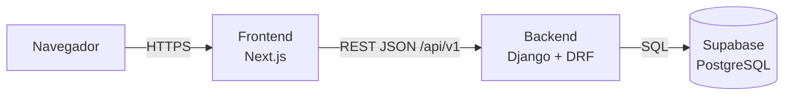

# Study Platform

Plataforma web pessoal de estudos, organização acadêmica e produtividade: disciplinas, tópicos, exercícios, revisão espaçada, anotações com matemática, notas, calendário, metas e estatísticas, em um só lugar.

> **Status: em desenvolvimento.** A fundação (F0) está implementada: backend Django com autenticação por cookies e isolamento por usuário, frontend Next.js com login, Docker e CI. Os módulos de estudo entram a partir da F1 (ver [Roadmap](#18-roadmap-resumido)). Itens marcados como **pendente de definição** dependem de decisões listadas em [`DEVELOPMENT_PLAN.md`](DEVELOPMENT_PLAN.md), seção 3.15.

## Sumário

1. [Apresentação](#1-apresentação) · 2. [Descrição e proposta de valor](#2-descrição-e-proposta-de-valor) · 3. [Objetivos](#3-objetivos) · 4. [Funcionalidades](#4-funcionalidades) · 5. [Tecnologias](#5-tecnologias-utilizadas) · 6. [Arquitetura](#6-arquitetura-geral) · 7. [Estrutura de diretórios](#7-estrutura-de-diretórios) · 8. [Pré-requisitos](#8-pré-requisitos) · 9. [Instalação](#9-instalação) · 10. [Variáveis de ambiente](#10-configuração-das-variáveis-de-ambiente) · 11. [Docker](#11-execução-com-docker) · 12. [Sem Docker](#12-execução-local-sem-docker) · 13. [Migrações](#13-migrações-do-banco-de-dados) · 14. [Superusuário](#14-criação-de-superusuário) · 15. [Testes](#15-execução-dos-testes) · 16. [Convenções](#16-convenções-de-desenvolvimento) · 17. [Contribuição](#17-fluxo-de-contribuição) · 18. [Roadmap](#18-roadmap-resumido) · 19. [Licença](#19-licença)

## 1. Apresentação

A Study Platform nasce como sistema de **um único usuário** (um estudante de graduação que também treina para olimpíadas de matemática e programação competitiva), com arquitetura que permite evoluir para mais usuários no futuro. O nome é provisório (pendente de definição, D-08).

## 2. Descrição e proposta de valor

Reúne o que normalmente exige várias ferramentas: gerenciador de disciplinas e notas, banco de exercícios com tentativas, flashcards com repetição espaçada, anotações com fórmulas, calendário, metas e estatísticas. Os dados pertencem ao usuário e podem ser exportados.

**Sem inteligência artificial:** o projeto não tem chatbots, agentes, RAG, ajuste fino nem geração de conteúdo por modelos de linguagem. O foco é registrar, organizar e acompanhar os estudos.

## 3. Objetivos

- Registrar o estudo diário com atrito mínimo (iniciar sessão em até 2 cliques).
- Distinguir exercício **resolvido** de **bem estudado**.
- Manter a revisão em dia, com fila única de revisão.
- Controlar notas e projeções da graduação.
- Acompanhar metas e fazer revisões semanais e mensais.
- Servir como projeto de portfólio: testado, documentado e implantável.

## 4. Funcionalidades

16 módulos, entregues em fases (detalhes e critérios de aceitação em [`DEVELOPMENT_PLAN.md`](DEVELOPMENT_PLAN.md), seção 3.2):

| Fase | Módulos |
|---|---|
| **MVP (F0–F2)** | Configurações e perfil · Disciplinas · Conteúdos e tópicos · Exercícios e questões · Sessões de estudo · Dashboard · Flashcards e revisão espaçada · Anotações (Tiptap + KaTeX) · Metas · Estatísticas |
| **F3** | Gestão acadêmica (semestres, avaliações, médias e projeção de nota) · Avaliações e simulados · Planejamento e calendário |
| **F4** | Biblioteca de materiais · Programação competitiva · Projetos pessoais e acadêmicos |
| **F5** | Exportação de dados, backups, implantação e endurecimento |

## 5. Tecnologias utilizadas

| Camada | Tecnologias |
|---|---|
| Frontend | Next.js (App Router), TypeScript, Tailwind CSS, shadcn/ui, TanStack Query, React Hook Form + Zod, Recharts, KaTeX, Tiptap |
| Backend | Python, Django, Django REST Framework, Django ORM, SimpleJWT, drf-spectacular |
| Banco de dados | PostgreSQL gerenciado pelo **Supabase** (acessado somente pelo backend) |
| Infraestrutura | Docker e Docker Compose |
| Qualidade | pytest, Ruff, mypy, ESLint, Prettier, Vitest, Playwright |

Versões fixadas na Fase 0 (D-13): Python 3.13, Django 5.2 LTS, Node LTS e Next.js 15.

## 6. Arquitetura geral



- Frontend e backend são **desacoplados** e conversam apenas por API REST.
- O backend concentra autenticação, regras de negócio e acesso ao banco. O frontend **nunca** acessa o Supabase diretamente.
- Autenticação própria (JWT em cookies `HttpOnly`); o Supabase é usado apenas como banco.

Detalhes: [`docs/ARCHITECTURE.md`](docs/ARCHITECTURE.md), [`docs/DATABASE.md`](docs/DATABASE.md), [`docs/API.md`](docs/API.md).

## 7. Estrutura de diretórios

```
.
├── DEVELOPMENT_PLAN.md      # plano técnico completo (referência oficial)
├── README.md · CONTRIBUTING.md · CHANGELOG.md
├── docker-compose.yml       # backend, frontend e PostgreSQL local opcional
├── backend/                 # Django + DRF (apps/, config/, tests/)
├── frontend/                # Next.js (src/app, src/features, src/components)
└── docs/                    # arquitetura, banco, API, ADRs e planos
```

A estrutura interna de `backend/` e `frontend/` está em `DEVELOPMENT_PLAN.md`, seções 3.6 e 3.7.

## 8. Pré-requisitos

- Git.
- Docker Desktop (ou Docker Engine) com Docker Compose v2.
- Para executar fora do Docker: Python 3.13 e Node.js 22 ou superior.
- Um projeto no [Supabase](https://supabase.com) para uso diário, **ou** apenas o PostgreSQL local do Compose.

## 9. Instalação

```bash
git clone https://github.com/MrtSt2049/Sistemas_de_estudos.git
cd Sistemas_de_estudos
cp backend/.env.example backend/.env
cp frontend/.env.local.example frontend/.env.local
```

Preencha `DJANGO_SECRET_KEY` e `DATABASE_URL` em `backend/.env`.

## 10. Configuração das variáveis de ambiente

Os nomes abaixo estão definidos no plano (seção 3.10.6) e nos arquivos de exemplo. **Nunca** versione `.env` nem `.env.local`.

**Backend (`backend/.env`)**

| Variável | Descrição |
|---|---|
| `DJANGO_SETTINGS_MODULE` | Ex.: `config.settings.local` |
| `DJANGO_SECRET_KEY` | Chave secreta, única por ambiente |
| `DJANGO_DEBUG` | `false` por padrão; nunca `true` em produção |
| `DJANGO_ALLOWED_HOSTS` | Hosts permitidos, separados por vírgula |
| `DATABASE_URL` | Conexão PostgreSQL (Supabase ou banco local) |
| `DB_CONNECT_TIMEOUT` | Segundos até desistir da conexão com o banco; padrão `10` |
| `CORS_ALLOWED_ORIGINS`, `CSRF_TRUSTED_ORIGINS` | Ex.: `http://localhost:3000` |
| `COOKIE_DOMAIN` | Somente produção |
| `JWT_ACCESS_TTL_MINUTES`, `JWT_REFRESH_TTL_DAYS` | Padrões `15` e `7` |
| `ALLOW_REGISTRATION` | `false` por padrão (cadastro público desativado) |
| `LOG_LEVEL` | Padrão `INFO` |

**Frontend (`frontend/.env.local`)**

| Variável | Descrição |
|---|---|
| `NEXT_PUBLIC_API_BASE_URL` | Ex.: `http://localhost:8000/api/v1` (usada pelo navegador) |
| `API_INTERNAL_URL` | Ex.: `http://backend:8000/api/v1` (usada pelo servidor Next.js no Docker) |

**Variáveis de armazenamento de arquivos (`SUPABASE_*`)**: pendentes de definição (D-02); só serão necessárias se o Supabase Storage for adotado.

### Conectando ao Supabase

1. Crie um projeto no painel do Supabase e guarde a senha do banco.
2. Em **Connect**, escolha **Session pooler** e copie a string no formato `postgresql://postgres.[PROJECT-REF]:[SENHA]@[POOLER-HOST]:5432/postgres`.
3. Cole em `DATABASE_URL` em `backend/.env`. Se a senha tiver caracteres especiais, codifique-os na URL.

O schema é criado **somente pelas migrações do Django** (seção 13); não crie tabelas pelo painel.

## 11. Execução com Docker

```bash
# Usando o Supabase (DATABASE_URL apontando para o projeto de desenvolvimento)
docker compose up --build

# Com PostgreSQL local
docker compose --profile local-db up --build
```

Com o banco local, use em `backend/.env`:

```
DATABASE_URL=postgresql://study_platform:study_platform@db:5432/study_platform
```

O banco local também é exposto em `127.0.0.1:5432` para executar testes e `manage.py` fora do Docker.

| Serviço | URL |
|---|---|
| Frontend | http://localhost:3000 |
| API | http://localhost:8000/api/v1 |
| Documentação da API (somente fora de produção) | http://localhost:8000/api/docs/ |
| Saúde | http://localhost:8000/healthz e http://localhost:8000/readyz |

Para parar: `docker compose --profile local-db down`.

Imagens de produção:

```bash
docker build --target production -t sp-backend ./backend
docker build --target production --build-arg NEXT_PUBLIC_API_BASE_URL=http://localhost:8000/api/v1 -t sp-frontend ./frontend
```

## 12. Execução local sem Docker

**Backend** (com o PostgreSQL local do Compose: `docker compose --profile local-db up -d db`)

```bash
cd backend
python -m venv .venv
source .venv/bin/activate          # Windows (PowerShell): .venv\Scripts\Activate.ps1
pip install -r requirements/dev.txt
python manage.py migrate
python manage.py runserver         # http://localhost:8000
```

Fora do Docker, aponte `DATABASE_URL` para `127.0.0.1`, não `localhost`. No Windows, `localhost` resolve primeiro para IPv6 e cada conexão demora vários segundos.

**Frontend** (em outro terminal)

```bash
cd frontend
npm ci
npm run dev                        # http://localhost:3000
```

## 13. Migrações do banco de dados

As migrações **nunca** rodam automaticamente ao iniciar os contêineres. Aplique-as de forma explícita:

```bash
# Com Docker
docker compose run --rm backend python manage.py migrate

# Sem Docker (dentro de backend/, com o ambiente virtual ativo)
python manage.py migrate
```

Ao alterar modelos:

```bash
python manage.py makemigrations
python manage.py sqlmigrate <app> <numero>     # revise o SQL antes de aplicar
```

Faça um backup antes de migrar produção. Detalhes e política de migrações destrutivas: `DEVELOPMENT_PLAN.md`, seção 3.10.7.

## 14. Criação de superusuário

O cadastro público é desativado por padrão. Crie o primeiro usuário pelo terminal:

```bash
# Com Docker
docker compose run --rm backend python manage.py createsuperuser

# Sem Docker
python manage.py createsuperuser
```

O identificador de login é o **e-mail**.

## 15. Execução dos testes

**Backend** (exige o PostgreSQL local em execução)

```bash
cd backend
pytest
pytest --cov                       # com cobertura
ruff check .                       # lint
ruff format --check .              # formatação
mypy .                             # tipos
lint-imports                       # fronteiras entre apps
python manage.py spectacular --validate --file schema.yml --settings=config.settings.test
pip-audit -r requirements/base.txt
```

**Frontend**

```bash
cd frontend
npm run lint
npm run typecheck
npm test                           # Vitest
npm run build
npm audit --audit-level=high
```

Os testes usam PostgreSQL local ou de CI, **nunca** o banco de produção do Supabase.

## 16. Convenções de desenvolvimento

- **Linguagem:** código, tabelas e URLs em inglês; textos da interface em português do Brasil.
- **API:** prefixo `/api/v1`, recursos no plural, `kebab-case` nas URLs, `snake_case` nos campos, UUID como identificador.
- **Backend:** regras de negócio em `services.py`, leituras em `selectors.py`, views finas; todo dado pertence a um `owner`.
- **Frontend:** TypeScript `strict`; tipos da API gerados do OpenAPI; nenhuma chamada `fetch` direta nas páginas.
- **Qualidade:** Ruff, mypy, ESLint, Prettier e testes obrigatórios no CI.
- **Sem IA:** nenhuma funcionalidade de inteligência artificial.
- **Commits:** Conventional Commits (ver `CONTRIBUTING.md`).

## 17. Fluxo de contribuição

1. Escolha ou abra uma tarefa vinculada a um requisito (`RFxxx`) do plano.
2. Crie uma *branch* curta a partir da principal.
3. Implemente com testes; rode lint, tipos e testes localmente.
4. Abra um *pull request* seguindo o checklist de revisão (`DEVELOPMENT_PLAN.md`, seção 3.11.4).
5. Faça o merge somente com o CI verde e atualize `CHANGELOG.md`.

Regras completas em [`CONTRIBUTING.md`](CONTRIBUTING.md).

## 18. Roadmap resumido

| Fase | Foco | Resultado |
|---|---|---|
| F0 | Fundação: repositório, Docker, Supabase, autenticação, CI, design system | Login funcionando e CI verde |
| F1 | Disciplinas, tópicos, exercícios, tentativas, sessões, dashboard básico | Primeira versão usável no dia a dia |
| F2 | Revisão espaçada, anotações, metas, estatísticas | **MVP** |
| F3 | Notas e semestres, simulados, calendário | Vida acadêmica coberta |
| F4 | Biblioteca, programação competitiva, projetos | Ecossistema completo |
| F5 | Exportação, backups, desempenho, acessibilidade, implantação | **Versão 1.0** |

Detalhes por fase (requisitos, tarefas e critérios de conclusão): [`docs/ROADMAP.md`](docs/ROADMAP.md).

## 19. Licença

**Pendente de definição** (D-08). Até a decisão, todos os direitos são reservados ao autor.
