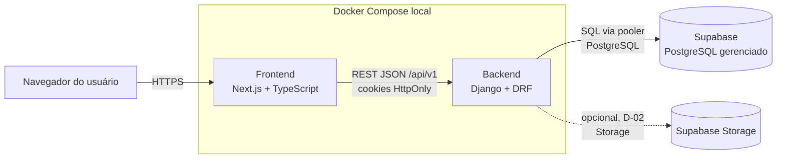
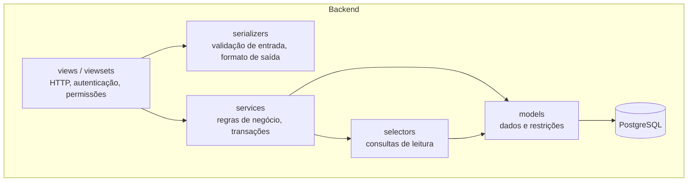
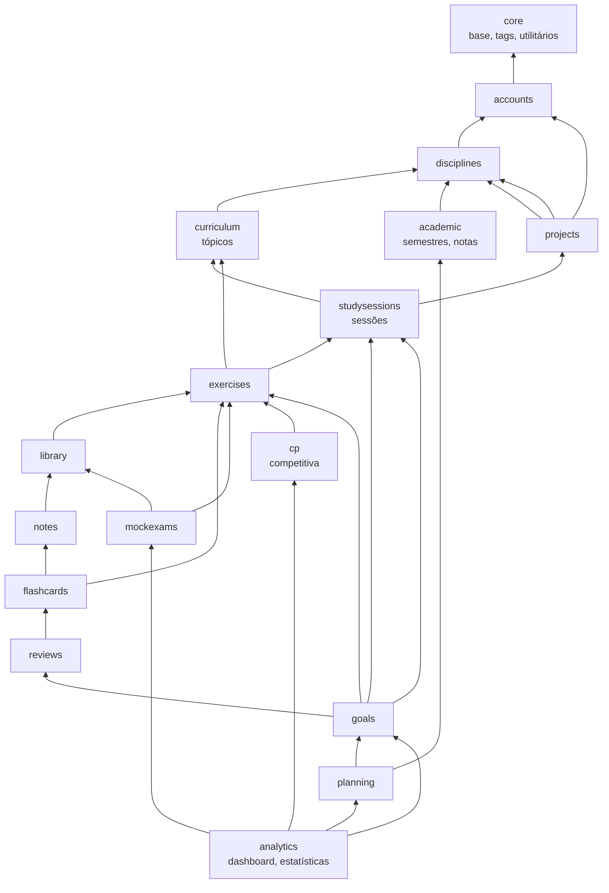
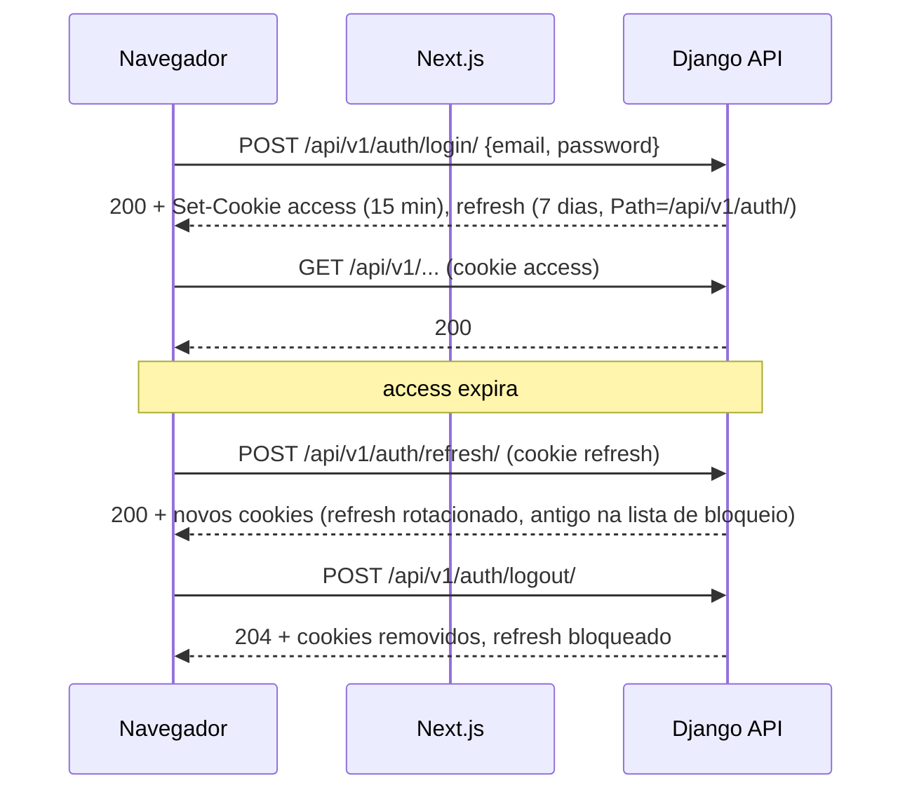

# Arquitetura

> Extraído de [`DEVELOPMENT_PLAN.md`](../DEVELOPMENT_PLAN.md), seções 3.4, 3.6 e 3.7, em 23/11/2026. Em caso de divergência, **vale o `DEVELOPMENT_PLAN.md`**. Alterações devem ser feitas primeiro no plano e depois replicadas aqui, no mesmo pull request.

## 3.4. Arquitetura de software

### 3.4.1. Visão geral

Arquitetura em três blocos independentes, comunicando-se apenas por HTTP e SQL:



- O **frontend** nunca fala com o banco nem usa chaves do Supabase. Toda leitura e escrita passa pela API.
- O **backend** é o único cliente do banco. Ele concentra autenticação, autorização, validação e regras de negócio.
- O **banco** é o PostgreSQL do Supabase, usado como PostgreSQL gerenciado "puro" (ADR-02).

### 3.4.2. Separação frontend e backend

| Aspecto | Frontend (Next.js) | Backend (Django) |
|---|---|---|
| Responsabilidade | Apresentação, navegação, estado de interface, validação de formulário para feedback imediato | Regras de negócio, validação autoritativa, persistência, autorização |
| Fonte de verdade dos dados | Nenhuma (cache de leitura) | Banco de dados |
| Contrato | Consome o esquema OpenAPI e os tipos gerados dele | Publica o esquema OpenAPI (drf-spectacular) |
| Proibido | Replicar regras de negócio (ex.: cálculo de média, agendamento de revisão); acessar o banco | Renderizar HTML de aplicação; conhecer detalhes de interface |

Regra prática: se alterar o cálculo mudaria um número exibido, o cálculo vive no backend. O frontend pode **formatar** e **antecipar** (ex.: mostrar o erro de peso > 100 enquanto digita), mas a decisão final é do servidor.

### 3.4.3. Comunicação via API REST

- Base: `/api/v1/`. JSON em UTF-8. Datas/horas em ISO 8601 UTC (`2026-11-23T12:00:00Z`); datas puras em `YYYY-MM-DD`.
- Recursos no plural, `kebab-case` nas URLs e `snake_case` nos campos JSON.
- Métodos: `GET` (leitura), `POST` (criação e ações), `PATCH` (atualização parcial), `DELETE` (remoção). `PUT` não é usado.
- Paginação: `?page=` e `?page_size=` (padrão 25, máximo 100); resposta `{count, next, previous, results}`.
- Filtros por parâmetros de consulta (`django-filter`), ordenação por `?ordering=`, busca por `?search=`.
- Ações que não são CRUD usam `POST /recurso/{id}/acao/` (ex.: `POST /exercises/{id}/attempts/`).
- Identificadores: UUID.
- Versionamento: prefixo na URL; mudanças incompatíveis exigem `/api/v2/`.
- Documentação interativa: `/api/schema/` (OpenAPI) e `/api/docs/` (somente em ambientes não produtivos).

### 3.4.4. Responsabilidades de cada camada



| Camada (backend) | Faz | Não faz |
|---|---|---|
| `models` | Campos, relacionamentos, `Meta.constraints`, índices, métodos triviais | Regra de negócio multi-entidade, consultas de relatório |
| `serializers` | Validar tipos e regras de campo; converter entrada/saída | Gravar em várias tabelas; chamar serviços de outro módulo |
| `services` | Operações de escrita com regra de negócio, dentro de `transaction.atomic` (ex.: registrar tentativa, responder revisão, encerrar sessão) | Conhecer `request`/HTTP |
| `selectors` | Consultas de leitura reutilizáveis e agregações (`select_related`, `prefetch_related`, `annotate`) | Alterar dados |
| `views` | Mapear HTTP ↔ serviços/seletores; aplicar permissões; paginar | Conter regra de negócio |
| `permissions` | Autorização (dono do objeto, usuário ativo) | Filtrar dados manualmente em cada view (isso é do `OwnedQuerysetMixin`) |

### 3.4.5. Organização dos módulos

O backend é um **monólito modular**: um app Django por módulo de negócio, com dependências sempre "para baixo" (a seta significa "depende de").



Regras: (1) um app só importa de apps abaixo dele; (2) apps conversam por `services` e `selectors` públicos, nunca importando models para escrever neles; (3) `analytics` só lê; ninguém depende dele. Uma verificação automática de importações (por exemplo, `import-linter`) é adicionada na Fase 0 para impedir ciclos (RNF015).

### 3.4.6. Estratégia de autenticação

**Decisão (ADR-04):** autenticação própria do Django, **sem Supabase Auth**, porque o Supabase é usado apenas como banco (ADR-02) e manter um único provedor de identidade evita duplicar usuários e regras.



- Biblioteca: `djangorestframework-simplejwt` com rotação e lista de bloqueio de refresh.
- Transporte (proposto em D-03): tokens em cookies `HttpOnly; Secure; SameSite=Lax`. Não ficam acessíveis ao JavaScript, reduzindo o impacto de XSS.
- CSRF: como cookies são enviados automaticamente, métodos não seguros exigem o cabeçalho `X-CSRFToken` (padrão *double submit*); a classe de autenticação personalizada aplica a verificação de CSRF do DRF.
- Em desenvolvimento, `localhost:3000` e `localhost:8000` são do mesmo *site* (portas não contam), então `SameSite=Lax` funciona. Em produção, front e API devem compartilhar o domínio registrável (ex.: `app.exemplo.com` e `api.exemplo.com`).
- Renderização no servidor do Next.js: o servidor repassa o cookie recebido ao chamar a API (`API_INTERNAL_URL`).
- Usuário: modelo customizado com **e-mail como identificador**. Cadastro público desativado por padrão (`ALLOW_REGISTRATION=false`); o usuário é criado por `createsuperuser` ou pelo admin do Django.
- Hash de senha: Argon2id (`argon2-cffi`) como primeiro hasher; validadores de senha do Django ativos.
- Limite de tentativas: throttling no login (RNF007).

### 3.4.7. Gerenciamento de permissões

Modelo simples e restritivo, preparado para multiusuário:

1. **Autenticado obrigatório** em todos os endpoints, exceto `auth/login`, `auth/refresh`, `healthz` e `readyz` (`DEFAULT_PERMISSION_CLASSES = [IsAuthenticated]`).
2. **Propriedade do objeto:** todo model de negócio herda de `OwnedModel` (campo `owner`). Um `OwnedQuerysetMixin` filtra `queryset.filter(owner=request.user)` e injeta `owner` na criação. Um objeto de outro usuário retorna **404**, não 403, para não revelar existência.
3. **Referências cruzadas:** ao receber um ID de outro recurso (ex.: `discipline` ao criar exercício), o serializer valida que o recurso pertence ao mesmo usuário (`OwnedPrimaryKeyRelatedField`).
4. **Papéis:** apenas `is_staff`/`is_superuser` do Django para o admin. Sem RBAC próprio enquanto houver um usuário (decisão revisitada se D-09 mudar).
5. **Teste de contrato (RNF004):** uma suíte percorre todas as rotas registradas com dois usuários e falha se alguma resposta contiver dados do outro.

### 3.4.8. Validação de dados

Três camadas, cada uma com um papel:

| Camada | Exemplo | Quando falha |
|---|---|---|
| Frontend (Zod + React Hook Form) | Campo obrigatório, formato de URL, intervalo 0–5 | Mensagem no campo, sem requisição |
| Serializer DRF | Tipos, tamanho, `choices`, posse das referências, regras entre campos | `400` com detalhes por campo |
| Banco (`CHECK`, `UNIQUE`, FK) | Peso 0–100, `ended_at > started_at`, exatamente uma FK em `review_item` | `409`/`400` mapeado pelo tratador de exceções |

O serializer **não substitui** a restrição do banco: a regra crítica existe nos dois lugares (RNF023).

### 3.4.9. Tratamento de erros

Formato único de erro, produzido por um `exception_handler` DRF customizado:

```json
{
  "error": {
    "code": "validation_error",
    "message": "Dados inválidos.",
    "details": { "weight_percent": ["Deve estar entre 0 e 100."] },
    "request_id": "b6c1…"
  }
}
```

| Situação | HTTP | `code` |
|---|---|---|
| Validação | 400 | `validation_error` |
| Não autenticado / token expirado | 401 | `not_authenticated` / `token_expired` |
| Sem permissão | 403 | `permission_denied` |
| Não encontrado (inclui objeto de outro usuário) | 404 | `not_found` |
| Violação de regra de negócio (ex.: sessão ativa já existe) | 409 | `conflict` / código específico |
| Limite de taxa | 429 | `throttled` |
| Erro inesperado | 500 | `server_error` (sem detalhes internos; detalhes só no log) |

Erros de domínio são exceções tipadas (`DomainError` e subclasses) lançadas pelos `services` e traduzidas para HTTP no tratador, de modo que os serviços não conhecem HTTP. O frontend mapeia `code` para mensagens em português.

### 3.4.10. Logging e observabilidade

- Logs em **JSON** na saída padrão (12-factor): `timestamp`, `level`, `logger`, `message`, `request_id`, `user_id`, `method`, `path`, `status`, `duration_ms`.
- Middleware gera/propaga `X-Request-ID` e o inclui na resposta de erro.
- Nunca registrar senhas, tokens, cookies, corpo de requisições de autenticação nem conteúdo de notas.
- Níveis: `INFO` para requisições e eventos de negócio relevantes (sessão iniciada, revisão respondida); `WARNING` para regras violadas e 4xx incomuns; `ERROR` para 5xx com *stack trace*.
- `/healthz` (processo vivo) e `/readyz` (consulta `SELECT 1` ao banco) para verificações de saúde.
- Serviço de agregação de erros (ex.: Sentry) é **opcional** e fica fora do MVP (D-13).

### 3.4.11. Estratégia de testes (resumo)

Pirâmide: muitos testes unitários de funções puras e serviços, testes de API por endpoint, poucos testes de ponta a ponta nos fluxos críticos. Detalhes, ferramentas e metas estão na seção 3.11.

### 3.4.12. Decisões arquiteturais tomadas (ADRs)

Cada ADR deve ganhar um arquivo curto em `docs/adr/` (contexto, decisão, alternativas, consequências) na Fase 0.

| ADR | Decisão | Justificativa | Alternativa descartada |
|---|---|---|---|
| ADR-01 | Monólito modular Django + frontend Next.js separado, comunicação por REST | Pedido explícito de desacoplamento; um único backend é suficiente para um usuário e é simples de operar | Microsserviços (complexidade sem ganho); Next.js full-stack (mistura responsabilidades) |
| ADR-02 | **Supabase como PostgreSQL gerenciado**, acessado **somente pelo Django** via string de conexão; não usar Supabase Auth, PostgREST/Data API nem `supabase-js` | Aproveita banco gerenciado, backups e painel sem acoplar o código a APIs proprietárias; o Django ORM e as migrações continuam a fonte do schema | Usar Supabase como BaaS (duplicaria autenticação e regras no cliente, contrariando ADR-01) |
| ADR-03 | Conexão de runtime e de migração pelo **pooler em modo sessão (porta 5432)**; o modo transação (6543) fica como evolução, com `DISABLE_SERVER_SIDE_CURSORS=True` e `CONN_MAX_AGE=0` | A conexão direta do Supabase usa IPv6 no plano gratuito; o pooler em modo sessão funciona em IPv4 e preserva o comportamento esperado pelo Django (conexões persistentes, `SET`, transações) | Modo transação desde o início (exige cuidados com cursores do lado do servidor e estado de sessão) |
| ADR-04 | Autenticação própria com JWT (SimpleJWT) em cookies `HttpOnly` | Um só provedor de identidade; tokens fora do alcance do JavaScript | JWT em `localStorage` (exposto a XSS); sessão Django clássica (menos adequada a clientes desacoplados) |
| ADR-05 | Chaves primárias UUID v4 | Evita enumeração de IDs na API; facilita importação/merge futuro | `bigint` sequencial (mais compacto, porém previsível) |
| ADR-06 | Todo dado de negócio pertence a um `owner` desde o início | Multiusuário futuro sem migração dolorosa | Sem `owner` (mais simples hoje, caro depois) |
| ADR-07 | Regras de negócio em `services`, leitura em `selectors`, views finas | Testabilidade e reutilização | "Fat models" e lógica em serializers |
| ADR-08 | Contrato por OpenAPI (drf-spectacular) e tipos TypeScript gerados (openapi-typescript) | Elimina divergência manual entre back e front | Tipos escritos à mão |
| ADR-09 | Sem filas/Celery; cálculos sob demanda e agregações em SQL | Volume pessoal não justifica; reduz infraestrutura | Celery + Redis |
| ADR-10 | Uma entidade `Discipline` com campo `kind` cobre cursos universitários, olimpíada, programação competitiva etc. | Tópicos, exercícios e sessões se ligam a um único conceito; campos acadêmicos opcionais, validados por `CHECK` | Tabelas separadas por área (duplica relacionamentos) |
| ADR-11 | Fila de revisão com FKs exclusivas (`flashcard`, `exercise` ou `topic`) e `CHECK` de exatamente uma | Integridade referencial real, sem `GenericForeignKey` | `GenericForeignKey` (sem FK no banco) |
| ADR-12 | Django 5.2 LTS (suporte de segurança estendido até abril de 2028), com migração planejada para a LTS de abril de 2027 (6.2) quando estabilizar | Estabilidade para um projeto de longa duração | Django 6.1 (mais recente, suporte mais curto) |
| ADR-13 | Markdown seguro (sem HTML bruto) + KaTeX para texto longo (enunciados, soluções, cartões); Tiptap (JSON) para anotações | Reduz risco de XSS e mantém conteúdo portátil | HTML armazenado e renderizado cru |
| ADR-14 | Dados de tempo em `timestamptz` (UTC); "dia do usuário" derivado do fuso do perfil | Evita erros de virada de dia e de horário de verão | Datas locais armazenadas sem fuso |

---

## 3.6. Arquitetura do backend

### 3.6.1. Estrutura de diretórios

Código, nomes de tabelas e URLs em **inglês**; textos exibidos ao usuário em **português do Brasil**.

```
backend/
├── manage.py
├── pyproject.toml               # configuração de ruff, mypy, pytest, coverage, import-linter
├── requirements/
│   ├── base.txt                 # dependências de execução
│   ├── dev.txt                  # base + ferramentas de teste e qualidade
│   └── prod.txt                 # base + servidor de produção
├── Dockerfile
├── config/
│   ├── settings/
│   │   ├── base.py              # comum a todos os ambientes
│   │   ├── local.py             # desenvolvimento
│   │   ├── test.py              # testes
│   │   └── production.py        # produção
│   ├── urls.py                  # inclui /api/v1/, /healthz, /readyz, /admin/, /api/schema/
│   ├── wsgi.py
│   └── asgi.py
├── apps/
│   ├── core/                    # base compartilhada (ver 3.6.3)
│   ├── accounts/                # User, UserProfile, autenticação
│   ├── disciplines/
│   ├── curriculum/              # tópicos e histórico de domínio
│   ├── academic/                # semestres, avaliações, notas, frequência
│   ├── exercises/               # fontes, exercícios, tentativas, tipos de erro
│   ├── cp/                      # programação competitiva
│   ├── flashcards/
│   ├── reviews/                 # fila e agendamento de revisão
│   ├── notes/
│   ├── library/
│   ├── mockexams/
│   ├── planning/                # calendário e semana padrão
│   ├── goals/                   # metas e revisões periódicas
│   ├── studysessions/
│   ├── projects/
│   └── analytics/               # dashboard e estatísticas (somente leitura)
└── tests/                       # conftest, fábricas globais, testes de contrato entre apps
```

Estrutura de **cada app** (arquivos criados somente quando necessários):

```
apps/<app>/
├── models.py
├── serializers.py
├── views.py                     # ViewSets e APIViews
├── urls.py                      # registrado em config/urls.py sob /api/v1/
├── services.py                  # escrita e regras de negócio
├── selectors.py                 # leitura e agregações
├── permissions.py               # apenas se houver regra específica
├── filters.py                   # classes django-filter
├── admin.py
├── migrations/
└── tests/
    ├── factories.py
    ├── test_models.py
    ├── test_services.py
    └── test_api.py
```

### 3.6.2. Responsabilidade de cada componente

| Componente | Responsabilidade | Regra de ouro |
|---|---|---|
| **Models** | Esquema, restrições (`Meta.constraints`), índices, `__str__`, métodos sem efeito colateral | Toda regra de integridade crítica vira `CheckConstraint`/`UniqueConstraint` |
| **Serializers** | Validação de entrada e formatação de saída; `OwnedPrimaryKeyRelatedField` para referências | Não gravam em mais de uma tabela |
| **Views** | Fluxo HTTP: autenticação, permissão, paginação, chamada a serviço/seletor | Sem regra de negócio; ≤ 15 linhas por ação |
| **URLs** | Roteamento com `DefaultRouter` por app | Rotas no plural e em `kebab-case` |
| **Services** | Funções (não classes) que executam casos de uso, com `transaction.atomic` e exceções de domínio | Recebem `owner` e dados já validados; não recebem `request` |
| **Selectors** | Consultas de leitura e agregações com `select_related`/`prefetch_related`/`annotate` | Retornam `QuerySet` ou estruturas simples; não gravam |
| **Permissions** | Autorização por objeto quando a regra de propriedade não bastar | Padrão é `IsAuthenticated` + posse |
| **Filters** | Filtros declarativos por recurso | Campos expostos listados explicitamente |
| **Admin** | Operação de emergência pelo superusuário | Somente leitura para dados de usuário em produção |
| **Tests** | Fábricas, testes de modelo, serviço e API | Ver 3.11 |

Exemplos de serviços previstos: `exercises.services.record_attempt`, `reviews.services.answer_review`, `studysessions.services.start_session / pause / resume / finish`, `academic.services.compute_course_grade`, `academic.services.required_score_for_target`, `goals.selectors.goal_progress`.

### 3.6.3. App `core`

| Módulo | Conteúdo |
|---|---|
| `models.py` | `TimeStampedModel`, `OwnedModel` (herda o anterior; UUID, `owner`), `Tag` |
| `mixins.py` | `OwnedQuerysetMixin`: filtra por `owner`, injeta `owner` na criação |
| `fields.py` | `OwnedPrimaryKeyRelatedField` |
| `exceptions.py` | `DomainError` e subclasses (`Conflict`, `RuleViolation`, `NotFoundInScope`); `exception_handler` |
| `pagination.py` | Paginador padrão |
| `middleware.py` | `RequestIdMiddleware`, log de requisições |
| `logging.py` | Formatador JSON |
| `clock.py` | Função `now()` injetável para testes; utilitários de "dia do usuário" |
| `health.py` | `/healthz` e `/readyz` |
| `markdown.py` | Sanitização/validação de Markdown recebido (rejeita HTML bruto) |

### 3.6.4. Configurações por ambiente

| Configuração | `local` | `test` | `production` |
|---|---|---|---|
| `DEBUG` | verdadeiro | falso | falso (obrigatório) |
| Banco | `DATABASE_URL` (Supabase de desenvolvimento ou contêiner local, D-01) | PostgreSQL local/CI, **nunca** o Supabase de produção | `DATABASE_URL` do Supabase de produção |
| Cookies seguros | `Secure` desligado em HTTP local | desligado | `Secure`, `HttpOnly`, `SameSite=Lax` |
| CORS/CSRF | origem `http://localhost:3000` | — | origens explícitas por variável |
| Hash de senha | Argon2 | MD5 rápido **apenas em teste** para acelerar a suíte | Argon2id |
| Logs | JSON legível | silencioso | JSON, nível `INFO` |
| Documentação da API | ativa | ativa | desativada |

Todos os valores sensíveis vêm de variáveis de ambiente (seção 3.10.6). Falta de variável obrigatória derruba a inicialização com mensagem clara (*fail fast*).

### 3.6.5. Dependências do backend (propostas; versões fixadas na Fase 0, D-13)

| Finalidade | Pacote |
|---|---|
| Framework e API | `Django` (5.2 LTS, ADR-12), `djangorestframework`, `django-filter`, `drf-spectacular` |
| Autenticação | `djangorestframework-simplejwt` (com *blacklist*), `argon2-cffi` |
| Banco | `psycopg` (v3), `django-environ` |
| Segurança e rede | `django-cors-headers` |
| Execução | `gunicorn` (produção), `whitenoise` (estáticos do admin) |
| Logs | `python-json-logger` |
| Testes e qualidade | `pytest`, `pytest-django`, `pytest-cov`, `factory-boy`, `freezegun`, `ruff`, `mypy`, `django-stubs`, `djangorestframework-stubs`, `import-linter`, `pip-audit`, `pre-commit` |

Nenhuma dependência é adicionada sem registro no PR explicando o motivo (diretriz de evitar dependências excessivas).

---

## 3.7. Arquitetura do frontend

### 3.7.1. Stack e decisões

| Item | Escolha | Observação |
|---|---|---|
| Framework | Next.js (App Router) + React + TypeScript `strict` | Versões fixadas na Fase 0 (D-13) |
| Estilo | Tailwind CSS + shadcn/ui | shadcn copia componentes para o repositório (código nosso, sem dependência de runtime pesada) |
| Dados do servidor | TanStack Query | Cache, invalidação, estados de carregamento e erro |
| Formulários | React Hook Form + Zod | Esquema Zod por formulário, espelhando as regras da API |
| Estado de interface | Zustand, **apenas** para estado efêmero de UI (barra lateral, cronômetro ativo) | Dados do servidor nunca vão para stores |
| Gráficos | Recharts | |
| Matemática | KaTeX | Renderização no cliente e no servidor (SSR) |
| Editor | Tiptap | Carregado sob demanda (`dynamic import`); desativar renderização imediata no SSR (`immediatelyRender: false`, a verificar na versão adotada) |
| Tipos da API | `openapi-typescript` a partir de `/api/schema/` | ADR-08 |
| Datas | `date-fns` + `date-fns-tz` | Fuso vindo do perfil |

### 3.7.2. Estrutura de diretórios

```
frontend/
├── package.json
├── tsconfig.json                 # "strict": true
├── next.config.ts
├── components.json               # configuração do shadcn/ui
├── eslint.config.mjs
├── .prettierrc
├── vitest.config.ts
├── playwright.config.ts
├── Dockerfile
├── public/
├── tests/e2e/                    # Playwright
└── src/
    ├── app/                      # rotas (App Router)
    │   ├── layout.tsx            # fontes, tema, provedores
    │   ├── error.tsx, not-found.tsx, global-error.tsx
    │   ├── (auth)/login/page.tsx
    │   └── (app)/                # área autenticada
    │       ├── layout.tsx        # sidebar + topbar + verificação de sessão
    │       ├── dashboard/page.tsx
    │       ├── disciplines/      # lista, [id]
    │       ├── topics/           # árvore
    │       ├── exercises/        # lista, [id], novo, error-notebook
    │       ├── sessions/
    │       ├── review/           # fila e sessão de revisão
    │       ├── flashcards/
    │       ├── notes/
    │       ├── goals/
    │       ├── stats/
    │       ├── academic/         # semestres, notas
    │       ├── mock-exams/
    │       ├── calendar/
    │       ├── library/
    │       ├── competitive/
    │       ├── projects/
    │       └── settings/
    ├── components/
    │   ├── ui/                   # shadcn/ui (Button, Input, Dialog...)
    │   ├── layout/               # Sidebar, Topbar, PageHeader, Shell
    │   ├── feedback/             # EmptyState, ErrorState, Skeletons, Toaster
    │   ├── charts/               # wrappers de Recharts com o tema
    │   ├── markdown/             # <MarkdownView> com KaTeX e realce de código
    │   └── editor/               # <RichEditor> (Tiptap)
    ├── features/<módulo>/        # tudo de um módulo no mesmo lugar
    │   ├── api.ts                # funções tipadas que chamam a API
    │   ├── queries.ts            # hooks do TanStack Query (useExercises, useAnswerReview…)
    │   ├── schemas.ts            # Zod
    │   ├── components/           # componentes específicos do módulo
    │   └── utils.ts
    ├── hooks/                    # hooks genéricos (useDebounce, useHotkeys…)
    ├── lib/
    │   ├── api-client.ts         # fetch com credenciais, CSRF, refresh e tradução de erros
    │   ├── query-client.ts
    │   ├── errors.ts             # ApiError e mapeamento code → mensagem pt-BR
    │   ├── dates.ts, format.ts, utils.ts
    ├── stores/                   # ui-store.ts, active-session-store.ts
    ├── types/
    │   └── api.ts                # GERADO — não editar à mão
    └── styles/
        └── globals.css           # tokens do design system como variáveis CSS
```

### 3.7.3. Padrões e responsabilidades

| Tema | Padrão |
|---|---|
| **Páginas** | Arquivos `page.tsx` finos: compõem componentes de `features/`. Server Components por padrão; `"use client"` apenas onde há interação ou TanStack Query. |
| **Componentes reutilizáveis** | `components/ui` (primitivos), `components/feedback` (estados) e `components/charts`/`markdown`/`editor`. Um componente só vai para `components/` quando for usado por 2+ módulos. |
| **Layouts** | `(auth)` sem navegação; `(app)` com sidebar, topbar e *gate* de sessão (redireciona para `/login` se não autenticado). |
| **Hooks** | Um hook de query/mutação por operação (`useExercises`, `useRecordAttempt`), com chaves de cache centralizadas por módulo. |
| **Services (API)** | `features/<módulo>/api.ts`; nenhuma página chama `fetch` diretamente. |
| **Stores** | Zustand pequeno, sem persistência de dados do servidor. A sessão ativa é lida do servidor (RF071); o store apenas guarda o cronômetro exibido. |
| **Types** | `types/api.ts` gerado do OpenAPI; tipos de domínio derivados dele, nunca duplicados à mão. |
| **Formulários** | React Hook Form + Zod. Erros de campo vindos da API (`details`) são aplicados com `setError`. Enviar desabilitado enquanto pendente. |
| **Validação** | Mesmas regras visíveis da API (intervalos, obrigatórios) para feedback imediato; a API continua autoritativa (3.4.8). |
| **Comunicação com a API** | `lib/api-client.ts`: `credentials: "include"`, cabeçalho `X-CSRFToken` em métodos não seguros, uma tentativa de `POST /auth/refresh/` ao receber `401 token_expired`, e conversão de qualquer falha em `ApiError` tipado. Em Server Components, o cookie recebido é repassado a `API_INTERNAL_URL`. |
| **Carregamento** | `loading.tsx` e *skeletons* por região; botões com estado pendente; nunca tela em branco. |
| **Erro** | `error.tsx` por segmento, `ErrorState` com ação "Tentar de novo" e `request_id` visível para suporte; erros de formulário inline. |
| **Sucesso** | Notificação discreta (toast) e atualização otimista apenas quando seguro (ex.: marcar tarefa); revalidação das chaves afetadas. |
| **Vazio** | Todo listagem tem `EmptyState` com explicação e ação primária (ver 3.9). |
| **Acessibilidade** | Componentes shadcn/Radix como base; `aria-live` para toasts e resultado de revisão; foco gerenciado em diálogos. |
| **Desempenho** | Rotas carregadas sob demanda; Tiptap e Recharts via `dynamic import`; `next/font` para Inter e JetBrains Mono. |

## Integrações externas

A única integração externa autorizada é a leitura da API pública do Codeforces ([ADR-015](adr/0015-codeforces-readonly-on-demand-api.md)): feita pelo backend, acionada pelo usuário, sem credenciais e sem tarefas em segundo plano.
