# Banco de dados

> Extraído de [`DEVELOPMENT_PLAN.md`](../DEVELOPMENT_PLAN.md), seção 3.5, em 23/11/2026. Em caso de divergência, **vale o `DEVELOPMENT_PLAN.md`**. Alterações devem ser feitas primeiro no plano e depois replicadas aqui, no mesmo pull request.

## 3.5. Modelagem do banco de dados

### 3.5.1. Princípios

1. **PostgreSQL gerenciado pelo Supabase**, com o schema criado e evoluído **exclusivamente pelas migrações do Django** (nunca pelo painel do Supabase).
2. **Chave primária `uuid`** (v4, gerada pela aplicação) em todas as tabelas (ADR-05).
3. **Isolamento por dono:** toda tabela de negócio tem `owner_id → accounts_user(id)` com `ON DELETE CASCADE` (ADR-06). Para não poluir o diagrama, essa relação não é desenhada.
4. **Auditoria mínima:** `created_at` e `updated_at` (`timestamptz`) em toda tabela de negócio.
5. **Tempo em UTC** (`timestamptz`); datas de calendário em `date` (ADR-14).
6. **Sem redundância:** valores derivados (média da disciplina, progresso de metas, contagem de resolvidos, percentuais) **não são armazenados**; são calculados por *selectors*. Exceções justificadas: `Exercise.state`, `Topic.last_studied_at` e `ReviewItem.due_on`, necessários para filtrar/ordenar com desempenho, sempre atualizados por serviços na mesma transação.
7. **Nomes das tabelas:** padrão do Django (`<app>_<modelo>`, em minúsculas, ex.: `exercises_attempt`). Neste documento usa-se o nome do modelo.
8. **Tags:** uma tabela `Tag` por usuário e relações *muitos-para-muitos* com tabelas intermediárias geradas pelo Django (sem `GenericForeignKey`).
9. **Exclusão:** `CASCADE` para dependentes que não têm sentido sem o pai (tentativas de um exercício); `PROTECT` para cadastros de referência em uso (fonte, tipo de erro); `SET NULL` para vínculos opcionais (nota ligada a um tópico).
10. **Supabase:** RLS habilitado em todas as tabelas do schema `public`, sem políticas, e privilégios revogados de `anon` e `authenticated` (RNF006). Como o Django acessa com o papel dono das tabelas, ele não é afetado. A migração usa `RunSQL` condicional (só revoga se os papéis existirem), para funcionar também no PostgreSQL local (D-01).

### 3.5.2. Diagrama entidade-relacionamento

```mermaid
erDiagram
    USER ||--|| USER_PROFILE : possui
    USER ||--o{ PERIODIC_REVIEW : registra
    USER ||--o{ TAG : cria

    DISCIPLINE ||--o| COURSE_INFO : "detalhes acadêmicos"
    TERM |o--o{ COURSE_INFO : agrupa
    COURSE_INFO ||--o| GRADE_RULE : define
    DISCIPLINE ||--o{ ACADEMIC_ASSESSMENT : avalia
    DISCIPLINE ||--o{ GRADE_BONUS : bonifica
    ACADEMIC_ASSESSMENT |o--o{ GRADE_BONUS : "aplica-se a"
    DISCIPLINE ||--o{ ATTENDANCE_RECORD : frequencia

    DISCIPLINE ||--o{ TOPIC : contem
    TOPIC |o--o{ TOPIC : "pai de"
    TOPIC ||--o{ TOPIC_MASTERY_LOG : historico

    DISCIPLINE ||--o{ EXERCISE : agrupa
    TOPIC |o--o{ EXERCISE : classifica
    EXERCISE_SOURCE ||--o{ EXERCISE : origina
    EXERCISE ||--o{ ATTEMPT : recebe
    ERROR_TYPE |o--o{ ATTEMPT : "erro dominante"
    STUDY_SESSION |o--o{ ATTEMPT : "ocorre em"
    EXERCISE ||--o| CP_PROBLEM_INFO : "metadados CP"
    CP_CONTEST ||--o{ CP_CONTEST_RESULT : resultados
    EXERCISE |o--o{ CP_CONTEST_RESULT : referencia

    DECK ||--o{ FLASHCARD : contem
    DISCIPLINE |o--o{ DECK : organiza
    EXERCISE |o--o{ FLASHCARD : origem
    NOTE |o--o{ FLASHCARD : origem
    FLASHCARD |o--o| REVIEW_ITEM : agenda
    EXERCISE |o--o| REVIEW_ITEM : agenda
    TOPIC |o--o| REVIEW_ITEM : agenda
    REVIEW_ITEM ||--o{ REVIEW_LOG : historico

    DISCIPLINE |o--o{ NOTE : classifica
    TOPIC |o--o{ NOTE : classifica
    EXERCISE |o--o{ NOTE : comenta
    MATERIAL |o--o{ NOTE : comenta
    DISCIPLINE |o--o{ MATERIAL : classifica
    TOPIC |o--o{ MATERIAL : classifica
    MATERIAL }o--o{ EXERCISE : "origem de"
    MATERIAL |o--o{ MOCK_EXAM : "prova anterior"

    DISCIPLINE |o--o{ STUDY_SESSION : dedica
    TOPIC |o--o{ STUDY_SESSION : foca
    PROJECT |o--o{ STUDY_SESSION : dedica

    MOCK_EXAM ||--o{ MOCK_EXAM_ITEM : itens
    EXERCISE |o--o{ MOCK_EXAM_ITEM : usa

    DISCIPLINE |o--o{ CALENDAR_EVENT : cor
    ACADEMIC_ASSESSMENT |o--o{ CALENDAR_EVENT : prazo
    CALENDAR_EVENT ||--o{ CALENDAR_EVENT_EXCEPTION : excecoes
    WEEKLY_PLAN_PROFILE ||--o{ WEEKLY_PLAN_BLOCK : blocos
    DISCIPLINE |o--o{ WEEKLY_PLAN_BLOCK : area

    GOAL |o--o{ GOAL : "composta por"
    GOAL ||--o{ GOAL_PROGRESS_ENTRY : lancamentos
    DISCIPLINE |o--o{ GOAL : escopo

    PROJECT ||--o{ PROJECT_TASK : tarefas
    PROJECT ||--o{ PROJECT_MILESTONE : marcos
    DISCIPLINE |o--o{ PROJECT : "vinculado a"

    TAG }o--o{ EXERCISE : etiqueta
    TAG }o--o{ NOTE : etiqueta
    TAG }o--o{ MATERIAL : etiqueta
    TAG }o--o{ PROJECT : etiqueta
```

### 3.5.3. Dicionário de dados

Convenções: **PK** chave primária; **FK** chave estrangeira; `O` = `owner_id` presente (não repetido); `ts` = `timestamptz`; todo modelo de negócio tem também `id uuid PK`, `created_at ts`, `updated_at ts`. Enumerações são `varchar` com `CHECK (valor IN (...))` gerado pelo Django (`TextChoices`).

#### Contas (`accounts`)

| Entidade | Campo | Tipo | Restrições e observações |
|---|---|---|---|
| **User** | email | varchar(254) | Único sem diferenciar maiúsculas (índice único em `lower(email)`); identificador de login |
| | password | varchar(128) | Hash Argon2id |
| | name | varchar(150) | |
| | is_active, is_staff, is_superuser | boolean | |
| | date_joined, last_login | ts | |
| **UserProfile** | user | uuid FK 1-1 | `ON DELETE CASCADE` |
| | timezone | varchar(64) | Nome IANA; padrão `America/Sao_Paulo` |
| | locale | varchar(10) | Padrão `pt-BR` |
| | theme | varchar(10) | `light`, `dark`, `system` |
| | daily_study_goal_minutes | smallint | 0–960 |
| | week_starts_on | smallint | 0 (domingo) a 6 |
| | review_intervals_days | integer[] | 2 a 8 valores estritamente crescentes; padrão `{1,3,10,30}` |

#### Núcleo (`core`)

| Entidade | Campo | Tipo | Restrições e observações |
|---|---|---|---|
| **Tag** | O, name | varchar(50) | `UNIQUE (owner_id, lower(name))` |
| | color | varchar(7) | Hex `#RRGGBB`, opcional |

#### Disciplinas (`disciplines`)

| Entidade | Campo | Tipo | Restrições e observações |
|---|---|---|---|
| **Discipline** | O, name | varchar(150) | `UNIQUE (owner_id, lower(name))` |
| | kind | varchar(30) | `university_course`, `olympiad`, `competitive_programming`, `software_engineering`, `self_study` |
| | code | varchar(30) | Código da disciplina na faculdade, opcional |
| | color | varchar(7) | Hex |
| | position | integer | Ordem manual |
| | archived_at | ts | Nulo = ativa |

#### Gestão acadêmica (`academic`)

| Entidade | Campo | Tipo | Restrições e observações |
|---|---|---|---|
| **Term** | O, name | varchar(50) | `UNIQUE (owner_id, name)` |
| | start_date, end_date | date | `CHECK (end_date >= start_date)` |
| | is_current | boolean | Índice único parcial `(owner_id) WHERE is_current` |
| **CourseInfo** | discipline | uuid PK/FK 1-1 | Somente disciplinas `kind = university_course` (validado em serviço) |
| | term | uuid FK null | `SET NULL` |
| | credits | numeric(4,1) null | `CHECK >= 0` |
| | passing_grade | numeric(4,2) | Padrão a confirmar (D-06); configurável |
| | min_attendance_percent | numeric(5,2) null | 0–100 |
| **GradeRule** | course_info | uuid PK/FK 1-1 | |
| | model | varchar(20) | `weighted`, `arithmetic`, `custom` |
| | formula | text null | Obrigatória se `custom`; avaliada por interpretador próprio (RF011) |
| | max_grade | numeric(4,2) | Padrão 10,00 |
| | decimals | smallint | Casas decimais do arredondamento (0–2) |
| **AcademicAssessment** | discipline | uuid FK | `CASCADE` |
| | name | varchar(100) | `UNIQUE (discipline_id, name)` |
| | kind | varchar(20) | `exam`, `assignment`, `list`, `other` |
| | weight_percent | numeric(5,2) | `CHECK (0 <= x <= 100)` |
| | max_score | numeric(5,2) | Padrão 10,00; `CHECK > 0` |
| | score | numeric(5,2) null | `CHECK (score IS NULL OR score BETWEEN 0 AND max_score)` |
| | due_date | date null | |
| | status | varchar(15) | `pending`, `taken`, `graded` |
| **GradeBonus** | discipline | uuid FK | `CASCADE` |
| | name | varchar(100) | |
| | value | numeric(4,2) | `CHECK >= 0` |
| | mode | varchar(25) | `add_to_final`, `add_to_assessment`, `replace_lowest` |
| | assessment | uuid FK null | Obrigatório quando `mode = add_to_assessment` (`CHECK`) |
| **AttendanceRecord** | discipline | uuid FK | `UNIQUE (discipline_id, date)` |
| | date | date | |
| | status | varchar(10) | `present`, `absent`, `excused` |

#### Conteúdos (`curriculum`)

| Entidade | Campo | Tipo | Restrições e observações |
|---|---|---|---|
| **Topic** | discipline | uuid FK | `CASCADE` |
| | parent | uuid FK null | Auto-relação; profundidade máxima 4 validada em serviço; mesma disciplina do pai |
| | title | varchar(200) | |
| | description | text | |
| | position | integer | `UNIQUE (parent_id, position)` é evitado; reordenação atômica em serviço |
| | status | varchar(15) | `not_started`, `in_progress`, `done` |
| | mastery_level | smallint | `CHECK (0..5)` |
| | last_studied_at | ts null | Atualizado ao encerrar sessão (derivado, ver princípio 6) |
| **TopicMasteryLog** | topic | uuid FK | `CASCADE` |
| | level | smallint | `CHECK (0..5)` |
| | changed_at | ts | Origem: `manual` ou `review` (`source`) |

#### Exercícios (`exercises`)

| Entidade | Campo | Tipo | Restrições e observações |
|---|---|---|---|
| **ExerciseSource** | O, name | varchar(100) | `UNIQUE (owner_id, lower(name))` |
| | kind | varchar(20) | `olympiad`, `competitive`, `book`, `course`, `other` |
| **ErrorType** | O, name | varchar(60) | `UNIQUE (owner_id, lower(name))` |
| | is_default | boolean | Tipos criados no primeiro acesso |
| **Exercise** | discipline | uuid FK | `PROTECT` |
| | topic | uuid FK null | `SET NULL`; deve pertencer à mesma disciplina (serviço) |
| | source | uuid FK | `PROTECT` |
| | external_ref | varchar(100) null | Ex.: `2023-P2-Q4`, `1850B` |
| | title | varchar(200) | |
| | statement_md, solution_md | text | Markdown + KaTeX, sem HTML bruto |
| | difficulty | smallint null | `CHECK (1..5)` |
| | url | varchar(500) null | |
| | state | varchar(15) | `new`, `in_progress`, `solved`, `mastered` (derivado; ver D-05) |
| | mastered_at | ts null | |
| | | | `UNIQUE (owner_id, source_id, external_ref) WHERE external_ref IS NOT NULL` |
| **Attempt** | exercise | uuid FK | `CASCADE` |
| | study_session | uuid FK null | `SET NULL` |
| | attempted_at | ts | |
| | result | varchar(20) | `solved_alone`, `solved_with_hint`, `partial`, `not_solved` |
| | duration_seconds | integer null | `CHECK >= 0` |
| | hint_level | smallint | `CHECK (0..3)` |
| | dominant_error | uuid FK null | `SET NULL` |
| | key_technique | varchar(200) | Técnica-chave (caderno de erros) |
| | rewritten | boolean | Solução reescrita sim/não |
| | notes_md | text | |

#### Programação competitiva (`cp`)

| Entidade | Campo | Tipo | Restrições e observações |
|---|---|---|---|
| **CpProblemInfo** | exercise | uuid PK/FK 1-1 | `CASCADE`; exercício deve ter fonte do tipo `competitive` (serviço) |
| | platform | varchar(20) | `codeforces`, `atcoder`, `cses`, `beecrowd`, `maratona_sbc`, `other` |
| | contest_ref, problem_index | varchar(30) null | |
| | rating | integer null | `CHECK > 0` |
| | time_limit_ms, memory_limit_mb | integer null | |
| **CpContest** | O, platform | varchar(20) | Mesmo conjunto acima |
| | name | varchar(200) | |
| | kind | varchar(20) | `real`, `virtual`, `practice`, `marathon_training` |
| | held_at | ts | |
| | rank, penalty | integer null | |
| | team_name | varchar(100) null | |
| | notes_md | text | |
| **CpContestResult** | contest | uuid FK | `CASCADE`; `UNIQUE (contest_id, label)` |
| | label | varchar(10) | Letra do problema |
| | exercise | uuid FK null | `SET NULL` |
| | solved | boolean | A contagem de resolvidos é derivada |
| | solve_minutes | integer null | `CHECK >= 0` |
| | wrong_submissions | integer | `CHECK >= 0` |

#### Flashcards (`flashcards`) e revisão (`reviews`)

| Entidade | Campo | Tipo | Restrições e observações |
|---|---|---|---|
| **Deck** | O, name | varchar(120) | `UNIQUE (owner_id, lower(name))` |
| | discipline, topic | uuid FK null | `SET NULL` |
| **Flashcard** | deck | uuid FK | `CASCADE` |
| | front_md, back_md | text | Não vazios |
| | source_exercise, source_note | uuid FK null | `SET NULL`; origem opcional |
| **ReviewItem** | O | | |
| | flashcard, exercise, topic | uuid FK null | `CASCADE`; `CHECK` exatamente uma delas não nula (ADR-11) |
| | | | Índice único parcial por FK não nula: `UNIQUE (flashcard_id) WHERE flashcard_id IS NOT NULL` (idem para as outras) |
| | status | varchar(10) | `active`, `suspended` |
| | step | smallint | Posição na escada de intervalos (0 = início) |
| | due_on | date | Dia (fuso do usuário) em que vence; derivado do agendamento |
| | repetitions, lapses | integer | `CHECK >= 0` |
| | last_reviewed_at | ts null | |
| **ReviewLog** | review_item | uuid FK | `CASCADE` |
| | reviewed_at | ts | |
| | rating | varchar(10) | `again`, `hard`, `good`, `easy` |
| | previous_step, new_step | smallint | |
| | scheduled_for | date | |
| | client_request_id | uuid | `UNIQUE (review_item_id, client_request_id)` garante idempotência |
| | duration_ms | integer null | |

#### Anotações (`notes`) e biblioteca (`library`)

| Entidade | Campo | Tipo | Restrições e observações |
|---|---|---|---|
| **Note** | title | varchar(200) | |
| | body_json | jsonb | Documento Tiptap |
| | body_text | text | Texto puro derivado, para busca |
| | search_vector | tsvector | Coluna gerada a partir de `title` e `body_text` (configuração `portuguese`); índice GIN |
| | is_pinned | boolean | |
| | version | integer | Controle otimista de concorrência (RF028) |
| | discipline, topic, exercise, material | uuid FK null | `SET NULL` |
| **Material** | title | varchar(250) | |
| | author | varchar(200) null | |
| | kind | varchar(15) | `book`, `exam`, `handout`, `slides`, `article`, `link`, `other` |
| | url | varchar(500) null | Obrigatória se `kind = link` (`CHECK`) |
| | status | varchar(12) | `to_read`, `reading`, `done` |
| | pages_total, pages_read | integer null / integer | `CHECK (pages_read >= 0 AND (pages_total IS NULL OR pages_read <= pages_total))` |
| | file_key | varchar(500) null | Caminho no armazenamento (D-02) |
| | file_name, mime_type | varchar null | |
| | size_bytes | bigint null | `CHECK >= 0` |
| | checksum_sha256 | char(64) null | |
| | discipline, topic | uuid FK null | `SET NULL` |
| | exercises | M2M | Tabela intermediária `library_material_exercises` |

#### Sessões (`studysessions`), simulados (`mockexams`)

| Entidade | Campo | Tipo | Restrições e observações |
|---|---|---|---|
| **StudySession** | activity_kind | varchar(15) | `reading`, `exercises`, `review`, `class`, `mock_exam`, `project`, `programming` |
| | discipline, topic, project | uuid FK null | `SET NULL` |
| | started_at | ts | |
| | ended_at | ts null | `CHECK (ended_at IS NULL OR ended_at > started_at)` |
| | paused_at | ts null | Preenchido enquanto pausada |
| | paused_total_seconds | integer | `CHECK >= 0` |
| | focus_rating, energy_rating | smallint null | `CHECK (1..5)` |
| | notes | text | |
| | is_manual | boolean | |
| | | | Índice único parcial `UNIQUE (owner_id) WHERE ended_at IS NULL` (uma sessão ativa por usuário) |
| **MockExam** | title | varchar(200) | |
| | kind | varchar(20) | `mock`, `past_exam`, `virtual_contest` |
| | discipline, material | uuid FK null | `SET NULL` |
| | planned_minutes | integer | `CHECK > 0` |
| | started_at, ended_at | ts null | |
| | notes_md | text | |
| **MockExamItem** | mock_exam | uuid FK | `CASCADE`; `UNIQUE (mock_exam_id, position)` |
| | position | smallint | |
| | label | varchar(20) | |
| | exercise | uuid FK null | `SET NULL` |
| | max_score | numeric(6,2) | `CHECK >= 0` |
| | score | numeric(6,2) null | `CHECK (score IS NULL OR score BETWEEN 0 AND max_score)` |
| | time_spent_seconds | integer null | |
| | result | varchar(20) null | Mesmo conjunto de `Attempt.result` |

A pontuação total do simulado é **derivada** (soma dos itens), não armazenada.

#### Planejamento (`planning`), metas (`goals`), projetos (`projects`)

| Entidade | Campo | Tipo | Restrições e observações |
|---|---|---|---|
| **CalendarEvent** | title | varchar(200) | |
| | kind | varchar(15) | `class`, `exam`, `study`, `competition`, `deadline`, `workout`, `personal` |
| | starts_at, ends_at | ts | `CHECK (ends_at >= starts_at)` |
| | all_day | boolean | |
| | discipline | uuid FK null | `SET NULL` |
| | assessment | uuid FK null | `CASCADE`: prazo vinculado a `AcademicAssessment` (RF059) |
| | recurrence_interval_weeks | smallint null | `CHECK >= 1`; nulo = sem recorrência |
| | recurrence_until | date null | Obrigatória se houver recorrência |
| | location | varchar(200) | |
| **CalendarEventException** | event | uuid FK | `UNIQUE (event_id, occurrence_date)`; existência sujeita a D-10 |
| | occurrence_date | date | |
| | is_cancelled | boolean | |
| | override_starts_at, override_ends_at | ts null | |
| **WeeklyPlanProfile** | O, name | varchar(80) | `UNIQUE (owner_id, name)` |
| | is_active | boolean | Índice único parcial `(owner_id) WHERE is_active` |
| **WeeklyPlanBlock** | profile | uuid FK | `CASCADE` |
| | weekday | smallint | `CHECK (0..6)` |
| | start_time, end_time | time | `CHECK (end_time > start_time)` |
| | discipline | uuid FK null | `SET NULL` |
| | label | varchar(100) | |
| | activity_kind | varchar(15) | Mesmo conjunto de `StudySession.activity_kind` |
| **Goal** | title | varchar(200) | |
| | description | text | |
| | scope | varchar(10) | `weekly`, `monthly`, `semester`, `yearly`, `custom` |
| | period_start, period_end | date | `CHECK (period_end >= period_start)` |
| | metric | varchar(25) | `study_minutes`, `exercises_attempted`, `exercises_solved`, `exercises_mastered`, `reviews_done`, `sessions_count`, `cp_contests`, `manual` |
| | target_value | numeric(12,2) | `CHECK > 0` |
| | discipline | uuid FK null | `SET NULL`; restringe a métrica a uma disciplina |
| | parent | uuid FK null | Auto-relação; sem ciclos (serviço) |
| | status | varchar(12) | `active`, `done`, `abandoned` |
| **GoalProgressEntry** | goal | uuid FK | `CASCADE` |
| | entry_date | date | |
| | delta | numeric(12,2) | |
| | note | varchar(300) | Usado só quando `metric = manual` (RF065) |
| **PeriodicReview** | O, kind | varchar(10) | `weekly`, `monthly`; `UNIQUE (owner_id, kind, period_start)` |
| | period_start, period_end | date | |
| | planned_text, completed_text, evidence_text, obstacles_text, adjustments_text | text | As cinco perguntas de RF066 |
| **Project** | O, name | varchar(150) | `UNIQUE (owner_id, lower(name))` |
| | description | text | |
| | kind | varchar(10) | `personal`, `academic` |
| | status | varchar(15) | `idea`, `planning`, `in_progress`, `paused`, `done` |
| | start_date, target_date | date null | `CHECK (target_date >= start_date)` quando ambas |
| | repo_url, docs_url | varchar(500) null | |
| | discipline | uuid FK null | `SET NULL` |
| | archived_at | ts null | |
| **ProjectTask** | project | uuid FK | `CASCADE` |
| | title | varchar(200) | |
| | status | varchar(10) | `todo`, `doing`, `done` |
| | priority | smallint | `CHECK (1..3)` |
| | due_date | date null | |
| | position | integer | |
| **ProjectMilestone** | project | uuid FK | `CASCADE` |
| | title | varchar(200) | |
| | due_date | date | |
| | completed_at | ts null | |

### 3.5.4. Relacionamentos explicados

| Relação | Cardinalidade | Explicação e regra |
|---|---|---|
| **Usuário → tudo** | 1 : N | Todo registro de negócio pertence a um usuário. Excluir o usuário remove seus dados em cascata (útil para exportação seguida de exclusão). |
| **Disciplina → Tópico** | 1 : N | Um tópico pertence a exatamente uma disciplina; tópicos formam uma árvore por auto-relação (`parent`). O tópico filho deve ter a mesma disciplina do pai. |
| **Disciplina → Exercício; Tópico → Exercício** | 1 : N; 0..1 : N | O exercício sempre tem disciplina e, opcionalmente, um tópico da mesma disciplina. Assim, "estudar OBMU" e "estudar Cálculo" usam a mesma estrutura (ADR-10). |
| **Fonte → Exercício** | 1 : N | A fonte (OBMU, Codeforces, livro) é cadastro de referência com `PROTECT`; a dupla fonte + referência externa é única. |
| **Exercício → Tentativa** | 1 : N | O histórico de tentativas é a base de estatísticas e do estado "bem estudado". A tentativa pode estar ligada a uma sessão (`SET NULL`) e a um tipo de erro. |
| **Material ↔ Exercício** | N : M | Um material (prova, livro) origina vários exercícios e um exercício pode citar vários materiais. Material também se liga a disciplina e a tópico (0..1). |
| **Anotação → disciplina/tópico/exercício/material** | N : 0..1 cada | Vínculos opcionais; remover o alvo não apaga a nota (`SET NULL`). |
| **Deck → Flashcard** | 1 : N | Cartão pertence a um deck. Pode registrar o exercício ou a nota de origem. |
| **ReviewItem ↔ Flashcard/Exercício/Tópico** | 1 : 0..1 cada, exatamente um | Um item de revisão agenda **um** objeto. Isso unifica a fila (RF048) mantendo chaves estrangeiras reais (ADR-11). |
| **ReviewItem → ReviewLog** | 1 : N | Cada resposta gera um log imutável; o estado atual do agendamento fica no item. |
| **Disciplina → CourseInfo → GradeRule** | 1 : 0..1 : 0..1 | Dados acadêmicos (semestre, créditos, nota mínima) e regra de média existem apenas para cursos universitários. |
| **Disciplina → AcademicAssessment; GradeBonus** | 1 : N | Avaliações com peso e notas; bônus pode atuar na média final, em uma avaliação ou substituir a menor nota. A média **nunca é armazenada**. |
| **AcademicAssessment → CalendarEvent** | 0..1 : N | O evento aponta para a avaliação; o prazo mostrado é o da avaliação, sem copiar datas (RF059). |
| **Meta (Goal) → GoalProgressEntry** | 1 : N | Só metas manuais usam lançamentos; as demais calculam progresso a partir de sessões, tentativas e revisões. Meta pode ter meta-pai. |
| **Sessão → Disciplina/Tópico/Projeto** | N : 0..1 cada | A sessão registra onde o tempo foi gasto. Tentativas apontam para a sessão (e não o contrário), evitando referência circular. |
| **Evento de calendário → Disciplina/Avaliação** | N : 0..1 cada | Cor e vínculo acadêmico. Perfis de semana padrão geram eventos, mas são uma entidade separada (`WeeklyPlan*`). |
| **Projeto → Tarefa/Marco; Projeto → Sessão** | 1 : N; 1 : N | Tempo do projeto é a soma das sessões que o referenciam; não é armazenado. |
| **Tag ↔ Exercício/Anotação/Material/Projeto** | N : M | Tags livres por usuário, sem relação genérica. |

### 3.5.5. Índices

Além das chaves primárias e dos índices únicos descritos acima, o Django cria índices para chaves estrangeiras. Os índices abaixo são **adicionais**, justificados por consultas conhecidas:

| Tabela | Índice | Consulta atendida |
|---|---|---|
| `exercises_exercise` | `(owner_id, discipline_id, state)` | Listagem filtrada por disciplina e estado |
| | `(owner_id, source_id)` e `(owner_id, difficulty)` | Filtros por fonte e dificuldade |
| | GIN trigram em `lower(title)` (extensão `pg_trgm`, a confirmar disponível) ou `ILIKE` simples no início | Busca por título (RF036) |
| `exercises_attempt` | `(owner_id, attempted_at DESC)` e `(exercise_id, attempted_at DESC)` | Estatísticas por período; histórico do exercício |
| | `(owner_id, dominant_error_id)` parcial `WHERE dominant_error_id IS NOT NULL` | Erros recorrentes (RF076) |
| `studysessions_studysession` | `(owner_id, started_at DESC)`; `(owner_id, discipline_id, started_at)` | Tempo por período e disciplina |
| | índice único parcial `(owner_id) WHERE ended_at IS NULL` | Sessão ativa (RF067, RF071) |
| `reviews_reviewitem` | `(owner_id, due_on) WHERE status = 'active'` | Fila do dia (RF048) |
| `reviews_reviewlog` | `(review_item_id, reviewed_at DESC)` | Histórico por item |
| `curriculum_topic` | `(discipline_id, parent_id, position)` | Montagem da árvore |
| `notes_note` | GIN em `search_vector`; `(owner_id, is_pinned, updated_at DESC)` | Busca full-text e listagem |
| `library_material` | `(owner_id, kind, status)`; `(owner_id, discipline_id)` | Filtros da biblioteca |
| `planning_calendarevent` | `(owner_id, starts_at, ends_at)` | Consulta por intervalo de datas |
| `goals_goal` | `(owner_id, status, period_end)` | Metas ativas |
| `academic_academicassessment` | `(discipline_id, due_date)` | Próximas avaliações |
| `cp_cpcontest` | `(owner_id, held_at DESC)` | Linha do tempo de contests |

Índices adicionais só entram após evidência (`EXPLAIN ANALYZE`) na Fase 5, para evitar custo de escrita sem benefício.

### 3.5.6. Regras de integridade críticas (resumo)

1. Uma sessão ativa por usuário (índice parcial).
2. Um item de revisão referencia exatamente um objeto (`CHECK` + índices únicos parciais).
3. `Exercise` tem fonte + referência únicas por usuário.
4. Soma dos pesos das avaliações pode não fechar 100% **durante o cadastro**; o sistema avisa, mas só considera o cálculo "completo" quando fecha (RF007).
5. `Topic.mastery_level`, `Attempt.hint_level`, notas e pesos têm `CHECK` de faixa.
6. Todas as FKs entre entidades de negócio de donos diferentes são impossíveis pela validação de posse; um teste de contrato verifica isso (RNF004).

### 3.5.7. Evolução futura

- Multiusuário: já suportado pelo `owner`; faltaria cadastro, papéis e limites.
- Arquivos: `Material.file_key` abstrai o local de armazenamento (D-02).
- Recorrência de calendário mais rica (RRULE completa) pode substituir `recurrence_*` sem alterar o restante (D-10).
- Exclusão lógica (`deleted_at`) não é usada; se for necessária, será adicionada por modelo com justificativa.
