# Plano de Implantação — Study Platform

> **Referência oficial:** [`DEVELOPMENT_PLAN.md`](../DEVELOPMENT_PLAN.md) · [`docs/ARCHITECTURE.md`](ARCHITECTURE.md) · [`docs/ROADMAP.md`](ROADMAP.md) · [`AGENTS.md`](../AGENTS.md)
> **Versão:** 0.1 — 26/11/2026 (Aprovado para execução da Fase 0).

---

## 1. Objetivo e Premissas Inegociáveis

Este documento consolida a estratégia prática de implantação da **Study Platform** de ponta a ponta — da fundação local e de CI (**Fase 0**) até o **MVP (`v0.2.0`)** e a entrada em produção da **Versão 1.0 (`v1.0.0`)**.

- **Sem IA:** nenhuma funcionalidade de LLM, agentes, RAG ou embeddings.
- **Monólito modular + Frontend desacoplado:** Django 5.2 LTS + DRF (`/api/v1/`) e Next.js (App Router, TypeScript `strict`). Sem Celery/Redis, sem microsserviços.
- **Supabase exclusivamente como PostgreSQL gerenciado:** acessado somente pelo backend via **Session Pooler (porta 5432, IPv4)**. Proibido usar Supabase Auth, `supabase-js` ou Data API no frontend.
- **Isolamento por `owner` desde o dia 1:** toda entidade privada possui `owner` e todo queryset filtra por `request.user`.
- **Migrações explícitas:** nunca executar `migrate` automaticamente ao subir contêineres.

---

## 2. Decisões Confirmadas na Fase 0 e Portões Pendentes

| ID | Status | Decisão / Prazo |
|---|---|---|
| `D-01` | **Decidida (F0)** | Contêiner PostgreSQL (`local-db`) para testes/CI; projeto Supabase Dev para uso diário. |
| `D-03` | **Decidida (F0)** | Autenticação própria com JWT (SimpleJWT) em cookies `HttpOnly; Secure; SameSite=Lax` + CSRF *double submit*. |
| `D-08` | **Decidida (F0)** | Manter nome provisório "Study Platform" e licença privada (todos os direitos reservados) nesta etapa. |
| `D-11` | **Decidida (F0)** | Gerenciamento de dependências Python via `pip` + `requirements/{base,dev,prod}.txt`. |
| `D-13` | **Decidida (F0)** | Python 3.13, Django 5.2 LTS, Node 22/24 LTS e Next.js estável vigente. |
| `D-14` | **Resolvida (23/11/2026)** | Protótipo legado preservado apenas como referência em `docs/legacy-prototype/`. |
| `D-04`, `D-05` | Pendente (antes da F2) | Algoritmo de revisão espaçada e regra de exercício `mastered`. |
| `D-06`, `D-10` | Pendente (antes da F3) | Regras oficiais de aprovação da faculdade e exceções de recorrência de calendário. |
| `D-02` | Pendente (antes da F4) | Provedor de armazenamento de arquivos da biblioteca (interface isolada no backend). |
| `D-07`, `D-12` | Pendente (antes da F5) | Hospedagem de produção sob mesmo domínio registrável, plano Supabase e serviço de e-mail. |

---

## 3. Topologia de Ambientes

```mermaid
flowchart TB
    subgraph DEV["Ambiente Local (Docker Compose)"]
        FE_DEV["frontend (Next.js dev :3000)"] -->|"/api/v1 (REST + cookies)"| BE_DEV["backend (Django runserver :8000)"]
        BE_DEV -->|"Session Pooler :5432"| SB_DEV[("Supabase Dev (PostgreSQL)")]
        BE_DEV -.->|"perfil --profile local-db"| PG_LOC[("PostgreSQL 17 Local")]
    end

    subgraph CI["Ambiente CI (GitHub Actions)"]
        CI_BE["pytest + ruff + mypy + import-linter"] --> PG_CI[("PostgreSQL Efêmero CI")]
        CI_FE["ESLint + tsc + Vitest + Build"] --> CI_BE
    end

    subgraph PROD["Ambiente de Produção (F5 — D-07)"]
        USER["Navegador (HTTPS)"] -->|"app.dominio.com"| FE_PROD["Next.js (standalone :3000)"]
        USER -->|"api.dominio.com (cookies HttpOnly)"| BE_PROD["Django + Gunicorn (:8000)"]
        FE_PROD -->|"SSR: API_INTERNAL_URL"| BE_PROD
        BE_PROD -->|"Session Pooler :5432 (TLS)"| SB_PROD[("Supabase Produção (RLS ativo)")]
        BKP["scripts/backup_db.sh (pg_dump)"] -.->|"Criptografado / Off-site"| SB_PROD
    end
```

---

## 4. Runbook de Release e Produção (Resumo)

1. **Pré-verificação:** CI verde na tag SemVer, `CHANGELOG.md` atualizado e `sqlmigrate` revisado.
2. **Backup pré-migração:** executar `scripts/backup_db.sh` contra o banco de produção e validar integridade.
3. **Build:** construir estágios `production` de `backend/Dockerfile` e `frontend/Dockerfile` (com `--build-arg NEXT_PUBLIC_API_BASE_URL=...`).
4. **Migração explícita:** rodar `python manage.py migrate --noinput` como etapa isolada; validar RLS no Supabase.
5. **Deploy Backend → Smoke test `/healthz` e `/readyz`** (`200`).
6. **Deploy Frontend → Smoke test `/login`**, cookies `HttpOnly; Secure; SameSite=Lax`, `X-CSRFToken`, `/api/docs/` retornando `404` e `ALLOW_REGISTRATION=false`.
7. **Rollback:** migrações destrutivas sempre em 2 releases; reimplantação da tag anterior em caso de regressão de código ou restauração do dump pré-migração em incidente grave de banco.
