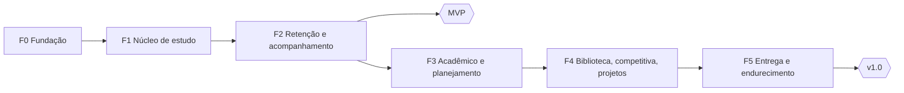

# Roadmap

> Extraído de [`DEVELOPMENT_PLAN.md`](../DEVELOPMENT_PLAN.md), seção 3.12, em 23/11/2026. Em caso de divergência, **vale o `DEVELOPMENT_PLAN.md`**. Alterações devem ser feitas primeiro no plano e depois replicadas aqui, no mesmo pull request.

## 3.12. Roadmap de desenvolvimento

**Princípios do roadmap**

- Incremental: cada fase termina em algo **usável**, com testes e documentação.
- **MVP = F0 + F1 + F2.** F3 a F5 completam a versão 1.0.
- Esforço em tamanho relativo (P, M, G), **sem datas de calendário**: o ritmo depende do tempo semanal disponível, que não foi definido (o plano anterior do projeto sugeria um teto de 4 a 6 h por semana para desenvolvimento; confirmar). Fases podem ser pausadas em semanas de prova e competição.
- Uma fase só começa quando os critérios de conclusão da anterior foram cumpridos. Nenhum requisito é implementado antes das suas dependências (verificado em 3.2).
- A lista de requisitos de cada fase é gerada da tabela de 3.2, para que roadmap e requisitos não divirjam.

### F0 — Fundação (tamanho G)

**Objetivo:** repositório, ambientes, autenticação e esqueleto das duas aplicações funcionando de ponta a ponta, com qualidade automatizada desde o primeiro commit.

**Requisitos cobertos**

- RF088 Autenticação (Must Have)
- RF093 Tema (Must Have)

**Tarefas técnicas**

1. Resolver D-01, D-03, D-08, D-11, D-13 e D-14; registrar ADR-01 a ADR-14 em `docs/adr/`.
2. Criar a estrutura da raiz (`backend/`, `frontend/`, `docs/`), `.gitignore`, `.editorconfig`, `CONTRIBUTING.md`, `CHANGELOG.md`.
3. Criar o projeto Supabase de desenvolvimento e validar a conexão pelo session pooler.
4. Backend: projeto Django, settings por ambiente, apps `core` e `accounts`, usuário customizado, `OwnedModel`, `OwnedQuerysetMixin`, autenticação por cookies, tratador de erros, logs JSON, `/healthz` e `/readyz`, OpenAPI.
5. Migração de segurança do Supabase (RLS) e teste de contrato de isolamento com um modelo de exemplo.
6. Frontend: projeto Next.js, Tailwind, shadcn/ui, tokens (claro/escuro), shell (sidebar, topbar), tela de login, `api-client`, geração de tipos do OpenAPI.
7. Dockerfiles, `docker-compose.yml`, `.env.example` de cada parte.
8. CI com lint, tipos, testes, auditoria; `pre-commit`.
9. Design system aprovado (3.9.1).

**Dependências:** nenhuma.
**Entregáveis:** `docker compose up` sobe backend e frontend; login e logout funcionam; CI verde; migração aplicada no Supabase de desenvolvimento; ADRs; design system aprovado.
**Critérios de conclusão:** todos os itens de 3.14.1 para F0; um teste de contrato falha de propósito se um endpoint de exemplo vazar dado de outro usuário e passa depois da correção; README com comandos **validados** nesta fase.

### F1 — Núcleo de estudo (tamanho G)

**Objetivo:** registrar o estudo diário — disciplinas, tópicos, exercícios, tentativas e sessões — e ver um resumo útil no dashboard. É a primeira fatia **usável no dia a dia**.

**Requisitos cobertos**

- RF001 Resumo do dia (Must Have)
- RF002 Indicadores semanais (Must Have)
- RF005 Ações rápidas (Should Have)
- RF013 CRUD de disciplinas (Must Have)
- RF014 Arquivar e reativar (Should Have)
- RF016 Cor e ordenação (Could Have)
- RF017 Árvore de tópicos (Must Have)
- RF018 Nível de domínio (Must Have)
- RF019 Reordenar e mover tópicos (Should Have)
- RF020 Status e último estudo (Should Have)
- RF034 Fontes de exercícios (Must Have)
- RF035 CRUD de exercícios (Must Have)
- RF036 Filtros e busca (Must Have)
- RF037 Registrar tentativa (Must Have)
- RF038 Tipos de erro (Should Have)
- RF039 Estado do exercício (Must Have)
- RF040 Enunciado e solução em Markdown (Should Have)
- RF067 Cronômetro de sessão (Must Have)
- RF068 Registro manual (Must Have)
- RF069 Autoavaliação (Should Have)
- RF070 Associações (Must Have)
- RF071 Recuperação da sessão ativa (Should Have)
- RF089 Perfil (Must Have)
- RF090 Senha (Should Have)

**Tarefas técnicas:** apps `disciplines`, `curriculum`, `studysessions`, `exercises` (com `ExerciseSource`, `ErrorType`, `Attempt`), `analytics` (somente o resumo básico do dashboard); índices de 3.5.5 dessas tabelas; telas de disciplinas, árvore de tópicos, lista/ficha de exercícios, registro de tentativa, cronômetro e dashboard; renderizador de Markdown com KaTeX; perfil e senha em Configurações; semente de desenvolvimento.
**Dependências:** F0.
**Entregáveis:** versão `0.1.0` utilizável; estado do exercício com `new`, `in_progress`, `solved`; testes de API e E2E dos fluxos (2) e (3) de 3.11.1.
**Critérios de conclusão:** 3.14.1 para cada módulo desta fase; **uso real por 7 dias seguidos** sem perda de dados nem bloqueios; RNF010 e RNF011 medidos nas listagens e no dashboard.

### F2 — Retenção e acompanhamento (tamanho G)

**Objetivo:** fixar o conteúdo (revisão espaçada, anotações) e medir evolução (metas, estatísticas). Fecha o **MVP**.

**Requisitos cobertos**

- RF003 Fila de revisão no dashboard (Must Have)
- RF015 Página da disciplina (Should Have)
- RF021 Importação de estrutura (Could Have)
- RF028 CRUD de anotações (Must Have)
- RF029 Matemática com KaTeX (Must Have)
- RF030 Vínculos da anotação (Should Have)
- RF031 Busca full-text (Should Have)
- RF032 Fixar e etiquetar (Could Have)
- RF041 Importação por CSV (Could Have)
- RF042 Caderno de erros (Should Have)
- RF043 Decks (Must Have)
- RF044 Cartões (Must Have)
- RF045 Sessão de revisão (Must Have)
- RF046 Agendamento (Must Have)
- RF047 Criar cartão a partir de nota ou exercício (Should Have)
- RF048 Fila unificada de revisão (Must Have)
- RF049 Suspender e reiniciar item (Could Have)
- RF062 CRUD de metas (Must Have)
- RF063 Progresso automático (Must Have)
- RF064 Metas hierárquicas (Could Have)
- RF065 Progresso manual (Should Have)
- RF066 Revisão semanal e mensal (Should Have)
- RF072 Tempo por disciplina e período (Must Have)
- RF073 Desempenho em exercícios (Must Have)
- RF074 Evolução do domínio (Should Have)
- RF075 Mapa de consistência (Should Have)
- RF076 Erros recorrentes (Should Have)
- RF091 Preferências (Should Have)

**Tarefas técnicas:** apps `reviews`, `flashcards`, `notes`, `goals` e ampliação de `analytics`; escada de intervalos configurável e testes da função pura (D-04); decisão e implementação do estado `mastered` (D-05); editor Tiptap com KaTeX; busca full-text com `tsvector` e índice GIN; progresso de metas por consultas agregadas; gráficos com Recharts; revisão semanal/mensal pré-preenchida; importação de exercícios por CSV e de tópicos por Markdown.
**Dependências:** F1.
**Entregáveis:** versão `0.2.0` (MVP); fila única de revisão; estatísticas por disciplina/assunto; metas com progresso automático.
**Critérios de conclusão:** 3.14.2 (MVP pronto), incluindo **14 dias de uso diário** com a fila de revisão em dia e os fluxos E2E (4), (5) e (7).

### F3 — Acadêmico e planejamento (tamanho G)

**Objetivo:** cobrir a vida acadêmica (semestres, notas, projeção) e o planejamento do tempo (calendário, semana padrão, simulados).

**Requisitos cobertos**

- RF004 Próximos eventos e prazos (Should Have)
- RF006 Semestres letivos (Must Have)
- RF007 Avaliações acadêmicas (Must Have)
- RF008 Cálculo da média (Must Have)
- RF009 Projeção de nota necessária (Should Have)
- RF010 Bônus de nota (Should Have)
- RF011 Regra de cálculo editável (Could Have)
- RF012 Frequência e faltas (Could Have)
- RF050 Criar simulado (Should Have)
- RF051 Itens do simulado (Should Have)
- RF052 Cronômetro do simulado (Should Have)
- RF053 Análise pós-simulado (Should Have)
- RF055 Eventos de calendário (Must Have)
- RF056 Visões mês, semana e dia (Must Have)
- RF057 Recorrência semanal (Should Have)
- RF058 Semana padrão (Should Have)
- RF059 Eventos derivados (Should Have)
- RF060 Conflitos de horário (Could Have)
- RF077 Planejado versus realizado (Could Have)

**Tarefas técnicas:** apps `academic`, `mockexams`, `planning`; função pura de cálculo de média (ponderada, aritmética, bônus) e avaliador de fórmula com gramática própria e testes por operador; caso de aceite "Espaços Métricos" como teste (RF008, RF009); calendário com consulta por intervalo e expansão de recorrência (D-10); feed unificado (avaliações e metas derivadas); aplicação de semana padrão sem duplicar; análise pós-simulado; comparação planejado × realizado.
**Dependências:** F2 (metas) e F1.
**Entregáveis:** versão `0.3.0`; tela de notas por disciplina; calendário; simulados.
**Critérios de conclusão:** 3.14.1 para os módulos da fase; regras da faculdade confirmadas (D-06) e configuradas; fluxo E2E (6).

### F4 — Biblioteca, programação competitiva e projetos (tamanho M)

**Objetivo:** organizar materiais, treino competitivo e projetos.

**Requisitos cobertos**

- RF022 Cadastro de materiais (Must Have)
- RF023 Upload de arquivo (Should Have)
- RF024 Progresso de leitura (Should Have)
- RF025 Vínculos (Must Have)
- RF026 Tags e busca (Should Have)
- RF027 Download seguro (Should Have)
- RF054 Prova anterior vinculada (Could Have)
- RF078 Metadados de problema competitivo (Must Have)
- RF079 Contests e resultados (Must Have)
- RF080 Estatísticas competitivas (Should Have)
- RF081 Treino virtual (Could Have)
- RF082 Lista de upsolving (Should Have)
- RF083 CRUD de projetos (Must Have)
- RF084 Tarefas do projeto (Must Have)
- RF085 Marcos (Should Have)
- RF086 Links e etiquetas (Could Have)
- RF087 Tempo por projeto (Should Have)

**Tarefas técnicas:** apps `library`, `cp`, `projects`; **decisão D-02 tomada antes de começar**; interface de armazenamento isolada (RNF031) e upload com validação de tamanho/tipo/checksum; download por URL temporária; estatísticas competitivas; quadro simples de tarefas.
**Dependências:** F3 (simulados para RF054 e treino virtual) e F1.
**Entregáveis:** versão `0.4.0`.
**Critérios de conclusão:** 3.14.1 para os módulos da fase; teste de acesso negado a arquivos de outro usuário e sem sessão.

### F5 — Entrega e endurecimento (tamanho M)

**Objetivo:** tornar a plataforma confiável e implantável.

**Requisitos cobertos**

- RF033 Exportar em Markdown (Could Have)
- RF061 Exportar ICS (Could Have)
- RF092 Exportação de dados (Should Have)

**Tarefas técnicas:** exportação JSON completa e teste com dois usuários; ICS; exportação de notas; script e rotina de backup (`scripts/backup_db.sh`) com **restauração testada**; medições de desempenho e ajuste de índices; auditoria de acessibilidade e segurança (lista OWASP, `check --deploy`, cabeçalhos); decisão D-07 e implantação; atualização do README e deste plano; migração para a LTS seguinte do Django se já estável.
**Dependências:** F4.
**Entregáveis:** versão `1.0.0` implantada e documentada.
**Critérios de conclusão:** 3.14.3.

### Pós-1.0 (fora do escopo atual)

Multiusuário real (D-09), recorrência completa de calendário, algoritmo de revisão adaptativo com os dados acumulados, integrações externas. Qualquer item só entra com revisão deste plano.
