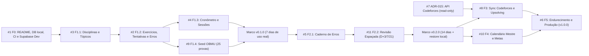

# Plano Consolidado de Implementação e Implantação — Study Platform (F0 → F5 / v1.0.0)

> **Gerado em:** 27/11/2026 — consolida [`docs/DEPLOYMENT_PLAN.md`](../DEPLOYMENT_PLAN.md), [`00-plano-de-implantacao-pragmatico.md`](00-plano-de-implantacao-pragmatico.md), [`F1-nucleo-de-estudo.md`](F1-nucleo-de-estudo.md), [`F5-implantacao-e-endurecimento.md`](F5-implantacao-e-endurecimento.md) e as **11 issues abertas no GitHub (`#1`–`#11`)**.
> **Referência oficial em caso de conflito:** [`DEVELOPMENT_PLAN.md`](../../DEVELOPMENT_PLAN.md) · [`docs/ARCHITECTURE.md`](../ARCHITECTURE.md) · [`docs/ROADMAP.md`](../ROADMAP.md) · [`development-rule.md`](../rules/.agents/development-rule.md).
> **Metodologia obrigatória:** **TDD (`Red → Green → Refactor`)** + **verificação antes da promoção (`Test → Verify → Promote`)** + **commits pequenos, atômicos e contínuos na conta pessoal do proprietário**.

---

## 1. Objetivo, Premissas Inegociáveis e Governança

Este plano unifica o roteiro de engenharia, produto e operação da **Study Platform** — do fechamento da fundação (**F0**) ao uso diário real no treino da OBMU e da Maratona SBC (**F1–F4**) até o endurecimento e entrada em produção (**F5 / `v1.0.0`**), respeitando o teto pragmático de **4–6 h/semana**.

### 1.1 Premissas arquiteturais e de segurança
- **Sem inteligência artificial:** nenhuma funcionalidade de LLM, chatbots, agentes, RAG ou automações inteligentes.
- **Monólito modular + Frontend desacoplado:** Django 5.2 LTS + DRF (`/api/v1/`, Python 3.13) e Next.js (App Router, TypeScript `strict`, Tailwind CSS, shadcn/ui, TanStack Query, React Hook Form + Zod, Recharts, KaTeX, Tiptap). Sem Celery, filas assíncronas ou microsserviços (`ADR-01`, `ADR-09`).
- **Regras de negócio exclusivamente no backend:** `views.py` finas, consultas em `selectors.py`, escrita e invariantes em `services.py` com transações atômicas (`ADR-07`). O frontend nunca acessa o banco diretamente.
- **Supabase exclusivamente como PostgreSQL gerenciado:** acessado apenas pelo backend via **Session Pooler (porta 5432, IPv4)** (`ADR-02`, `ADR-03`). Proibido usar Supabase Auth, `supabase-js` ou Supabase Data API.
- **Autenticação própria e isolamento por `owner` desde o dia 1:** JWT em cookies `HttpOnly; Secure; SameSite=Lax` + CSRF *double submit* (`ADR-04`). Toda entidade privada possui `owner` e todo queryset filtra pelo usuário autenticado (`ADR-06`); ausência de filtro de `owner` é bug de segurança.
- **Persistência e datas:** chaves primárias UUID v4 (`ADR-05`), datas/horários armazenados em UTC com fuso do perfil (`America/Sao_Paulo`, `ADR-14`) e migrações gerenciadas exclusivamente pelo Django — **nunca** executar `migrate` no entrypoint/CMD dos containers.
- **Contratos e interface:** OpenAPI (`/api/schema/`) como fonte para geração dos tipos TypeScript (`ADR-08`); interface em `pt-BR`, código em inglês, temas claro e escuro com igual qualidade e acessibilidade WCAG 2.2 AA.

### 1.2 Regras obrigatórias de Git e autoria
- **Identidade exclusiva do proprietário:** confirmar antes de commitar ou fazer push:
  ```bash
  git config user.name          # Marcus Rafael
  git config user.email         # marcusrafaelmarquini@gmail.com
  git remote -v                 # repositório pessoal (MrtSt2049/Sistemas_de_estudos)
  git check-ignore -v backend/.env frontend/.env.local
  ```
- **Nunca** atribuir autoria ou `Co-authored-by` a ferramentas de IA ou terceiros.
- **Nunca** usar `git add .` às cegas — adicionar caminhos explícitos (`git add <arquivos>`) e revisar `git diff --cached`.
- **Nunca** incluir segredos ou arquivos `.env` no Git; **nunca** executar `git push --force`, `git reset --hard`, `git commit --amend` ou `git rebase` sem autorização explícita.
- Trabalhar em branches curtas (`feat/*`, `fix/*`, `docs/*`, `chore/*`) com **Conventional Commits** (`<type>(<scope>): <description>`) e merge na `main` somente com CI verde.

---

## 2. Diagnóstico Atual e Mapa de Issues (`#1`–`#11`)

### 2.1 Estado real do repositório em 27/11/2026
| Área | Estado real verificado | Ação necessária |
|---|---|---|
| **Código da F0** | Backend (`core`, `accounts`, JWT em cookies, isolamento, healthchecks, migração RLS), frontend (Next.js, login, shell, `api-client`), Dockerfiles, `docker-compose.yml`, CI e `ADR-01`–`ADR-14` já versionados na `main` | Validar pilha local com PostgreSQL, builds Docker e CI verde (**Issue `#1`**) |
| **Documentação (`README.md`)** | Ainda afirma na linha 5 que *"Nenhum código de aplicação foi escrito ainda"* | Atualizar para o estado real da F0 com comandos efetivamente validados (**Issue `#1`**) |
| **Banco e CI/CD** | `DATABASE_URL` via Session Pooler e `.github/workflows/ci.yml` prontos; execução completa com Docker/PostgreSQL local e provisionamento/migração no Supabase Dev pendentes | Executar bateria local, validar CI no GitHub e aplicar `migrate` explícito no Supabase Dev (**Issue `#1`**) |
| **Dados reais externos** | `Plano/banco-provas-obmu.csv` (25 provas, 2001–2025) e `Plano/calendario-mestre.csv` vivem fora da plataforma; divergência entre `Plano/` e Obsidian Vault | Importar OBMU na F1.4 (**Issue `#9`**) e definir fonte única da verdade antes da F4 (**Issue `#10`**) |
| **GitHub** | **11 issues abertas (`#1`–`#11`)**, sem responsáveis atribuídos e **0 pull requests** | Executar na ordem de dependências abaixo |

### 2.2 Matriz consolidada de Issues × Fases × Requisitos
| Ordem | Issue | Fase / Fatia | Requisitos | Pré-requisitos / Portões | Tag-alvo |
|---|---|---|---|---|---|
| 1 | **#1** | **F0** — Fechar F0: README e validação da fundação | Checklist 3.14.1 | Docker + PostgreSQL local; Supabase Dev | — |
| 2 | **#3** | **F1.1** — CRUD de disciplinas e tópicos | `RF013`, `RF017` *(ext.: `RF014`, `RF016`, `RF018`–`RF020`)* | Issue `#1` concluída; `D-12` verificada | `v0.1.0` |
| 3 | **#2** | **F1.2** — Exercícios, tentativas e tipos de erro | `RF034`–`RF039` *(ext.: `RF040`)* | Issue `#3` (`disciplines`/`curriculum`) | `v0.1.0` |
| 4 | **#4** | **F1.3** — Cronômetro e sessões de estudo | `RF067`, `RF068`, `RF071` *(ext.: `RF069`, `RF070`)* | Issues `#3` e `#2` | `v0.1.0` |
| 5 | **#9** | **F1.4** — Seed idempotente das provas da OBMU | Dados reais OBMU | Issue `#2` (fontes/exercícios) | `v0.1.0` |
| 6 | **#5** | **F2.1** — Caderno de erros e reescrita | `RF042` | F1 concluída (7 dias de uso real) + Issue `#2` | `v0.2.0` |
| 7 | **#11** | **F2.2** — Fila automática de revisão espaçada | `RF045`, `RF046`, `RF048` | Issue `#5`; decisão `D-04` (e `D-05` se `mastered`) | `v0.2.0` |
| 8 | **#7** | **ADR-015** — Aprovar API somente leitura do Codeforces | Revisão seção 3.1.7 | Aprovação formal em ADR + atualização de docs | `v0.3.0` |
| 9 | **#8** | **F3** — Sincronizar submissões e histórico do Codeforces | `RF078`–`RF082` | **Bloqueada até Issue `#7` (`ADR-015`) aprovada** | `v0.3.0` |
| 10 | **#10** | **F4** — Importar calendário mestre e metas semanais | `RF055`–`RF059`, `RF062`, `RF063`, `RF066` | **Decisão de produto:** fonte única (`Plano/` vs. Obsidian); `D-10` se recorrência | `v0.4.0` |
| 11 | **#6** | **F5** — Endurecer a plataforma e implantar em produção | `RF033`, `RF061`, `RF092`, `RNF003`, `RNF008`, `RNF010`–`RNF012`, `RNF021`, `RNF028` | `D-07` e `D-12` definidas; MVP validado no uso diário | `v1.0.0` |

---

## 3. Decisões Confirmadas e Portões Pendentes (`D-01`–`D-14` e `ADR-015`)

Nenhuma decisão em aberto pode ser presumida silenciosamente durante a implementação.

| ID | Status | Decisão / Prazo |
|---|---|---|
| `D-01` | **Decidida (F0)** | PostgreSQL local (`--profile local-db`) para testes/CI; Supabase Dev para uso diário. |
| `D-03` | **Decidida (F0)** | Autenticação própria com SimpleJWT em cookies `HttpOnly; Secure; SameSite=Lax` + CSRF *double submit*. |
| `D-08` | **Decidida (F0)** | Nome provisório "Study Platform" e licença atual do repositório mantidos nesta etapa. |
| `D-11` | **Decidida (F0)** | Dependências Python via `pip` + `requirements/{base,dev,prod}.txt`. |
| `D-13` | **Decidida (F0)** | Python 3.13, Django 5.2 LTS, Node LTS e Next.js estável vigente. |
| `D-14` | **Resolvida (23/11/2026)** | Protótipo legado preservado apenas como referência histórica em `docs/legacy-prototype/`. |
| `D-12` | **Pendente (verificar antes da F1 / fechar na F5)** | Plano Supabase (limites de pausa por inatividade e backups gerenciados) e serviço de e-mail. |
| `D-04`, `D-05` | **Pendente (antes da F2)** | Algoritmo/escada de revisão espaçada (proposta inicial D+3, D+7, D+21 na `#11`) e critério do estado `mastered`. |
| `ADR-015` | **Pendente (Issue `#7`, bloqueia F3 / `#8`)** | Aprovação formal da integração somente leitura sob demanda com a API pública do Codeforces (revisão da seção 3.1.7). |
| `D-06`, `D-10` | **Pendente (antes de módulos acadêmicos/recorrência)** | Regras oficiais de aprovação da faculdade e exceções de recorrência de calendário. |
| **Fonte Única** | **Pendente (pré-requisito da F4 / `#10`)** | Definir explicitamente `Plano/` **ou** Obsidian Vault como fonte única da verdade e arquivar o espelho divergente. |
| `D-02` | **Pendente (se houver storage de PDFs na F4)** | Provedor de armazenamento de arquivos (interface isolada no backend; `SUPABASE_SERVICE_ROLE_KEY` apenas no backend). |
| `D-07` | **Pendente (antes da F5 / `#6`)** | Hospedagem de produção sob **mesmo domínio registrável** (`app.<domínio>` e `api.<domínio>`) para cookies `HttpOnly; SameSite=Lax` (fallback: proxy reverso no Next.js). |

---

## 4. Topologia de Ambientes e Dependências

### 4.1 Topologia de ambientes (Local, CI e Produção)

```mermaid
flowchart TB
    subgraph DEV["Ambiente Local (Docker Compose)"]
        FE_DEV["frontend (Next.js dev :3000)"] -->|"/api/v1 (REST + cookies)"| BE_DEV["backend (Django runserver :8000)"]
        BE_DEV -->|"Session Pooler :5432"| SB_DEV[("Supabase Dev (PostgreSQL)")]
        BE_DEV -.->|"perfil --profile local-db"| PG_LOC[("PostgreSQL 17 Local")]
    end

    subgraph CI["Ambiente CI (GitHub Actions)"]
        CI_BE["pytest + ruff + mypy + import-linter"] --> PG_CI[("PostgreSQL Efêmero CI")]
        CI_FE["ESLint + tsc + Vitest + Build"] --> CI_BE
    end

    subgraph PROD["Ambiente de Produção (F5 — D-07)"]
        USER["Navegador (HTTPS)"] -->|"app.dominio.com"| FE_PROD["Next.js (standalone :3000)"]
        USER -->|"api.dominio.com (cookies HttpOnly)"| BE_PROD["Django + Gunicorn (:8000)"]
        FE_PROD -->|"SSR: API_INTERNAL_URL"| BE_PROD
        BE_PROD -->|"Session Pooler :5432 (TLS)"| SB_PROD[("Supabase Produção (RLS ativo)")]
        BKP["scripts/backup_db.sh (pg_dump)"] -.->|"Criptografado / Off-site"| SB_PROD
    end
```


### 4.2 Fluxo de dependências entre Fases e Issues


---

## 5. Plano Detalhado por Fase e Fatia

### Etapa 0 — Fechamento da F0 e Base Implantável (**Issue `#1`**, bloqueante)

**Objetivo:** fechar todas as pendências da fundação para que o ambiente local, o Supabase Dev e o CI operem de ponta a ponta antes de abrir a F1.

1. **Segredos e Git:** confirmar que `backend/.env` e `frontend/.env.local` não estão rastreados e seguem ignorados no `.gitignore`.
2. **Banco local e checks completos:** subir `docker compose --profile local-db up -d` e executar:
   - Backend: `pytest`, `ruff check .`, `ruff format --check .`, `mypy .`, `lint-imports`, `python manage.py spectacular --validate`.
   - Frontend: `npm run lint`, `npm run typecheck`, `npm test`, `npm run build`.
   - Adicionar `timeout` de conexão no `DATABASE_URL`/settings de teste (via TDD: `/readyz` retorna `503` sem banco) para evitar travamento do `pytest` quando o PostgreSQL estiver parado.
3. **Builds de produção:** validar `docker build --target production` em `backend/` e `frontend/` (passando `--build-arg NEXT_PUBLIC_API_BASE_URL=...`).
4. **Supabase Dev e RLS:** provisionar/configurar `DATABASE_URL` (Session Pooler `:5432`) em `backend/.env`, revisar desativação da Data API, executar `python manage.py migrate` explicitamente e confirmar via SQL que 100% das tabelas em `public` possuem RLS ativo sem privilégios para `anon`/`authenticated` (`RNF006`).
5. **Validação funcional e contrato:** validar `/healthz`, `/readyz` (`200`), `createsuperuser`, login/refresh/logout com cookies `HttpOnly` e demonstrar o teste de contrato de isolamento (`test_isolation_contract`).
6. **Documentação:** atualizar [`README.md`](../../README.md) removendo o aviso de que não há código de aplicação e registrando somente comandos efetivamente validados.
7. **CI no GitHub:** confirmar pipeline verde na `main` (corrigindo apenas problemas reais necessários para tornar a F0 verificável).

**Critério de saída:** Issue `#1` fechada, `git status` limpo, CI verde, `README.md` sincronizado e login funcionando contra PostgreSQL real.

---

### Fase 1 — Núcleo Diário de Estudo / MVP OBMU (Tag `v0.1.0`, ~3 semanas)

> **Corte pragmático de escopo:** priorizar as 4 fatias das issues `#3`, `#2`, `#4` e `#9` para habilitar uso diário real na OBMU. Itens complementares previstos no plano expandido da F1 (dashboard analítico completo `RF089`/`RF090`, telas extras de configurações `RF001`/`RF002`/`RF005` e `seed_dev` sintético) podem ser incorporados como fatia incremental após o núcleo ou na F2, sem atrasar o uso real.

#### Fatia 1.1 — Disciplinas e Tópicos (`RF013`, `RF017`) — **Issue `#3`**
- **Testes primeiro (`apps/disciplines/tests/` e `apps/curriculum/tests/`):**
  - `Discipline`: unicidade case-insensitive `(owner, lower(name))`, validação de `kind` (`ADR-10`) e cor hex; arquivamento (`archived_at` via relógio injetado), reordenação atômica e `409` ao excluir com dependentes.
  - `Topic`: árvore hierárquica com profundidade máxima 4 (`400`), pai de outra disciplina rejeitado (`400`), prevenção de ciclos em `move` (`400`), `GET /topics/tree/` sem N+1 (`django_assert_max_num_queries`).
  - **Isolamento:** usuário B recebe `404` em qualquer leitura/escrita de recursos do usuário A.
- **Implementação:** models, migrations (com índice funcional `lower(name)`), services, selectors, serializers, views (`OwnedQuerysetMixin`) + telas simples de cadastro/listagem de disciplinas e navegação na árvore de tópicos.
- **Commit sugerido:** `feat(disciplines): add disciplines and hierarchical topics crud`

#### Fatia 1.2 — Exercícios, Tentativas e Tipos de Erro (`RF034`–`RF039`) — **Issue `#2`**
- **Testes primeiro (`apps/exercises/tests/`):**
  - `ErrorType` padrão criado de forma idempotente no primeiro acesso; `topic` de outra disciplina (`400`); duplicidade de `source + external_ref` (`409`); exclusão de fonte/tipo de erro em uso (`409`).
  - **Máquina de estados** (serviço puro, testes parametrizados): `new` → `in_progress` → `solved` (`mastered` permanece fora da F1 até definição de `D-05`).
  - `POST /exercises/{id}/attempts/` grava tentativa e atualiza estado do exercício na mesma transação (`transaction.atomic`, com teste de rollback em falha).
  - Validação de posse (`OwnedPrimaryKeyRelatedField`) em todas as FKs recebidas e sanitização segura de Markdown + KaTeX reutilizando `core/markdown.py` (sem HTML bruto inseguro, `ADR-13`).
- **Implementação:** backend completo + lista filtrável (`discipline`, `topic`, `source`, `difficulty`, `state`, `tag`, `search`, `ordering`), ficha do exercício e registro de tentativa em até 30 s.
- **Commit sugerido:** `feat(exercises): add exercises, attempts and error types`

#### Fatia 1.3 — Cronômetro e Sessões de Estudo (`RF067`, `RF068`, `RF071`) — **Issue `#4`**
- **Testes primeiro (`apps/studysessions/tests/`):**
  - Índice único parcial garantindo no máximo **1 sessão ativa por usuário** no banco; tentar iniciar a segunda retorna `409`.
  - Duração calculada no servidor com relógio injetável (`clock.now()`), armazenando instantes em UTC (`ADR-14`); atualização de `Topic.last_studied_at` ao encerrar.
  - Registro manual validando `ended_at >= started_at` (`400`) e posse das associações; `GET /study-sessions/active/` recupera a sessão ativa após reload.
- **Implementação:** backend + cronômetro acessível no topo da interface (iniciar em ≤ 2 cliques, calculado a partir de `started_at` do servidor) e formulário de registro manual.
- **Commit sugerido:** `feat(sessions): add study session timer and manual logging`

#### Fatia 1.4 — Seed Idempotente das Provas da OBMU — **Issue `#9`**
- **Testes primeiro:**
  - Comando `manage.py seed_obmu` lendo os cabeçalhos reais de `Plano/banco-provas-obmu.csv` (`Ano`, `Formato`, `Uso planejado`, `Status`, `Nota (/300)`, `Observação`).
  - Idempotência comprovada em duas execuções consecutivas (25 provas de 2001–2025 criadas/atualizadas sem duplicações), sem dependência de rede externa e com mensagens explícitas para erros de formato/linha.
- **Implementação:** management command + serviço de importação idempotente.
- **Commit sugerido:** `feat(exercises): add idempotent seed command for obmu csv`

**Critério de saída da F1 (`v0.1.0`):**
- Issues `#3`, `#2`, `#4` e `#9` fechadas com CI verde; tipos TypeScript regenerados do OpenAPI; `docs/API.md` e `CHANGELOG.md` atualizados.
- **Meta de produto obrigatória antes da F2:** **7 dias consecutivos de uso real** treinando OBMU na plataforma, sem perda de dados.

---

### Fase 2 — Caderno de Erros e Revisão Espaçada Automática / MVP Pessoal (Tag `v0.2.0`, ~2–3 semanas)

#### Fatia 2.1 — Caderno de Erros e Acompanhamento de Reescrita (`RF042`) — **Issue `#5`**
- **Testes primeiro:** listagem de tentativas com erro dominante filtrada por disciplina e tipo de erro, registro de técnica-chave, atualização da flag `rewritten` e isolamento estrito por proprietário.
- **Implementação:** selectors/services/endpoints no backend + visualização no frontend que permite identificar e retomar exercícios com erro sem duplicar regras de negócio.
- **Commit sugerido:** `feat(exercises): add error notebook view and rewrite tracking`

#### Fatia 2.2 — Fila Automática de Revisão Espaçada (`RF045`, `RF046`, `RF048`) — **Issue `#11`**
- **Pré-requisito:** formalizar `D-04` (escada inicial padrão **D+3, D+7, D+21**).
- **Testes primeiro:**
  - Função pura de agendamento cobrindo intervalos D+3, D+7, D+21 e virada de dia em `America/Sao_Paulo`.
  - Criação automática de `ReviewItem` (com FKs exclusivas conforme `ADR-11`) ao registrar tentativa não resolvida sem ajuda, dentro de transação atômica.
  - Registro idempotente de respostas (`Errei`, `Difícil`, `Bom`, `Fácil`) preservando invariantes em `transaction.atomic`.
- **Implementação:** motor de revisão no backend + fila diária no topo do dashboard e sessão rápida com atalhos de teclado `1–4`.
- **Commit sugerido:** `feat(reviews): add automatic spaced repetition queue`

**Critério de saída da F2 (`v0.2.0`):**
- Issues `#5` e `#11` fechadas; **14 dias de uso diário real** com a fila de revisão em dia + 1 backup lógico restaurado localmente com sucesso.

---

### Fase 3 — Programação Competitiva e Integração Codeforces (Tag `v0.3.0`, ~2–3 semanas)

#### Fatia 3.0 — Decisão Arquitetural `ADR-015` (**Issue `#7`**, bloqueante para `#8`)
- Avaliar e documentar `docs/adr/0015-codeforces-readonly-on-demand-api.md` (ou padrão `ADR-15` conforme convenção do diretório) revisando formalmente a proibição da seção `3.1.7` de `DEVELOPMENT_PLAN.md`.
- **Limites obrigatórios:** consumo **somente leitura** da API pública do Codeforces, acionado **exclusivamente sob demanda pelo usuário**, sem credenciais armazenadas e sem Celery/filas em background.
- Atualizar `DEVELOPMENT_PLAN.md`, `docs/ARCHITECTURE.md` e referências afetadas no mesmo PR.
- **Commit sugerido:** `docs(adr): approve read-only codeforces api integration (ADR-015)`

#### Fatia 3.1 — Sincronização de Submissões, Rating e Upsolving (`RF078`–`RF082`) — **Issue `#8`** *(bloqueada até `#7` aprovada)*
- **Testes primeiro:** cliente HTTP isolado para `user.status` e `user.rating` com respostas mockadas (zero acesso à rede nos testes), mapeamento para entidades competitivas do usuário, importação idempotente por `submission_id` e tratamento de falhas sem perda de dados existentes.
- **Implementação:** backend de sincronização sob demanda + botão "Sincronizar Codeforces", gráficos de resolvidos por rating/tag e fila de **upsolving** (problemas tentados e não aceitos) integrada ao caderno de erros.
- **Commit sugerido:** `feat(cp): add codeforces sync, rating history and upsolving list`

**Critério de saída da F3 (`v0.3.0`):** uso real no treino da Maratona SBC sem digitação manual de submissões.

---

### Fase 4 — Unificação do Planejamento e Metas Semanais (Tag `v0.4.0`)

#### Fatia 4.1 — Calendário Mestre e Metas com Progresso Automático (`RF055`–`RF059`, `RF062`, `RF063`, `RF066`) — **Issue `#10`**
- **Pré-requisito obrigatório de produto (fora do código):** definir explicitamente se `Plano/` **ou** o Obsidian Vault é a fonte única da verdade, registrar essa decisão na documentação e arquivar/congelar o espelho divergente. Não inferir nem sincronizar ambas as fontes enquanto isso estiver em aberto.
- **Testes primeiro:** importação idempotente de `Plano/calendario-mestre.csv` (sem duplicar registros em reexecuções), cálculo automático de progresso de metas no backend e geração da revisão semanal de domingo pré-preenchida com números reais da semana.
- **Implementação:** módulo de calendário/planejamento + importador + metas e revisão semanal.
- **Commits sugeridos:**
  - `feat(planning): add calendar and master schedule csv import`
  - `feat(goals): add automatic goal progress and weekly review`

**Critério de saída da F4 (`v0.4.0`):** Issue `#10` fechada, fonte única registrada e planejamento semanal rodando na plataforma.

---

### Fase 5 — Endurecimento, Implantação em Produção e Avaliação Multiusuário (Tag `v1.0.0`) — **Issue `#6`**

Execução em 6 fatias testadas antes da promoção (cada fatia = 1 PR):

1. **Exportação e portabilidade (`RF033`, `RF061`, `RF092`):**
   - Testes primeiro: `test_export_json` (100% dos dados do usuário A e 0 do usuário B, `RNF004`), `test_export_markdown` (preservação de KaTeX e sanitização contra *path traversal*) e `test_export_ics` (`VTIMEZONE` válido).
   - Endpoints autenticados em `/api/v1/` com streaming/memória controlada.
2. **Backup e prova real de restauração (`RNF028`, `D-12`):**
   - `scripts/backup_db.sh` (`pg_dump` via `DATABASE_URL`, compactado e criptografado, falhando rápido se `DATABASE_URL` ou chave estiverem ausentes).
   - **Prova obrigatória:** restaurar o dump gerado em um PostgreSQL local limpo (nunca produção), apontar o backend para ele e validar integridade via `pytest` + conferência de contagens. Documentar retenção (4 semanais, 6 mensais).
3. **Desempenho, carga sintética e índices (`RNF010`, `RNF011`, `RNF012`):**
   - Comando de carga sintética com **10.000 exercícios** e **5.000 notas** em banco local.
   - Metas: p95 < 300 ms em listagens e < 150 ms em leituras simples; `assertNumQueries` constante no dashboard/estatísticas/disciplina; `EXPLAIN ANALYZE` confirmando uso de índices; LCP < 2,5 s em 4G simulado e `dynamic import` para Tiptap e Recharts.
4. **Endurecimento de segurança e acessibilidade (`RNF003`, `RNF008`, `RNF021`):**
   - `DJANGO_SETTINGS_MODULE=config.settings.production python manage.py check --deploy --fail-level WARNING`.
   - Verificar cabeçalhos (HSTS, `X-Content-Type-Options: nosniff`, `X-Frame-Options: DENY`, CSP), `/api/docs/` retornando `404` e `/api/v1/auth/register/` retornando `403` com `ALLOW_REGISTRATION=false`.
   - Auditoria OWASP Top 10 registrada, `pip-audit` e `npm audit --audit-level=high` limpos, suíte `axe` no Playwright sem violações sérias + revisão manual WCAG 2.2 AA (390 px a 1440 px, temas claro e escuro).
5. **Provisionamento de produção e Go-Live (`D-07` → `v1.0.0`):**
   - **Pré-requisito:** `D-07` decidida sob mesmo domínio registrável (`app.<domínio>` e `api.<domínio>`) ou proxy reverso no Next.js (risco `R06`).
   - **Sequência estrita de release:**
     1. Conferir CI verde na tag `v1.0.0`, `CHANGELOG.md` atualizado e `sqlmigrate` revisado.
     2. Configurar segredos no cofre do provedor (runtime backend + `NEXT_PUBLIC_API_BASE_URL` no build frontend).
     3. Executar backup pré-migração (`scripts/backup_db.sh`) no Supabase Produção.
     4. Construir imagens `production` (backend + frontend).
     5. Executar `python manage.py migrate --noinput` como job isolado e confirmar RLS em 100% das tabelas de `public`.
     6. Subir backend (Gunicorn) → validar `GET /healthz` e `GET /readyz` (`200`).
     7. Subir frontend (`node server.js`) → executar **smoke test pós-deploy**: login, cookies `HttpOnly; Secure; SameSite=Lax`, `X-CSRFToken`, leitura do dashboard, troca de tema sem *flash*, `/api/docs/` = `404`, logs JSON sem vazamento de segredos.
6. **Rollback e avaliação multiusuário controlada:**
   - **Migrações destrutivas (regra de 2 releases):** Release N remove uso no código; Release N+1 remove coluna/tabela no banco.
   - **Rollback de código:** reimplantar tag Docker anterior. **Rollback de banco:** modo manutenção → restaurar dump pré-migração → reimplantar tag anterior.
   - **Multiusuário (somente após MVP validado no uso diário):** documentar critérios e controles para abertura restrita por convite ou `ALLOW_REGISTRATION` temporário; **nenhuma abertura pública é habilitada por padrão**.

---

## 6. Ciclo Padrão de Verificação e Checklist de Fim de Sessão

### 6.1 Ciclo TDD por tarefa
1. Escrever 1 teste do comportamento desejado (`pytest apps/<app>/tests/test_x.py::test_y` ou Vitest) e **vê-lo falhar pelo motivo certo**.
2. Implementar o código mínimo necessário e vê-lo passar.
3. Refatorar mantendo a suíte verde.

### 6.2 Bateria completa antes de PR / Release
- **Backend:** `ruff check .`, `ruff format --check .`, `mypy .`, `lint-imports`, `python manage.py spectacular --validate`, `pytest --cov`, `pip-audit -r requirements/base.txt`.
- **Frontend:** `npm run lint`, `npm run typecheck`, `npm test`, `npm run build`, `npm audit --audit-level=high`, E2E Playwright dos fluxos críticos (`3.11.1`).
- **Produção (F5):** `manage.py check --deploy`, backup pré-migração, `migrate --noinput` explícito, `/healthz` + `/readyz` + smoke test autenticado.

### 6.3 Checklist rápido de fim de sessão
1. Rodar os checks aplicáveis à fatia e corrigir todas as falhas (não ignorar lint, tipagem ou testes).
2. Conferir `git status` garantindo ausência de `.env`, caches ou arquivos não relacionados.
3. Confirmar `git config user.name` (`Marcus Rafael`) e `git config user.email` (`marcusrafaelmarquini@gmail.com`).
4. Adicionar arquivos explicitamente (`git add <caminhos>`), revisar `git diff --cached` e commitar em Conventional Commits.
5. Atualizar `CHANGELOG.md` ao fechar cada marco (`v0.1.0`, `v0.2.0`, `v0.3.0`, `v0.4.0`, `v1.0.0`).

---

## 7. Riscos Principais e Mitigações

| Risco | Impacto | Mitigação obrigatória |
|---|---|---|
| **Docker/PostgreSQL local parado** | Bloqueia `pytest` e validação de imagens na F0 | Manter `timeout` curto na conexão de testes e validar `--profile local-db` antes de abrir a F1 |
| **Escopo excessivo antes do uso real** | Paralisia por construir 16 módulos sem usar nenhum | Seguir a F1 enxuta (`#3`, `#2`, `#4`, `#9`) e exigir 7 dias de uso real antes da F2 |
| **Cookies cross-site (`R06` / `D-07`)** | Falha de autenticação em produção | Exigir mesmo domínio registrável (`app.` / `api.`) ou proxy reverso no Next.js |
| **Pausa ou perda de dados no Supabase (`R04`, `R14` / `D-12`)** | Indisponibilidade ou perda de histórico | Verificar plano Supabase antes da F1 e manter `scripts/backup_db.sh` com restauração testada |
| **Divergência `Plano/` vs. Obsidian Vault** | Duplicidade e conflito de planejamento na F4 | Congelar um dos espelhos e documentar a fonte única antes de implementar a `#10` |
| **Migração automática ou teste contra produção** | Quebra irreversível de schema ou corrupção de dados | Proibição absoluta de `migrate` em entrypoint e de apontar testes para o Supabase de produção |
